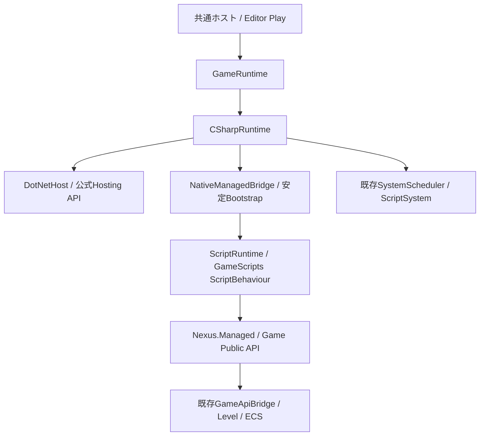

# C# Runtime / Game Logic — 改訂仕様 Phase 4

旧仕様で実装済みのHosting・Gameplay・Project生成を再利用し、改訂仕様Phase 3のScheduler登録解除へ接続する。
C#は共通Game Public APIから同じEntity / Transform / ScriptComponentを操作し、C#専用ECSは作らない。
このPhaseではWorld照合、開始失敗時の解放、ScriptSystemの登録解除、Component値取得の公開を補完した。

## 調査結果と再利用範囲

| 既存クラス・ファイル | 現在の責務 / 判断 |
|---|---|
| ProjectDescriptor / ProjectSerializer / ProjectTemplates | 共通Modules、Language、Templateからの生成。既存形式・生成サービスを維持 |
| LauncherApplication / ProjectHost.inl / ProjectBuild | 初期言語選択、配置解決、共通GameRuntime起動。古い未対応表示を修正 |
| GameRuntime / GameModuleLoader | LevelとNative / Managed sessionを所有。Native初期化後にManagedを開始し、逆順停止 |
| DotNetHost | 公式nethost / hostfxr、runtimeconfig、Bootstrap entry解決。CLR内部APIを使わない |
| NativeManagedBridge / ManagedBootstrap.h / EntryPoints | 固定レイアウト、数値session ID、Start / Tick / Stopと例外変換。既存V1〜V4 ABIを維持 |
| GameScriptCatalog / ScriptRuntime | 安定Nexus.ManagedとゲームAssemblyの分離、ScriptBehaviour所有とLifecycle |
| Level / Scene / EntityId / PersistentId | 唯一のECS、世代付きEntityと保存ID。ManagedへNative objectを貸し出さない |
| GameApiBridge / ScriptApi / ScriptComponent / ScriptSystem | World検証、既存Component、snapshot一括同期。Phase 3のScheduler解除を再利用 |
| TypeRegistry / PropertyDescriptor / PropertyHandle / PropertyEditService / PropertyDrawerRegistry / DetailsPanel | 既存共通編集経路。専用Inspectorを増やさない |
| LevelDocument / LevelSerializer / ManagedScriptMetadata | 既存Level保存とProperty Metadata。保存形式を変更しない |
| AssetCatalog / ModelAssetLibrary / Renderer | 既存Assetと描画。C#専用の管理を追加しない |
| GameServices / Logger / BufferedLogSink / RuntimeProtocol | 既存Event・Console・IPC。新しい通信基盤を追加しない |
| Nexus.ManagedBootstrap.targets / Nexus.ManagedGameplay.targets / managed-gameplay.nxtemplate | .NET準備・csproj参照・配置。生成器やBuildを実行せず構成を確認 |
| LiveCodingAgent / LivePP.props | Nativeパッチの既存Backend。Managed sessionの停止と混同しない |

`PropertiesPanel`という独立クラスは確認できず、不明。既存DetailsPanelと関連文書を維持する。
任意Component型のManaged取得、Input / Audio / Physics / AssetのGame Public APIは未実装。
それぞれの内部Backendの全実装状況は今回の調査では不明。今回のC#機能がゲーム制作API全体を網羅するとは扱わない。

## Hosting方式と採用理由

既存の`net10.0` / Windows x64 / framework-dependent構成を維持する。.NET 10は公式のLTS対象である。
出典：[.NET Support Policy](https://dotnet.microsoft.com/en-us/platform/support/policy/dotnet-core)。

| 候補 | 役割と判断 |
|---|---|
| nethost | hostfxrの公式探索に使用。独自のインストール探索を追加しない |
| hostfxr | runtimeconfig初期化とManaged loader delegate取得に使用 |
| UnmanagedCallersOnly | 安定Bootstrapのstatic entryをNativeから呼ぶ。blittable引数に限定 |
| Managed function pointer | 安定APIのCdecl関数表を呼ぶ既存Interopに使用。Game DLL pointerをC#へ渡さない |
| P/Invoke | ManagedからNative exportを呼ぶ方式。既存の明示関数表で足りるため今回追加しない |

公式資料：[Native Hosting](https://learn.microsoft.com/en-us/dotnet/core/tutorials/netcore-hosting)、
[UnmanagedCallersOnly制約](https://learn.microsoft.com/en-us/dotnet/api/system.runtime.interopservices.unmanagedcallersonlyattribute?view=net-10.0)。
nethost / hostfxrのこの構成はframework-dependentを前提とする。self-contained配置の対応済み扱いはしない。
`hostfxr_close`や`DotNetHost::Shutdown`はCLRのUnloadではない。CLRと安定BootstrapはProcess寿命、Game Script sessionはPlay寿命で管理する。

## アーキテクチャと依存方向



GameScriptsは安定Nexus.Managedだけを参照する。RuntimeからEditor / ImGuiへ依存を追加しない。
EditorはMetadataとPlay操作を扱い、Managed objectやDotNetHostを直接所有しない。既存の同Process PlayではGameRuntimeがsessionを所有する。
別Processへの直接object共有は行わず、IPCを変更する必要もない。

新しいManager・Component基底・言語共通Runtime層は追加していない。
既存ScriptSystemが既に一括同期とLifecycleを持つため、C#用Schedulerを作る案は所有と順序を重複させる。
任意Native Componentのpointerを返す案はECSの再配置・破棄・CRTへ依存するため採用せず、既存の値コピーを公開する。

## 所有権・Lifecycle・Thread

1. GameRuntimeがLevelを用意し、共通GameApiBridgeがWorld tokenを発行する。
2. Native Moduleがあれば先に登録し、CSharpRuntime.Startが同じLevel / World・所有Thread・idle Schedulerを検証する。
3. DotNetHostがnethost → hostfxr → runtimeconfig → Bootstrap entryを解決する。
4. 既存BootstrapがGameScriptsをロードし、数値sessionを発行する。ScriptSystemを既存Schedulerへ登録する。
5. ScriptComponentからsnapshotを作り、OnCreate → 必要ならOnEnableを実行する。ここではOnUpdateを呼ばない。
6. 毎frameは既存Native Module.update → SchedulerのSimulation（既存System、Native System、ScriptSystemの登録順）→ Transform phase。
7. 停止時はScriptSystemをDetach・Schedulerから解除し、全behaviourのOnDisable / OnDestroyと参照解除、Host参照解放へ進む。
8. 既存Native System / Moduleを停止してからWorld token・Levelを破棄する。

Level / SceneがEntityとComponentを所有する。SchedulerがScriptSystemを所有し、ScriptRuntimeだけがManaged instanceを所有する。
CSharpRuntimeはLevel / ScriptSystemを借用し、正常停止では登録自体も解除する。同じLevelで再開始しても無効Systemを蓄積しない。
Levelはsessionより長く生存させ、Unload / 破棄前にGameRuntimeを停止する。
開始途中のreturn・例外もRAIIでStopへ戻し、部分登録とManaged参照を解放する。これはWorld変更全体のrollback保証ではない。

登録、Tick、Stop、Component操作は同じ所有Threadへ限定する。callbackからの停止要求はGameRuntimeがframe境界へ遅延する。
CSharpRuntimeを直接利用する場合も同じ境界を守る。実行中の例外的なStopではadapterを削除せずDetachし、quarantineと再起動要求を記録する。
ScriptSystemはDetach後のcallback結果を旧Levelへ書き戻さない。誤Threadからの破棄や、callback中の所有object自体のdeleteはサポートしない。
ScriptはEntity生成・Component変更も可能なので、アクセス型一覧だけで並列実行可能とは扱わない。

無効化時はOnDisable、解除・型置換・Entity破棄時は必要なOnDisable → OnDestroy → Unbind。
同slotのEntity再利用、ScriptComponentの再追加、型変更はEntity世代とattachment tokenで検証する。
実行Handleは保存せず、既存Script Type ID・enabled・公開値だけを既存Level保存経路で維持する。

## Entity / ComponentとInterop

```csharp
protected override void OnUpdate(float deltaTime)
{
    if (!Entity.TryGetTransform(out var transform)) return;
    transform.Translation.X += deltaTime;
    Entity.Transform = transform;
}
```

`Entity`はWorld / index / generationのwrapper。Native pointerを保持しない。
`TryGetTransform`は既存TransformComponentのLocal値をコピーし、不在・Entity破棄ではfalseを返す。コピーの変更だけではECSは変わらず、setterで明示反映する。
session終了後・異なるThreadのアクセスは例外となる。`IsAlive`、`HasScript`、`ScriptEnabled`、`SetScript<T>`、`RemoveScript`は既存APIを維持する。
任意Componentを返す汎用GetComponentは実装せず、現在対応するComponent APIを明示する。

| 境界項目 | 既存契約 |
|---|---|
| Layout | Windows x64、pack 8、Cdecl、固定幅数値。LocalTransform 40 byte、EntityHandle 16 byte |
| 型 | Vector3 / Quaternionは値コピー。Scriptのboolは境界でuint32の0 / 1 |
| 文字列 | UTF-8 pointer + byte数。呼出し中だけ借用し、必要な値はコピー |
| Handle | World token、Entity index / generation、Script attachment / instance。GCHandleを公開しない |
| 戻り値 | Native statusをManaged内で検証。通常のComponent不在はTry APIでfalse |
| GC | 借用配列は呼出し中だけ固定。NativeへManaged object参照を保存しない |
| 呼出方向 | Nativeが一括Tickし、ScriptはEngine常駐の関数表へ戻る |
| 例外 | entry内でstatusへ変換。C++例外をManagedへ伝搬させない |

Tickはsnapshot配列を一回で渡し、Local Transformも一括転送する。EntityごとのTransform往復は残る。
大量処理用の追加バッチAPIは計測後の拡張候補であり、今回性能保証や複雑な転送基盤を追加しない。

## Project生成と既存機能への影響

BrowserでInitial Game LanguageにC#、TemplateにManaged Gameplayを選ぶ。
既存ProjectTemplatesが共通ProjectとModules、GameScripts.csproj、Host、PlayerController、Startup.levelを生成する。
blank / basic-3dのC#選択はModule宣言のみ、Managed BootstrapはHosting確認用であることをBrowserへ明示した。
完全なGameplayテンプレートと宣言だけのテンプレートを同じ実行能力とは扱わない。

`GameScripts.csproj`はSource設定に従うGame/**/*.csを列挙し、Nexus.Managed.dllだけを参照する。
ユーザーによるBuildでは既存Managed targetsがBootstrap / APIを先に準備する。必要なのは.NET 10 SDKと明示x64 Host Pack、実行環境は.NET 10 Runtime。
直接csprojを開く場合も参照APIの準備が先に必要。今回は生成器・Buildを実行していない。
Project JSON、LevelDocument、Asset保存先、永続IDは変更していない。途中の言語追加で既存データの作り直しを要求しない。

## Error Handling / Reloadへの影響

誤World・不正Thread・更新中の開始は.NETのファイル読込前に拒否する。Hostingエラーは既存Result / Loggerへ返す。
Scriptのユーザー例外は既存ScriptRuntimeが該当behaviourをfault状態にし、共通ログへ通知する。
初期化失敗は開始エラー、同期・Interop失敗は既存GameRuntimeの安全停止へ返す。
正常終了を確認できない場合はquarantineし、同じRuntimeの再開始を拒否する。未完了Unloadを成功扱いする変更は行わない。

旧仕様のcollectible AssemblyLoadContext、公開Property編集、Reload機能は維持するが、今回そのBackendや対応型を拡張していない。
既存Reloadの入口にも所有Level / Worldとidle Schedulerの照合を追加し、別Worldへの誤適用を防ぐ。
安定Nexus.Managedにメソッドを追加したため、適用時はユーザーによるAPI・Bootstrap・GameScriptsの再ビルドとホスト再起動が必要。
Live++とManaged Reloadの調停は改訂仕様Phase 7、Phase 3のNative Systemの型付きManaged公開はPhase 5へ残す。
旧GameServicesのbyte-command機能は維持するが、任意Native SystemのBindingが完成したとは扱わない。

## 変更ファイル

| ファイル | 今回の変更 |
|---|---|
| Runtime/Scripting/CSharpRuntime.h | Levelの借用、登録解除・開始失敗時の契約コメント |
| Runtime/Scripting/CSharpRuntime.cpp | World検証、RAII cleanup、Scheduler登録解除、既存Reload入口の所有元検証 |
| Runtime/Scripting/ScriptSystem.h | 構造変更可能なComponentアクセス制約を明示 |
| Runtime/Scripting/ScriptSystem.cpp | callback中Detach後の旧Level書戻し拒否 |
| Managed/Nexus.Managed/Entity.cs | TryGetTransformによる既存Component値取得の公開 |
| Launcher/LauncherApplication.cpp | C#テンプレートと必要環境の案内を修正 |
| Templates/ManagedGameplay/PlayerController.cs.in | TryGetTransformと明示書戻しの使用例 |
| Templates/ManagedGameplay/README.md.in | Component取得と終了順序の説明 |
| Tests/Fixtures/ManagedGameplay/Behaviours.cs | 値コピーとComponent削除後の取得失敗を検証するソース |
| Tests/ManagedGameplayTests.cpp | 誤World / Thread拒否、同一Level再開始、部分失敗後の登録数を検証するソース |
| Docs/ManagedGameplayREADME.md | 旧記録からの案内と現行停止順序 |
| Docs/CSharpGameLogicREADME.md | 改訂仕様の調査・設計・使用方法・制約 |
| ../README.md | 改訂仕様Phase 4への案内 |

## 静的確認・未実装・未検証

include / namespace / 宣言・定義、既存compile対象とProjectReference、csprojとTemplate参照を静的に照合する。
Public ABIと保存形式は変更せず、Level / Scheduler / Managed instanceの所有方向、旧Handleの失効、Thread・終了順序を確認する。
検証ソースは既存の明示Build用Projectへ含まれ、Agentは実行しない。
実施した静的照合では8 ProjectのXML・明示ソース・ProjectReference、3テンプレート合計30ファイルの参照・出力先・生成Project XML、
今回変更した13ファイルのUTF-8・競合記号・末尾空白とquoted include 34件、Managedソースの明示compile対象に問題は見つからなかった。
Launcherの既存imgui.hはCommon.propsのThirdParty include設定まで照合した。RuntimeへのEditor / ImGui依存は追加していない。
git diff --checkはエラーなし。既存Launcher/Standalone/Program.csのLF→CRLF警告は今回の変更対象外である。

ビルド、テスト、Game / Runtime / Editor起動、dotnet、Reflection生成器は実行していない。
実際のHosting、コンパイル・link、繰返しPlay、例外・部分生成失敗時の解放はユーザーによる動作確認が必要。
任意Component API、Input / Audio / Physics / Asset API、Native Systemの型付きBinding、自動Binding生成、Reload調停、Package完成は未実装。
