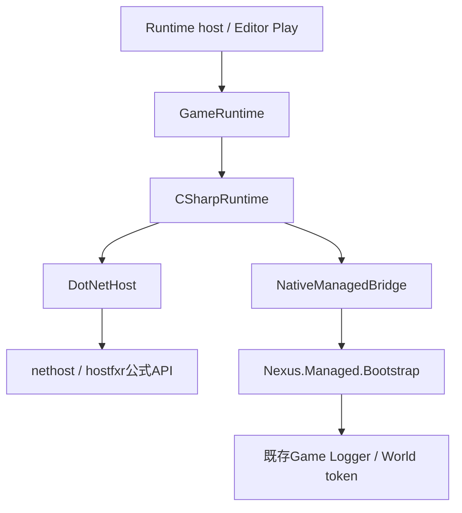

# Phase 3 — C# Runtime Hosting

公式Native Hostingで共通GameRuntime内から安定Managed bootstrapを開始・終了する経路を追加した。
本資料はPhase 3の実装記録。後続の[Phase 4](ManagedGameplayREADME.md)ではV1を維持してGameplay用V2境界とNexus.Managedを追加した。
今回ビルド、dotnet / MSBuild、Game / Editor / Launcher、CLI、回帰テストの実行は行っていない。
コンパイル・リンク・実際のRuntime起動成功を確認したという記録ではない。

## 調査結果

| 領域 | 確認した既存構造と再利用 |
|---|---|
| Project / Browser | `.nxproject`のmodules、ProjectTemplates、Native / 配布Launcher。言語は初期Module種類 |
| Runtime | GameRuntimeがLevel・実行コードを所有し、Editor Playと単体起動で共用 |
| Native境界 | Public/Nexus/GameApi、GameApiBridgeのWorld tokenと共通Logger。Managedも同じtokenを使う |
| 起動 | ProjectHost.inlがProject・Engine・実行ファイル位置を解決し、各Applicationへ設定を渡す |
| ECS / Level / Asset / Reflection | 既存Scene / EntityId / LevelDocument / ModelAssetLibrary / TypeRegistryを維持。Phase 3ではManagedから公開しない |
| Logger / Console | Loggerと既存SinkへNative HostingとManaged双方の診断を集約 |
| Build / SDK | ProjectBuild、BuildTargets、nxbuild stamp、Publish-Engine.ps1。Managed配置を最小限拡張 |
| 既存C# | 配布Launcherはnet10.0-windows / WinForms。ゲームRuntimeへ参照・共用しない |
| .NET導入状況 | 開発環境のwin-x64 Host Pack 10.0.13をファイル参照し、公式ヘッダだけを収録。dotnetコマンドは実行していない |
| Live++ / IPC | 従来のNativeパッチとRuntime通信を変更せず、ManagedのReload機能を追加しない |

実装前に[公式Hosting tutorial](https://learn.microsoft.com/en-us/dotnet/core/tutorials/netcore-hosting)と
[Native Hosting設計](https://github.com/dotnet/runtime/blob/main/docs/design/features/native-hosting.md)、
nethost.h / hostfxr.h / coreclr_delegates.hおよび公式status codesを確認した。
CoreCLR内部APIや独自のHosting ABI宣言は使わない。

## 設計判断と依存関係



- DotNetHostは公式DLLのロード、Runtime初期化、Managed entryの取得とHost側参照の解放を担当する。
- NativeManagedBridgeはStart / Stop entryの呼出しと数値session IDを担当し、.NETやECSを初期化しない。
- CSharpRuntimeは両者の順序を統括し、GameRuntimeが実行World単位で所有する。
- EditorApplication / EditorSessionは設定だけを転送し、DotNetHostや.NETを直接所有しない。
- ManagedBootstrapはセッションと境界例外処理のみを担い、World / ECS / Asset / Inspectorを新設しない。

Phase 3でManagedへ公開するのは数値World tokenとLogger関数だけ。
Phase 2のNative Entity / Component APIをC#へマーシャリングする作業はPhase 4へ残す。
既存Native ModuleとManaged bootstrapの同時選択、複数Moduleは明示的に拒否する。

## 公式Hostingと終了の意味

1. 明示されたnethost.dllを絶対パスでロードする。
2. 公式get_hostfxr_pathへassembly配置と任意のdotnetRootを渡し、必要buffer長を取得してからhostfxrを解決する。
3. hostfxrのinitialize / get_runtime_delegate / close / set_error_writerを公式型で取得する。
4. runtimeconfig.jsonで初期化し、hdt_load_assembly_and_get_function_pointerを取得する。
5. host contextをcloseする。初期化途中の失敗もRAIIで同じthreadのerror writer復元前にcloseする。
6. UNMANAGEDCALLERSONLY_METHODを指定してBootstrapのStart / Stop静的methodを解決する。

hostfxr_initializeの0（初回）と1（互換な既存Host）を受け入れる。
2（既存Runtimeとpropertiesが異なる）は差分の許容を実装していないため明示的に拒否する。
エラーにはAPI操作、HRESULT / Hosting status、対象配置とhostfxr診断を含める。
error writerはthread-localの先行callbackを保存・復元し、既存LoggerのDotNetHostカテゴリへ配送する。

**hostfxr_closeはHost contextを閉じるAPIであり、CoreCLRのUnloadではない。**
公式loaderが返すManaged method pointerとBootstrap componentはProcess寿命である。
StopではManagedセッション・関数参照・Hosting DLLのセッション参照を解除するが、CoreCLRと安定BootstrapはProcess終了まで残る。
hostfxrもWindowsのModule pinでProcess終了まで保持する。hostpolicy / CoreCLRだけが残った状態でhostfxrをUnloadすると、その再ロードで初期化状態が失われ、二回目のPlayが0x80008081で失敗することを実テストで確認した。host contextをcloseする責務とHosting DLLのProcess寿命を区別し、error writerは各呼出し後に復元する。
再Playは同じCoreCLRの互換性を確認して新セッションを開始し、CLRを毎回再起動したとは扱わない。
Bootstrapコードを変更して再配置する場合はEditor / Runtimeを終了してから再Buildする。
GameScriptsを後でReloadする際は、Bootstrap内から別のcollectible AssemblyLoadContextでロードする必要がある。
hostfxrのcomponent loaderにGameScriptsを渡すだけではPhase 6のUnload要件を満たさない。

## Interop / ownership / thread

| 項目 | 契約 |
|---|---|
| ABI | Windows x64 / pack 8 / Cdecl。Bootstrap contextは24 byte、UTF-8借用文字列は16 byte |
| Native → Managed | ABI version / structSize、uint64 World token、共通Loggerの常駐コードアドレスだけを渡す |
| Managed → Native | int32 statusとuint64 session ID。STL、Managed object、GCHandleを渡さない |
| Context | Start呼出し中だけNative stackを借用する。Managed側は数値と関数値だけをコピーする |
| Session | Managed内の辞書が所有し、Stopで辞書から削除してcallback / World tokenを明示解除する |
| UTF-8 | ログのbyte列はfixed中だけ借用し、Engine側へ保存・解放させない |
| 例外 | Managed Start / Stopは例外をstatusへ変換し、診断を共通Loggerへ送る |
| thread | Host初期化 / method取得 / Managed Start / Stopは開始threadで直列実行。異なるthreadからのmethod解決・session停止を拒否 |
| 非同期処理 | BootstrapはThread / Task / event / native callback登録を生成しない。次Phase以降のlifecycle設計なしに追加しない |
| 停止失敗 | Native側参照を残さずWorld tokenを失効させ、同じGameRuntimeの再Startを拒否。Process再起動を要求する |

この境界は信頼するBootstrap用で、任意の不正Nativeポインタの隔離機能ではない。
CLRはProcess共通だが、実行Worldとセッション状態はそれぞれのGameRuntimeに属する。

## 初期化・終了順序

開始は既存Levelのロード（Editorでは編集Worldの複製）→ GameLevelSetup → GameApiBridgeのtoken登録 →
CSharpRuntime / DotNetHost初期化 → 両Managed entry解決 → Managed Start → 初期Transform確定 → Runtime公開。
途中の失敗ではlocal RAIIでManaged Stop → Host側参照解放 → token失効 → 実行Level破棄とし、編集Worldを保持する。

通常停止もManaged Stop → Managed / Host参照解放 → token失効 → Level破棄の順序。
Phase 3のManagedにUpdate / Gameplay lifecycleはなく、Pause / Updateは既存Level / Schedulerの動作を維持する。
BootstrapからEntityやAssetを生成したり、Reflection / DetailsPanelへ登録したりしない。

## Project生成と前提条件

Project Browserで`Managed Bootstrap (C#)`とC#を選ぶ。
CLIではcreate-templateのtemplate-idに`managed-bootstrap`を指定し、初期言語CSharpを渡す。
旧blank / basic-3dのC#生成は宣言のみの既存動作を維持し、BuildTargetsがないProjectを黙って実行しない。

```text
MyGame/
  MyGame.nxproject                     # Game / CSharp / Source/Game
  Assets/  Levels/  Config/
  Source/Game/README.md                # ゲームコードはPhase 4で追加
  Source/Host/Main.cpp                 # 共通Runtimeへ配置設定を渡す
  ManagedBootstrap.vcxproj             # 安定Bootstrapを準備するUtility
  GameRuntime.vcxproj / GameEditor.vcxproj / Game.slnx
  Intermediate/ManagedBootstrap/...
  Build/Bin/x64/<Configuration>/
    nethost.dll
    GameRuntime.exe / GameEditor.exe
    Managed/
      Nexus.Managed.Bootstrap.dll
      Nexus.Managed.Bootstrap.runtimeconfig.json
      Nexus.Managed.Bootstrap.deps.json
```

ユーザー側のBuildには.NET 10 SDK、実行には互換なx64 .NET 10 Runtimeが必要。
公式Hostingが対応するframework-dependent構成に限定し、self-contained配布は実装しない。
BootstrapのruntimeconfigはSDKから生成し、LatestPatchで同じ.NET 10系列のpatchを解決する。
Engineの通常Native Buildには.NET SDKやnethost import libraryを要求せず、公式ヘッダのみで動的呼出しをコンパイルする。

Managed用Buildでは`NEXUS_DOTNET_HOST_PACK_DIR`環境変数、または`NexusDotNetHostPackDir` MSBuild propertyへ
公式win-x64 Host Packの`runtimes/win-x64/native`を明示指定する（nethost.dllを含むDirectory）。
マシン固有のパスやDLLはProject Descriptorへ保存しない。自動ダウンロード、Pack最新版探索、SDK自動切替は行わない。
実行時のhostfxr探索はnethost公式のRuntimeインストール解決を使用し、独自のversion探索を実装しない。
プログラム経由のCSharpRuntimeSettingsでは任意のdotnetRootも明示できる。

両ホストは同じManagedBootstrap UtilityへProjectReferenceを持つため、共通の中間Directoryと出力で準備する。
UtilityだけがNexus.ManagedBootstrap.targetsを呼び、Engine / SDK SourceをGameのBuildで書き換えない。
Build stampはBootstrap DLL、runtimeconfig、deps、nethost.dllの4ファイルを既存のEngine / host照合とともに固定する。
SDK発行処理はヘッダ、ライセンス、targets、Bootstrap Sourceを収集するが、今回SDK発行は実行していない。

## 変更ファイル

| ファイル | Phase 3の変更内容 |
|---|---|
| `Runtime/Scripting/CSharpRuntimeSettings.h` | HostingとBootstrapの明示配置 |
| `Runtime/Scripting/DotNetHost.h` / `.cpp` | 公式APIの解決・初期化・entry取得・Host参照解放 |
| `Runtime/Scripting/NativeManagedBridge.h` / `.cpp` | Start / Stop Interopと数値session ID |
| `Runtime/Scripting/CSharpRuntime.h` / `.cpp` | Managed / Hosting lifecycleの統括 |
| `Public/Nexus/ManagedBootstrap.h` | 共通LoggerとWorld tokenを使うBootstrap ABI |
| `Managed/Nexus.Managed.Bootstrap/Nexus.Managed.Bootstrap.csproj` | net10.0 / x64 / framework-dependentの安定assembly定義 |
| `Managed/Nexus.Managed.Bootstrap/EntryPoints.cs` | セッション開始・終了、参照解除、例外境界 |
| `ThirdParty/DotNetHosting/nethost.h` / `hostfxr.h` / `coreclr_delegates.h` | 公式10.0.13 Packの未改変ヘッダ |
| `ThirdParty/DotNetHosting/LICENSE.TXT` / `UPSTREAM.md` | MIT licenseと取得元・SHA-256 |
| `Runtime/Application/GameRuntime.h` / `.cpp` | CSharpRuntime所有、開始rollback・停止順序、Hybrid拒否 |
| `Runtime/Application/GameApplication.h` | 単体Runtimeへの設定転送 |
| `Editor/Core/EditorSession.h` / `EditorApplication.h` | Play用Runtimeへの設定転送のみ |
| `Core/Hosting/ProjectHost.inl` | 宣言言語とホストBackendの照合、Managed配置の解決 |
| `Build/NexusRuntime.vcxproj` / `NexusEngine.vcxproj` / `Tests/NexusEditorTests.vcxproj` | 新Native cppのコンパイル対象 |
| `Build/Nexus.ManagedBootstrap.targets` | 明示Host Packの検証、安定Bootstrap準備とnethost配置 |
| `Templates/managed-bootstrap.nxtemplate` | C# Bootstrap専用テンプレート |
| `Templates/ManagedBootstrap/Host.cpp.in` | Runtime設定用ホスト結合点 |
| `Templates/ManagedBootstrap/GameRuntime.vcxproj.in` / `GameEditor.vcxproj.in` | Nativeホストと共通Utilityの依存 |
| `Templates/ManagedBootstrap/ManagedBootstrap.vcxproj.in` | 単一の安定Bootstrap準備Utility |
| `Templates/ManagedBootstrap/Game.slnx.in` | 両ホストとUtilityのSolution |
| `Templates/ManagedBootstrap/BuildTargets.json.in` / `README.md.in` | 配置契約と生成Projectの説明 |
| `Tools/Project/ProjectBuild.h` / `.cpp` | Managed Backend認識と4ファイルstamp照合 |
| `Tools/Project/Build-Game.ps1` | 単一CSharp BootstrapのBuildを許可し、不一致・複数Moduleは拒否 |
| `Tools/Project/Write-GameBuildStamp.ps1` | Managed配布ファイルのSHA-256記録 |
| `Tools/Engine/Publish-Engine.ps1` | Bootstrap Source / targetsのSDK収集 |
| `Launcher/LauncherApplication.cpp` / `Launcher/Standalone/Program.cs` | テンプレート選択と現在の対応範囲の説明 |
| `Tests/GameRuntimeTests.cpp` | .NET不要の配置検証失敗・編集World保持・Hybrid拒否ケース |
| `Tests/ManagedHostingTests.cpp` / `Build/NexusManagedHostingTests.vcxproj` | 明示実行用の実Hosting・entry・Logger・再Start / Stopテスト |
| `README.md` / `Docs/CppCSharpREADME.md` / `Docs/GameModulesREADME.md` / `Docs/GameRuntime.md` / 本README | 進捗と設計、確認限界 |

## 静的確認

include / namespace / symbol：公式宣言と公開Interop型、C++ / C#のmethod名・Cdecl・サイズを照合。
Native SDKのlink依存を増やさず、新cppをGameRuntime.cppの全直接コンパイル元へ追加した。
ownership / lifecycle：Host context close、error writer復元、Managed参照解除、失敗rollback、Worldより先の停止を確認。
API consistency：宣言のみのC# ProjectとBootstrap対応Projectを区別し、BuildTargets / stamp / ホストの配置契約を照合。
MSBuild / csproj XML、PowerShell Parser、8ファイルのテンプレート参照・置換token、公式ヘッダhash、diff空白を静的に確認した。
明示コンパイル対象はNexusRuntime 100件、互換ホスト155件、Editorテスト87件と専用Hostingテスト1件の参照先を照合し、重複を検出しなかった。

通常Editorテストへ追加した失敗ケースも未実行。
実Hostingテストは.NETが必要な別Projectへ分離し、既存Solutionの通常Native Buildへ組み込んでいない。
ユーザーがBuild・実行する場合は、上記Host Packを指定してNexusManagedHostingTestsを明示選択する。
Runtime / assemblyロード、Managed entry呼出し、ログ、反復Start / Stop、missing method、ABI / thread拒否のケースを用意した。
コンパイル・リンク・各ケースの成功は未確認であり、実動作の検証はユーザーが行う。

## 未対応

- Phase 4のScriptBehaviour / 既存ECS統合は[後続実装](ManagedGameplayREADME.md)参照。Input / Audio / Physics等の公開APIは未対応。
- Phase 5：Managed metadataのTypeRegistry / PropertyDescriptor / DetailsPanel / Level保存への統合。
- Phase 6：GameScriptsのcollectible AssemblyLoadContext、Unload確認、状態復元、再コンパイル。
- Phase 7：Native / Managed同時使用と共通Event / API登録。複数Module宣言は保存可能だが実行は拒否する。
- Phase 8：ManagedゲームコードのBuild / IDE / Package統合、cooking、ランタイム配布方式。
- CoreCLR自体のin-process Unloadや再初期化は提供しない。公式HostingのProcess寿命に従う。
