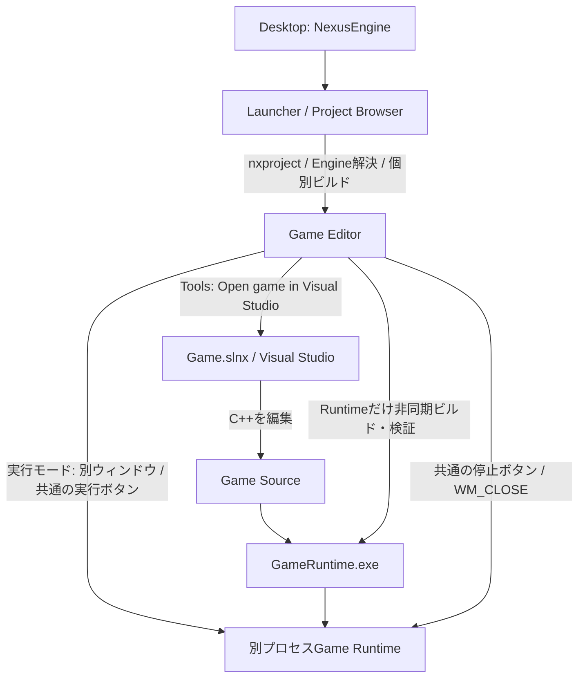

# Engineを入口にする開発フロー

## 標準の入口

NexusEngineの通常の入口はProject Browserとする。デスクトップから起動し、Projectを選び、選択したEngineとGame固有型を持つEditorを開く。Visual Studio直接起動はデバッグ用の選択肢として残す。



利用者から見れば一つの制作環境だが、内部ではLauncher、Editor、IDE、Runtimeのプロセスと責務を分ける。Launcherの終了でEditorやRuntimeをkillしない。IDEのhandleを閉じてもVisual Studioは終了させない。

## デスクトップのショートカット

リポジトリRootからPowerShellで次を実行すると、Windowsが返す現在ユーザーのDesktopDirectoryへ`NexusEngine.lnk`を新規作成する。

```powershell
./Project/Tools/Project/Create-LauncherShortcut.ps1
```

既存の同名shortcutは上書きしない。別配置のInstalled Launcherを入口にする場合や、作成先を選ぶ場合は明示する。

```powershell
./Project/Tools/Project/Create-LauncherShortcut.ps1 `
    -Launcher 'D:/NexusEngines/Stable/Bin/NexusLauncher.exe' `
    -Destination 'C:/Users/MyUser/Desktop/NexusEngine Stable.lnk'
```

Shortcutは特定のProjectを固定せず、引数なしでProject Browserを開く。Engine登録情報と最近使ったProjectは従来どおりユーザーごとのローカルRegistryを使う。Engineの配置を移動したらshortcutも明示的に作り直す。

## EditorからVisual Studioを開く

Project BrowserからGameを開き、Editorの`Tools → Open game in Visual Studio`を選ぶ。`SourceCodeEditor`は開いているGame Root直下の`.slnx`または`.sln`を解決する。複数のSolutionがある場合は勝手に選ばず通知する。Root外のリンク先は拒否し、Engine側のSolutionは開かない。

Visual Studio Installerの`vswhere`でC++ツールを持つIDEを検出し、GameのSolutionの絶対パスを一つのUnicode引数として渡す。CWDはGame Rootとする。検出ログはGameの`Build/Logs/IDE`へ新規保存し、失敗はEditorの既存通知とLogへ表示する。Visual Studioの実行ファイル位置はハードコードしない。

Visual StudioでGameのコードを変更して保存する。RuntimeはEditorの実行操作でも個別に増分ビルドできるため、毎回IDEでビルドを実行する必要はない。IDEで`GameRuntime`だけをビルドする操作も使える。使用中のGameEditor.exe自身の再リンクはできないため、Editorにも新しいGame型・コードを反映する場合はEditorを終了してGameEditorを再ビルドし、開き直す。現在の静的リンク方式はGame Moduleの動的な差替えとは異なる。

## 実行と現在の通信範囲

`実行 → 実行モード`（Run → Run Mode）で`エディタ内 / 別ウィンドウ`を選ぶ。Toolbarと実行メニューの`実行 / 停止`、F5 / Shift+F5は同じCommandを使い、選択モードへ振り分ける。初期値はエディタ内で、現在の選択はToolbarにも表示する。再生・ビルド・外部Runtimeの実行中はモード変更を禁止し、別ウィンドウでは一時停止を無効にする。選択はEditorセッション内で保持し、WorkspaceのReinstancingでも復元する。

エディタ内では編集中のWorldを複製する既存EditorSessionを使う。別ウィンドウではLevelを保存してから実行し、GameRuntimeだけを非同期で増分ビルド・検証して起動する。Editorの更新と描画は続ける。実行ファイルがまだ無いProjectもRuntimeターゲットが生成済みならビルドできる。データ専用Projectは既存の汎用Runtimeを利用する。

共通の`停止`（Stop）は、エディタ内の再生中なら複製Worldを破棄して編集へ戻る。別ウィンドウのビルド中なら自分のビルドJobを取り消し、起動済みなら自分のPIDのWindowへWM_CLOSEを送る。Window初期化中の停止はUI側で再試行する。取消済み要求はビルド完了と競合してもRuntimeを起動しない。Editor終了時は未完了ビルドだけを取消・待機し、既に起動した独立Runtimeは強制終了しない。

ツールバーにはビルド中・取消/終了中・実行中・停止中・失敗を表示し、状態表示のhoverでPIDとログを確認できる。ログはGameの`Build/Logs/Standalone/<uuid>.build.log`と`<uuid>.runtime.log`へ新規保存する。ビルド失敗、起動失敗、非ゼロ終了は既存のEditor通知とOutput Logへ一度だけ報告する。実行はDescriptorが指定した保存済み起動Levelを使い、Editorの未保存Worldは渡さない。

`StandaloneSession`はビルドworkerとProcessの寿命・状態だけを所有する。`StandaloneCommands`は外部実行の内部Commandと状態表示を登録し、EditorWorkspaceの共通Commandがモードに応じて委譲する。MainMenuBarはCommandの実行可否と選択状態だけを参照し、具体的なRuntimeサービスへ依存しない。workerはWorldやImGuiを操作せず、完了結果の受け取りとRuntime起動はUIスレッドで行う。

### Editorを開いたままのビルドとDLL配置

GameEditorとGameRuntimeは同じ出力DirectoryのDXC DLLを使用する。以前のBuild-Game.ps1は内容が同じDLLも毎回上書きしていたため、Editor起動中の実行要求がCopy-Itemで失敗した。修正後はSHA-256が一致する配置済みDLLをコピーせず、使用中の同一DLLを書き換えない。内容が異なるDLLを置換できない場合は、使用中のアプリを閉じて再ビルドするよう明示する。EngineやDLLの版を勝手に代用しない。

現在の別プロセス連携は、起動引数によるProject/Engine情報の受け渡し、Processの起動・状態照会、WM_CLOSEによる通常終了である。RuntimeProtocolとViewportSessionの抽象境界は存在するが、名前付きパイプ等の実際の双方向接続は未実装。Viewport映像の別プロセス転送、未保存Worldの転送、別RuntimeへのPause/Resume、IDE変更の自動reloadが完成したとは扱わない。

双方向IPCの次の拡張では、既存RuntimeProtocolを使い、Platformの非同期Channel、Editor側の接続状態、Runtime側のコマンド受信を分ける。まずHello/Ready/Shutdown/GoodbyeとLogを扱い、その後にLoadLevel/Play/Pause/Stopへ広げる。session nonce、Project ID、Engine buildId、protocol versionの照合、接続timeout、Runtime異常終了を設計に含める。描画の共有TextureやFenceはGraphics/FrameTransportの責務として分け、Project管理へ入れない。

## 検証

- `NexusSourceCodeTests`はGame Solutionの解決、欠損・複数候補の拒否、日本語・空白を含むSolutionの実argv/CWD、実環境のVisual Studio検出を確認する。IDEの起動引数は専用の子プロセスで検証し、ユーザーのVisual Studio Windowを勝手に開かない。
- `LauncherShortcut.Tests.ps1`は専用Directoryへshortcutを作り、COMで読み戻してTargetPath/CWD/引数なしと既存shortcut保護を確認する。検証のためにユーザーのデスクトップへ書き込まない。
- Game固有Editorの個別ビルドと有限GPU実行は既存`ProjectGpuSmoke.Tests.ps1`を使う。Solution全体のビルドやCleanは行わない。
- `NexusStandaloneTests`は同じEditorコマンドで非同期ビルド・起動・通常終了、重複要求の拒否、ビルド取消、失敗状態とログ、失敗の一度だけの報告、所有者破棄後の独立Runtimeを確認する。

新しいSourceCodeEditor実装はEditorSupportだけへ追加し、RuntimeからIDE/Editorへの依存は追加しない。旧単一exeのビルド入力にも追加するが、既存構造の全面移行は行わない。既に発行済みの固定SDKを変更せず、次回SDK発行へ含める。

2026-11-01の実行結果：IDE解決と引数のテストは`Generated/Modules/x64/Debug/NexusSourceCodeTests/Validation/4a70e59d-71d9-4012-8026-e10274d1236a`、shortcutは`Generated/LauncherShortcutValidation/047b0e46-2cf0-42a1-95a6-b6eeaca847a9`。新しいToolsメニューを含む生成GameのGPU実行は`Generated/ProjectGpuValidation/52d43438-7bda-4e92-8e4f-7f5e34cff349`で両ホストの3frameと正常終了を確認した。VS実画面の起動はこの自動テストでは行っていない。

Launcherの通常出力はユーザーが起動中で、再リンクはLNK1168になった。起動中のPID 15528を終了・再起動せず、`Generated/DevelopmentWorkflowValidation/NexusLauncherWorkflow.vcxproj`を同じ入力から別名で生成してビルドした。別出力のLauncherの3画面は`Generated/LauncherValidation/3194e232-1429-4216-9620-6117cebfda73`で確認済み。通常のLauncher更新は、そのLauncherを終了してから個別ビルドする。EditorメニューはGameEditorを再ビルドして開き直すと反映される。

Runtime実行導線の検証は`Generated/RuntimeLaunchValidation/3780de50-938c-487d-b559-60ecbbb47324`。Runtime exeが存在しない新規Basic 3D Projectで上記のEditorコマンド検証を実行した。同Rootの`GameEditor.log`では、新しいRuntime Toolbarを含むGameEditorのGPU 3frameと正常終了を確認している。テストは専用LOCALAPPDATA・非表示Windowで実行し、個人Registryや制作Gameを変更していない。

モード統合とDLL修正後は、同Projectの`Build/StandaloneTests/390f0df0-d9d8-426f-9968-47ecc4de7cd6`で実際のGameEditorを常駐させ、共通の実行・停止からRuntimeをビルド・起動・終了した。DLLの更新時刻が変化しないことも確認した。前の検証はEditor常駐中のDLL配置をカバーしていなかった。

既存NexusEditorTestsはモード選択、実行中の切替禁止、F5/Shift+F5、一時停止、選択のsnapshot復元と既存編集機能が通過。NexusGuiTestsの`--menus-only`では実際のImGuiメニュー展開、別ウィンドウ選択、共通の実行操作が通過した。GUI全体の既定実行にはSearchBarTests.cppの高さ32px固定期待と未変更の検索欄実装の不一致が残り、その期待値や検索欄を今回の修正に合わせて変更してはいない。
