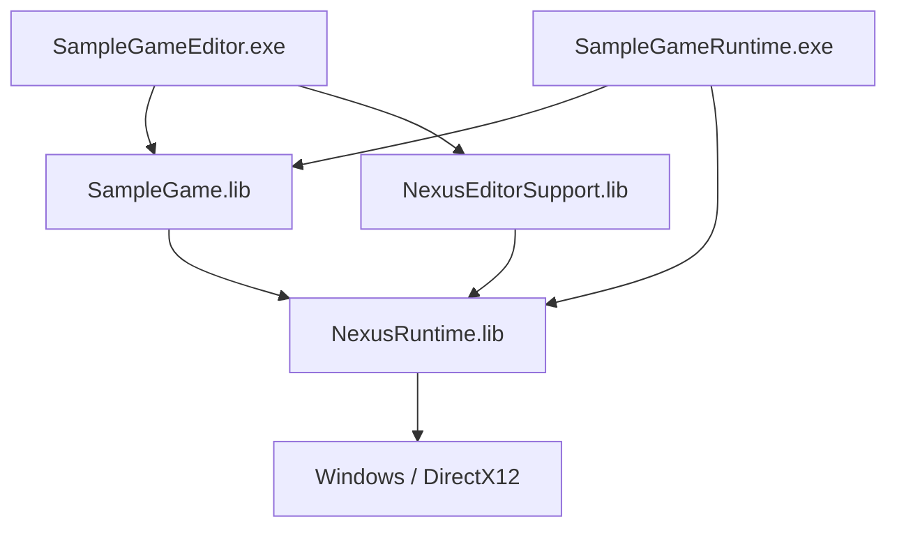

# Phase 1：Engine / Gameの分離

本資料はPhase 1時点の構成記録。追加されたDescriptor / ProjectContext / 作成CLIは[Phase 2：Project System](ProjectSystem.md)を参照する。

以下の「未実装」「後続Phase」は分離導入時点の記録。現在はLauncher、固定Installed SDK、版解決、明示移行・復旧、両GameホストのGPU実行まで実装・検証している。現在の構成は[Project Workflow](ProjectWorkflow.md)、要求ごとの証拠と検証限界は[要求監査](ProjectSystemAcceptance.md)を参照する。

Phase 0の調査に基づき、既存MSBuildとフォルダ配置を維持したままEngineの静的ライブラリとGameホストを追加した。
Launcher、`.nxproject`、Project Registry、Engine Version Resolver、Project作成UIは今回の対象外。

## 目的と構成

Engineの更新とGameの変更履歴を別々に管理し、各Gameが選択したEngineを参照できる境界を作る。
EngineのソースをGameへコピーする必要はない。DevelopmentではSource側のlibプロジェクトを参照し、
将来のInstalled SDKでは同じAPIに対して構成別libをリンクする。
Developmentの変更は利用中Gameへ反映される。安定性を固定するInstalled SDKの発行・検証・不変build ID管理は後続Phaseで実装する。



| ターゲット | 責務 |
|---|---|
| `Build/NexusRuntime.vcxproj` | Foundation / Runtime / Core / Graphics / Platform。Game・Samples・Editor・imguiのcppを含めない |
| `Build/NexusEditorSupport.vcxproj` | EditorとDear ImGui / ImGuizmo。Runtimeを利用する |
| `Build/SampleGame.vcxproj` | サンプルSystem、Game型の生成登録、Sample用の旧Asset構築 |
| `Build/SampleGameRuntime.vcxproj` | 単体Gameホスト。Editorをリンクしない |
| `Build/SampleGameEditor.vcxproj` | 同じGame型・Systemを使うEditorホスト |
| 既存`NexusEngine.vcxproj` | 互換用の単一exe構成を維持。新しい登録方針・起動パスを使用する |

新構成は`Build/NexusEngineModules.slnx`で開く。既存Solutionのターゲット集合を一度に変更していない。
新成果物は`Generated/Modules/<Platform>/<Configuration>/<ProjectName>/`、中間物はその下の`obj`へ出力する。
`NexusBuildRoot`で上書きでき、外部Game Solutionの`SolutionDir`には依存しない。
Debug / Developは`/MTd`、Releaseは`/MT`。x64 / v145 / C++23は既存構成を維持する。

## ビルド方式の選定

| 方式 | 判断 |
|---|---|
| MSBuild＋Static Library / ProjectReference | 採用。既存VS・個別テスト・Reflection生成の仕組みをそのまま使える |
| Premake | 導入可能だが、現在は生成するプロジェクト集合が小さく、追加の生成・保守経路を増やす利益が小さい。ターゲット増加時に明示ソース一覧から移行可能 |
| CMake package | 複数環境向けには有効。今回はビルドシステム移行を同時に行わない |
| Game DLL | 共通Editorで任意Gameを読めるが、ABI・CRT・型・callback・DLL解放の寿命契約が増える。今回は静的リンク |
| Submodule | Engine commitの固定には使えるが必須にしない。Installed SDKの代替ではない |

利点は既存の実装・デバッグ経路を保持できること。欠点はソース一覧をvcxprojへ明示登録することと、
Game固有型を認識するEditorホストをGameごとにリンクする必要があること。
汎用Editorが任意のC++ Gameを自動認識する仕組みは未実装。

## 型登録とライフサイクル

新しい`Runtime/Reflection/ReflectionRegistration.h`はComponentとInspectorの登録関数ポインタだけを保持する。
既定値はEngine型のみ。ホストはGameを含める登録方針をロード前に明示的に渡す。

```cpp
auto reflection = NexusGame::SampleReflection();
NexusEngine::GameApplication game(reflection, paths);
NexusEngine::EditorApplication editor(reflection, paths, startupLoader);
```

`Level`、`LevelDocument`、`GameApplication`、`EditorSession`へ登録方針を伝播する。
`LevelSerializer`、Details、Play複製、Reinstancingも同じ方針を使う。
GameLevelSetupは従来通りSystemの初期化を担当し、型登録とは分ける。
型の復元はSetupより先に必要なので、Setup時の登録では代用できない。

`Game/GameReflection.h`はSampleホスト側の結合例であり、Runtimeはこのヘッダをincludeしない。
Engine型だけのLevelでGame型をロードするとエラーになる。未知型を削除して保存する挙動にはしない。
登録関数の例外はLevel保存・読込でResultへ変換し、失敗時に既存Worldや保存ファイルを置換しない。

GameRuntimeは新しいLevelとSystemを所有し、StopでRAII解放する。Playは編集Worldと別のLevelを所有する。
ホスト所有のApplication / Renderer / GameサービスはFrameworkのRunとGPU終了まで生存させる。
登録関数・Systemが借用するGameサービスは、それらより長く生存させる。Projectごとの型をglobalへ蓄積しない。

### Reflection生成

- Engine：`Runtime/Reflection/EngineGenerated/GeneratedReflection.h/.cpp`
- Game：`Game/Generated/GeneratedGameReflection.h/.cpp`
- 各出力の`ReflectionSchema.json`：Engine / Game間の型ID・型名重複検査用。Project Descriptorではない。

Engineの走査対象はFoundation / Runtime / Graphics。Gameは指定Game Rootの`Game/`以下のみ。
Game生成はEngine schemaと照合し、Inspectorで別の型が同じIDへ誤結合されることを防ぐ。
生成物は変更がある場合だけ書き、出力Directoryごとのmutexで排他する。

```powershell
./Project/Tools/Reflection/Generate-Reflection.ps1
# 外部Game。Engine集合は先に生成しておく。
./Project/Tools/Reflection/Generate-Reflection.ps1 -Module Game `
  -GameRoot '<Game Root>' -OutputDirectory '<Game Root>/Intermediate/Reflection'
```

外部生成先を変更する場合は、そのcppをGameターゲットへ登録し、include先も一致させる。
既存の`Runtime/Reflection/Generated/*`は作業中変更を保護するため残し、新しいビルド入力から外した。
今後は新しい出力を使い、旧出力を手編集・再生成しない。

## パス管理と設定

`ApplicationPaths`はGameのprojectRootとEngineのengineRootだけを保持する。
`ResolveProjectPath`は相対参照をProject Rootから絶対化し、Root外、drive-relative、junction / symlinkによる逸脱を拒否する。
保存先が未作成でも、存在する親を解決して包含確認する。原子的なファイルシステム隔離を提供するものではない。

起動ホストはCWDを変更しない。`--project`は現段階では従来通りディレクトリを指定する。
`--engine`でShader / Editor内蔵資源のRootを明示できる。省略時はexe付近からEngineデータを探索する。
明示指定の失敗から別Rootへfallbackしない。

| データ | 解決基準 |
|---|---|
| Config / 起動Level / 旧HDR参照 | Game Project Root |
| モデル・Textureの保存参照 | Asset Root相対。ModelAssetLibraryの既存検証を使用 |
| Shader | Engine Root / Shaders |
| Editorフォント | Engine Root / Resources/Assets/Fonts。filesystem経由で読み、Context終了までバッファを保持 |
| Editor辞書 | Engine Root / Resources/Editor/Localization |
| LevelのOpen / SaveAs | EditorDocumentServiceでProject Root内に解決 |
| ベイク出力 | Project Root / Generated/Lighting / Level名.nxgi |

Levelの相対HDR参照は保存値を維持し、描画snapshotへ渡すときだけ絶対化する。
Project.settingsのReaderを起動ホストとEditorで共用する。
起動LevelはGame設定の`startupLevel`で必ず指定し、Engine内に特定SampleのLevel名を既定値として持たせない。
Editorの個人設定は従来通りLOCALAPPDATA、Game共有設定はGameのConfigに置く。
Level形式は独自の`NEXUS_LEVEL 12`のままで、`.json`拡張子を理由にJSONへ変換しない。

EditorはSampleのLoaderや材質名を直接参照しない。`:startup`を使用するLevelだけホスト提供Loaderを呼ぶ。
材質診断はモデルの材質名を使用する汎用表示へ変更した。

## 起動と確認

個別ターゲットを確認する例。Solution全体のビルドは必要ない。

```powershell
./Project/Tests/Invoke-GraphicsBuild.ps1 -Project Project/Build/SampleGameRuntime.vcxproj
./Project/Tests/Invoke-GraphicsBuild.ps1 -Project Project/Build/SampleGameEditor.vcxproj

./Generated/Modules/x64/Debug/SampleGameRuntime/SampleGameRuntime.exe `
  --project ./Project --engine ./Project `
  --level Resources/Assets/Levels/RuntimeDemoLevel.json --check-game
```

Editorホストは既定でEditor、Runtimeホストは既定でGame。既存exeの`--game`も維持する。
現行EditorのPlayは同一プロセスでGameRuntimeを使用する。
別プロセスGameの起動、CreateProcessW、IPC制御はPhase 5の対象であり、今回追加していない。
将来は同じProject Descriptorの絶対パスを引数で渡し、既存RuntimeProtocol / ViewportSessionを利用する。

## 独立Gameのビルド契約

`Build/Nexus.Game.props`をGame側vcxprojからimportし、未追跡のlocal propsまたは環境変数で`NexusEngineRoot`を指定する。
ソースとEngineは別Gitリポジトリに置ける。Game側は自分のコード・Assets・Configだけを所有する。

```xml
<Import Project="$(NexusEngineRoot)\Build\Nexus.Game.props" />
```

既定はdevelopmentのProjectReference。Editorを使うホストは`NexusWithEditor=true`をimport前に設定する。
Game側のOutDir / IntDirはimport後にGame Root内へ設定する。
最小の独立Game例は`Tests/Fixtures/IndependentGame`。Engineの具体的なSampleGameには依存しない。
Game固有Componentを保存・復元して、独自SystemをGameRuntimeで更新するCPU検証例である。

`installed`分岐は将来の`Lib/<Platform>/<Configuration>`とのリンク契約のみ。
SDK発行、API互換チェック、Engine登録、version固定の保証は未実装で、実用のInstalled Engine完成とは扱わない。
必要libがない場合はエラーとし、Developmentへ切り替えない。

Game公開APIの初期範囲はResult / Error、Math、ReflectionMarkers / Traits / codec、Scene / Entity / Components、
Level、ISceneSystem / SystemScheduler、GameRuntime / GameApplication / ReflectionRegistration。
ホスト構築にはFrameworkDesc、Renderer境界、AssetデータAPIも使う。
Backend / Device / Descriptor内部はGameロジックのAPI契約に含めない。
既存の推移includeにWin32 / Graphics型があるため、OS非依存APIやバイナリABIの安定化は未達。
SDK収集時は公開ヘッダの推移依存とShader共有ヘッダも検証する必要がある。

## 検証と残課題

2026-10-31にDebug / x64で以下を確認した。Solution全体のビルドと既存成果物のクリーンアップは行っていない。

| 検証 | 結果 |
|---|---|
| SampleGameRuntime / SampleGameEditorの個別ビルド（依存libを含む） | 成功 |
| 隔離出力先のNexusEditorTests | 成功 |
| 隔離出力先のNexusEcsTests | 成功 |
| Engine Sourceツリー外の日本語・空白を含むRootで独立Game fixtureをビルド・実行 | 成功。Engine Sourceのコピーなし |
| RuntimeのCPU起動・更新・描画抽出、別CWD、移動相当のRoot変更、独自Assets / Levelsパス | 成功 |
| 不正Project / Engine / Level逸脱パス | 終了コード1で拒否 |
| Engine / Game別Reflection、外部Root、重複ID、変更なし時の非更新、旧生成物保護 | 成功 |

ECSテストは従来のDemo / PBR / Sponza Levelの内容へ固定件数を仮定していたが、現行の制作データと不一致だった。
制作データを変更せず、テスト専用Worldを一意の一時ファイルへ保存・読込する方式に変更した。
assert失敗で検証プロセスがダイアログ待ちにならない設定もEditorテストと揃えた。
再実行用の検証入口は以下。

- `Tests/ReflectionSeparation.Tests.ps1`：別集合生成、外部Unicode Root、変更なし時の非更新、重複ID、旧生成物保護。
- `Tests/StartupIsolation.Tests.ps1`：異なるProject Root、独自Assets / Levels、無効Root / Levelパス拒否。
- `NexusEditorTests`：Game型の保存・復元、Engineのみでの拒否、Play登録の継承、重複登録失敗、Root外Open / SaveAs拒否、Unicodeパス。
- `NexusEcsTests`：既存Level / Scene / Serializationの回帰。
- `SampleGameRuntime --check-game`：CPU起動・更新・Asset準備・描画抽出。GPU描画は確認しない。
- 独立Game fixture：Engineコピーなしの静的リンク、独自型の保存・復元・更新。

新規モジュール構成ではLive++は無効。従来の単一exe構成は既存LivePP.propsを保持し、pre-build生成は新しい二集合を使う。
ライブラリ分離後のLive++パッチとGPU描画の実操作、Release / Develop、Installed SDKは別途確認が必要。
任意Gameの汎用EditorロードにはGame DLLまたは別プロセス型連携が必要である。
独立Game fixtureは制作向けテンプレートUIではなく、Phase 4で設定・Camera付きLevel等を整備する。

## 変更範囲

追加した主な値型はApplicationPaths / ReflectionRegistration。Managerや新しいRuntime更新階層は追加していない。
既存Level / Document / Application / Sessionは登録方針の受け渡しを追加した。
Editor / ImGuiはRoot注入とSample直接依存除去、生成器と各vcxprojは生成集合と入力の切替を担当する。
既存ゲームの型ID、Level形式、System更新順、Playの編集World保護を維持する。
本Phaseの全変更ファイルはGit差分で確認でき、ビルド成果物はGit管理外に置く。
