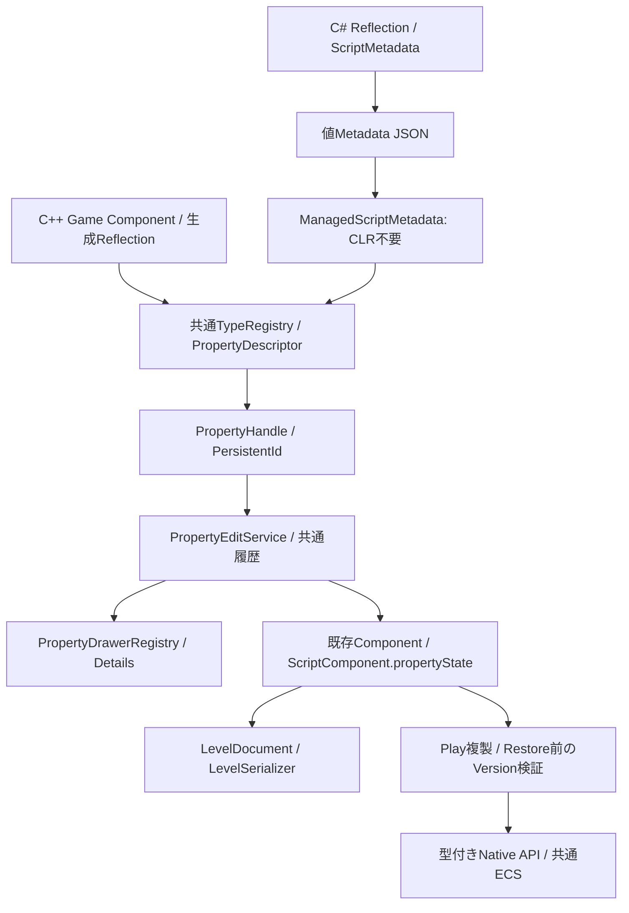

# Reflection / Serialization / Editor — 改訂仕様 Phase 6

既存のC++ ReflectionとManaged Property adapterを共通Details・履歴・LevelDocumentで利用する。
このPhaseでは新しいInspectorを作らず、保存Versionの保護・取得失敗理由・Hybrid設定値の編集を補完した。

後続の[統合監査・第9回](IntegrationAuditREADME.md)で共通PropertyEditServiceの編集後検証を補完した。複数Propertyのsetterが全て成功しても、Script型変更等で同じtransactionのProperty Handleが読めなくなる場合は失敗とし、既存の順序解決付きrollbackへ戻す。Previewは検証済みの最終値copyを履歴へ渡し、解決不能なoptionalを参照しない。これはC#専用処理ではなく、C++ / C#の共通Reflectionへ適用する。元のHandleを維持する同型Aliasへの変更や、通常の複数値編集・正規化・Undo / Redo / Cancelは既存フローを使う。公開ABIとLevel保存形式は変更していない。
旧仕様のManaged Reflection実装は[既存記録](ManagedReflectionREADME.md)、Native APIの契約は[改訂Phase 5](NativeManagedApiREADME.md)を参照。

## 調査結果と再利用

| 既存クラス・ファイル | 確認した責務と今回の扱い |
|---|---|
| ProjectDescriptor / ProjectTemplates / LauncherApplication | 共通ProjectとModule・初期言語・生成。形式やUIを変更しない |
| GameRuntime / CSharpRuntime / NativeManagedBridge | Runtime所有のHostingとManaged session。Editorへ所有権を移さない |
| NativeGameSystemScope / NativeGameApiMetadata / NativeBindings | Systemと公開関数の寿命・署名・値転送。Propertyの所有者にはしない |
| Scene / ScriptComponent / ScriptSystem / EntityId | 共通ECS・関連付け・instance。Native pointerではなくWorld / index / generationで操作 |
| ScriptMetadata / ScriptTypeMetadata / ScriptPropertyMetadata | C# Reflectionから安定ID・Alias・値kind・既定値をJSONへ変換 |
| ManagedScriptMetadata | CLRを使わずMetadataを読み、PropertyDescriptorへ値accessorを登録 |
| TypeRegistry / ReflectedInspector / ComponentReflection | 共通型とProperty。C++生成登録とComponent保存に再利用 |
| Game/GameReflection.h / MoveComponent | Game所有C++型をホストから登録し、共通編集・保存に接続済み |
| PropertyHandle / PropertyEditService / EditorHistory | PersistentIdと型・Property IDによる解決、複数値Preview・取消・Undo / Redo |
| PropertyDrawerRegistry / ReflectedPropertyEditor / DetailsPanel / PropertyPages | 同じPropertyKindで描画。専用カテゴリのないC++ / C#型は共通Otherカテゴリへ表示 |
| LevelDocument / LevelSerializer / ReflectionValue | 共通Level保存・復元。Script参照・公開値とEntity永続IDを保持 |
| EditorSession / EditorWorkspace | 編集World・Play複製・値Catalogの所有、Metadata差替え時の履歴解除 |
| AssetCatalog / ModelAssetLibrary / RuntimeProtocol / Logger | 既存Asset・IPC・Console。言語別の代替を追加しない |
| LiveCodingAgent / LivePP.props / ManagedReloadCommands | 既存の更新Backend。今回Reload手順を増やさない |
| Managed targets / Publish-Engine.ps1 / vcxproj / csproj | 既存の生成・compile対象と配布一覧。新しいsource itemは不要 |

PropertiesPanelという独立クラスは確認できず不明。実際の統合先はDetailsPanelとPropertyPagesである。
Native System全体のProperty owner・保存先は未実装。任意DLL内Componentの動的Reflection登録も今回追加していない。
Input / Audio / PhysicsのPublic Game APIは未実装であり、内部Backend全体の状態は今回の調査では不明。

## 採用構造・データフロー



C++型は既存ReflectedInspectorとComponentReflectionへホストのReflectionRegistrationから登録する。
C#はビルド時Exporterが値Metadataを出力し、Editorがそれを共通Descriptorへ変換する。
EditorはC# Type / PropertyInfo / ScriptBehaviour / DotNetHostを所有せず、getter / setterもNative側の保存値accessorである。
Playでは共通ScriptComponentの値をManaged instanceへ復元する。同じLevelやAssetを言語ごとに作り直さない。

今回追加した`PropertyDescriptor.unavailableReason`は、getが値を返せない場合の理由を値文字列として返す任意accessor。
既存getはoptional値しか返せず、不在・不正状態・将来Versionを区別してDetailsへ説明できなかったため、この小さな拡張を選んだ。
新Registry、System Property Manager、言語別Inspectorを作る案は既存の所有・編集・履歴を重複させるため採用しない。
取得失敗を既定値へ置き換える案は、ユーザーが保存値を失ったと誤認し上書きするため採用しない。

Descriptorの新fieldは任意で、既存C++のaggregate初期化では空になる。既存Native getterの動作やDrawer選択は変えない。
RuntimeはUIへ依存せず、Editorだけがこの理由を表示する。Public C ABI・Managed Interop DTO・IPC schemaは変更しない。

## 公開Propertyと所有者

HybridテンプレートのPlayerController / EnemyControllerに次のPropertyを追加した。

```csharp
[Expose(Id = "target", Label = "Target")]
public Vector3 Target { get; set; } = new(5, 0, 0);

protected override void OnUpdate(float deltaTime)
    => CrowdSimulation.SetTarget(Entity, Target);
```

MetadataのVector3は共通PropertyKind::Vector3へ変換し、既存Drawerを利用する。
DetailsでTargetを編集 → ScriptComponentへ値保存 → Play開始前に復元 → 型付きNative APIへ渡す、という経路になる。
Targetの所有者はEntityのGame Logicであり、Native System全体の共有stateをEntity Propertyと偽装しない。
Native Systemは入力を受け取り、既存Schedulerが次frameで処理する。System objectやCallbackをEditorへ公開しない。

C++のGame.Move.speedはGame/GameReflection.hの既存登録を利用し、C#の公開値と同じPropertyEditServiceへ接続する。
これはホストへ登録済みのC++ Game Componentの対応であり、任意Game DLLのC++メモリをInspectorが直接編集する機構ではない。
独立DLLのComponent登録、System共有設定の編集には所有Level・保存先・公開Metadata契約が別途必要。その曖昧な部分を今回のTargetで代用しない。

## Serialization・Version・互換性

既存ScriptComponentがScript Type ID・enabled・propertyStateを持つ。
propertyStateはschemaVersion、型IDごとのVersion、Property IDごとのkindと値を保存する既存形式を維持する。
Entityとの関係は既存Component格納、Entity永続IDはPersistentIdを使う。instance / attachment / Binding Handleは保存しない。

- 名前変更：安定ScriptType / Expose.Idを維持する。旧IDにはAliasesを指定する。
- Property削除・型変更：未知Propertyと旧kindの値を保持し、暗黙の型変換を行わない。
- 保存Versionが現在以下：既存のID・Alias・kind解決で復元できる。任意migrationの自動実行はしない。
- 保存Versionが現在より新しい：現在型の全既知ID・FullName・Aliasを調べ、編集・Restore・Captureを拒否する。
- 無関係な型IDの将来Version：opaqueな値として保持し、現在型の編集を妨げない。

従来は書戻しで現在Versionを設定できたため、古いコードで新しい契約を暗黙にdowngradeする余地があった。
Native adapterとManaged Runtimeの両方に同じVersion検証を追加した。
Native getは値を返さずsetは失敗する。保存値は保持し、Detailsに取得不能理由を表示する。
Managedではsetter / OnCreateより前に拒否し、Captureでもgetter実行前に拒否する。
対応Metadataへ更新すれば同じPersistentId / Type ID / Property IDから再び解決できる。
新しいVersionの値を含むLevelの読み書き自体は禁止せず、共通保存経路で値を保全する。

## Lifecycle・Thread・Reload

1. ホストがReflectionRegistrationを選び、LevelDocumentへ渡す。
2. Workspaceが既存Native型と値Metadataを共通TypeRegistryへ登録する。
3. Main threadでEntityをPersistentIdから解決し、値コピーを描画・編集する。
4. PropertyEditServiceが全対象を検証し、同じ履歴でPreview・取消・Undo / Redoする。
5. LevelDocumentが既存SerializerでComponentと公開値を保存する。
6. Playは編集Sceneの複製を使い、Runtime内だけでManaged instanceを生成・値復元する。
7. 終了は既存ScriptSystem / Managed参照・Native scopeの失効後にWorldを破棄する。

Registryと編集サービスはWorkspace所有、LevelDocumentは編集World所有、DescriptorのMetadataはimmutable共有所有である。
Entity / Component pointerを履歴へ保持せず、PropertyHandleは永続IDと文字列IDだけを保持する。
既存EditorはPlay中のProperty編集を無効にする。Play結果を編集Worldへ自動適用する機能は追加しない。

Metadata差替え時は既存Workspaceが候補Registryを検証し、旧Property履歴を解除してから差し替える。
Native System Bindingの世代更新とManaged Assembly Reloadは改訂Phase 7へ残す。
TypeRegistryの内部C++構造を拡張したため、適用時はユーザーによるEngine / Editor再ビルドとホスト再起動が必要。Live++パッチ適用は保証しない。

## Error HandlingとEditor / Runtime境界

不正Metadataは既存Load / Logger経路、Scriptの復元失敗は既存Runtime / Console経路へ返す。
Detailsの理由表示は共通Descriptorだけを参照し、CLRを起動しない。毎frame同じエラーをConsoleへ大量出力しない。
別Processで利用する場合にも必要なのは既存の値Metadata・コマンド・保存値であり、今回Native / Managed objectをIPCへ追加していない。
新しい保存VersionのPlay失敗は編集Documentを変更しない。初期化失敗やProperty setterの副作用全般のrollback保証ではない。

## 使用方法

Hybrid Projectを既存サービスで生成し、ユーザー側で通常BuildしてMetadataを用意する。
共通DetailsでPlayerControllerまたはEnemyControllerのTargetを編集し、LevelDocumentの既存Saveで保存する。
Play時に保存値が復元され、Native Crowd Systemへ渡る。AssetとEntityを言語ごとに複製する必要はない。
C++ Game Componentは従来のReflection宣言とホスト登録を利用する。生成器はユーザーの通常Build手順で扱い、Agentは実行しない。
Versionエラーが表示された場合は対応するMetadata / Gameコードを用意する。保存Versionを手動で下げる自動操作はしない。

## 変更ファイル

| ファイル | 変更内容 |
|---|---|
| Runtime/Reflection/TypeRegistry.h | 共通Descriptorへ任意の取得不能理由accessorを追加 |
| Runtime/Reflection/ManagedScriptMetadata.h | Version保護・理由通知の責務コメント |
| Runtime/Reflection/ManagedScriptMetadata.cpp | 既知ID / AliasのVersion検証、書戻し拒否と理由accessor |
| Managed/Nexus.Managed/ScriptMetadata.cs | Restore / Capture前の同じVersion検証 |
| Editor/Gui/ReflectedPropertyEditor.cpp | 共通Descriptorの理由を既存Details経路で表示 |
| Templates/Hybrid/EnemyController.cs.in | Native APIへ渡すTargetをExpose |
| Templates/Hybrid/PlayerController.cs.in | 初期LevelでもTargetを共通編集・保存可能にする |
| Templates/Hybrid/README.md.in | 所有者・編集フロー・Version失敗時の説明 |
| Tests/ManagedReflectionTests.cpp | 同一EntityのC++ / C#編集・共通Drawer・履歴・Document保存・将来Version・Metadata更新の検証ソース |
| Tests/ManagedGameplayTests.cpp | 将来VersionのPlay拒否で編集Worldを保つ検証ソース |
| Docs/ManagedReflectionREADME.md | 旧実装記録から改訂仕様への案内 |
| Docs/GameLogicReflectionREADME.md | 調査・設計・互換性・使用方法・制約 |
| ../README.md | 改訂Phase 6への案内 |

## 静的確認・未実装・未検証

include、namespace、宣言 / 定義、aggregate初期化、compile / link対象、Metadataの受渡しをソースで照合する。
Descriptor・Level・Managed instanceの所有権、永続Handle、保存互換性、Thread、終了・schema差替え順序を確認する。
追加した検証ソースはユーザーの明示検証用であり、Agentは実行しない。
実施した照合では7 ProjectのXML・明示ソース・ProjectReference、Hybridテンプレート17ファイルの参照・出力先・生成Project XML、
変更13ファイルのUTF-8・競合記号・末尾空白とquoted include 28件に問題は見つからなかった。
git diff --checkはエラーなし。既存Launcher/Standalone/Program.csのLF→CRLF警告は今回の変更対象外である。

ビルド、テスト、Game / Runtime / Editor起動、dotnet、Metadata Exporter、Reflection生成器は実行していない。
コンパイル・link、実際のDetails表示・操作、Level roundtrip、Playの拒否・復元は未検証。
任意型Serialization、System共有Propertyの永続owner、独立DLL Componentの動的Reflection公開、自動migration、Reload調停全体は未実装。
