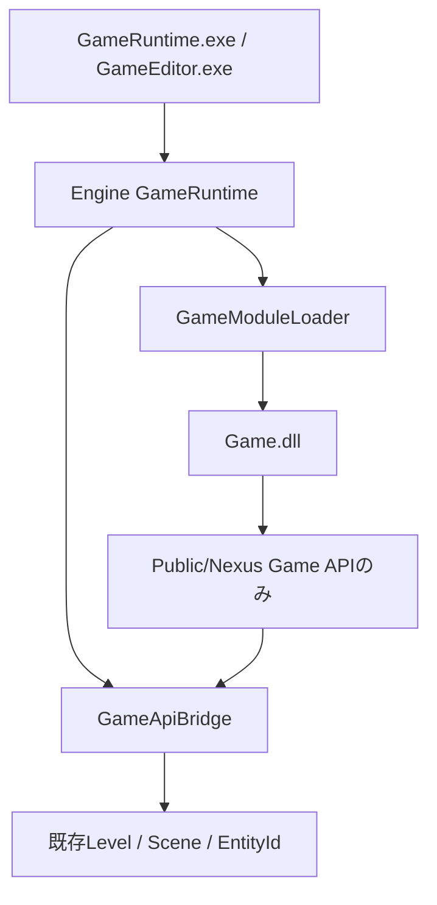

# Phase 2 — Game API / C++ Game Module

Phase 1の共通Project / Module宣言を使い、独立Game DLLの生成・起動経路を追加した。
続く.NET Hostingの実装は[Phase 3](CSharpRuntimeREADME.md)を参照。本資料はPhase 2の実装記録。
ビルド、Game / Editor / Launcher、生成CLI、回帰テストは実行していない。
以下はコードと静的確認に基づく設計・実装記録であり、コンパイル・動作成功の記録ではない。

後続の[統合監査・第7回](IntegrationAuditREADME.md)ではLoader単体の再入も保護した。DLL exportや完了ログのcallback中にStopを要求した場合、外側のLoader操作が戻るまでstate破棄とUnloadを遅延する。停止要求を受けたStart / Updateは成功を返さず、再入Update / patchは拒否する。destroyからの二重Stopも同じstateを再破棄しない。誤ThreadのStopは状態を変更せず拒否し、所有Threadでの再試行を要求する。Loader自体の所有者は操作終了まで生存させ、破棄も同じThreadで行う。System exportを持つDLLには既存Levelを必須とし、World対応をcreate前に検査する。公開ABIは変更していないが、Loaderの内部layout変更は通常BuildとHost再起動で反映する。

## 調査結果

| 既存実装 | 確認した責務と再利用方針 |
|---|---|
| `ProjectTemplates` / `.nxproject` | 初期Moduleを生成する既存サービス。新しいManagerを追加せずテンプレートを追加 |
| `NexusRuntime.lib` / `NexusEditorSupport.lib` | 既存Engine / Editor分離。RuntimeからEditorを参照しない |
| `ReflectionRegistration` / `GameLevelSetup` | 型登録とWorld初期構築の静的callback。既存Gameの経路を維持 |
| `GameRuntime` | 実行Level所有、Start / Pause / Update / Stop。単体起動とEditor Playで共通 |
| `GameApplication` / `EditorSession` | Levelロード、編集World複製とPlay。Module設定だけをRuntimeへ転送 |
| `ProjectHost.inl` | Engine・Game・ホストの結合点。Projectと実行ファイル位置から配置を解決 |
| `Scene` / `EntityId` / `Level` | 既存の唯一のECS。index / generationを再利用。Entity作成時は既存永続IDも発行 |
| `SystemScheduler` / `TransformSystem` | Simulation → Transformの決定的更新。DLL更新を既存Schedulerの直前に配置 |
| `LevelDocument` / `LevelSerializer` | 同じ編集・保存基盤。Module専用Level形式を作らない |
| `ComponentReflection` / `TypeRegistry` | Component保存・編集を担う既存Reflection。DLL越しにstd::functionやStorageを渡さない |
| `ModelAssetLibrary` / RenderScene / Renderer | Engine所有の資源解決と描画。Game DLLから内部APIやGPUポインタへ直接依存させない |
| `Logger` | Game APIのログも既存Sinkへ配送 |
| `ProjectBuild` / BuildTargets / nxbuild stamp | 選択Engine、配置、成果物hashの照合を再利用しDLL hashを拡張 |
| `LiveCodingAgent` / LivePP.props | 既存の同期パッチ・Reinstancing経路。新Moduleローダーと競合させない |
| `Publish-Engine.ps1` | SDKの既存収集処理へPublicヘッダとModule用propsを追加 |

既存C++ Gameはホストへ静的リンクされ、GameModule.hという名前もDLLを表すものではなかった。
任意の既存Gameを自動でDLL化すると、Reflection生成、STLとCRT、Systemの破棄関数の寿命に影響する。
そのため旧`blank` / `basic-3d`生成を維持し、独立DLLの`native-module`テンプレートを別途追加した。

## 設計判断と依存関係



Game DLLは`Public/Nexus/GameApi.h` / `GameModule.h`だけをEngineからincludeし、
NexusRuntime.lib、Renderer、Scene、Editor、ImGuiへリンクしない。
公開APIの関数表を通してホストが所有する同じLevelを操作する。
Bridge内部のProcess共通ルーティング表は数値World tokenを非所有Level参照へ解決するだけで、
EntityやComponentの別Storageを所有しない。通常ホストは全RuntimeをProcess終了前に停止する。

C++仮想インターフェースのIGameModuleは導入せず、将来のC#からも取り込める固定幅C ABIを採用した。
Module側のC++クラスはDLL内部で自由に使用できる。APIは当面Entity生成・破棄・生存確認・列挙、
Local Transform一括取得・更新、共通Loggerに絞り、未実装の機能を汎用登録機構で包まない。

## ABI / ownership / thread契約

| 項目 | 契約 |
|---|---|
| 対象ABI | Windows x64、pack 8、`__cdecl`、ABI version 1と厳密なstructSize。公開ヘッダにsizeofのstatic_assertを配置 |
| export | `extern C`の`NexusGetGameModule`。Entryはmetadataとcallbackのみを返す |
| 互換性 | ABI、Engine ID / version、Project ID、Module IDをロード時に完全一致で検証 |
| Engine build | 既存host stampのEngine buildIdと成果物hashを維持。Moduleも同じstampのSHA-256で照合 |
| STL | DLL境界をstd::string / vector / function / shared_ptr / C++例外で越えない |
| allocator / CRT | stateはDLLで生成しDLLのdestroyで解放する。Engineはvoid*の内容を解釈・deleteしない。Engine / DLLのCRT heap共有を要求しない |
| 借用buffer | UTF-8文字列と出力bufferはcallback呼出し中だけ有効。受取側は保存・解放しない |
| 関数表 | Engineの固定関数表をModuleが値コピーできる。公開Engineデータポインタは保持しない |
| Entity Handle | 再利用しないuint64 World token + 既存index / generation。生存確認とアクセスのたびに解決 |
| World停止 | token失効により古いHandleを拒否。別Worldや次回PlayへHandleを引き継がない |
| World交換 | 実行中にLevelをUnload / ExchangeSceneしない。必要ならRuntimeをStopしてから再Startする。Bridgeも登録時Sceneとの不一致を検出する |
| thread | create / update / destroyとWorld操作はStartしたthreadのみ。APIは誤threadをstatusで拒否。ModuleはEngine callbackを保持するThread / Task等をdestroyまでに停止する |
| 例外 | DLL側で全例外をstatusへ変換する契約。ローダーも防御的にcatchするが異種runtimeの例外互換性は保証しない |
| DLL初期化 | DllMain / 静的初期化でWorld、Thread、callbackを生成しない。Entryは検証完了前にゲームを開始しない |
| teardown失敗 | destroy失敗、誤threadでの停止、FreeLibrary失敗時は同Runtimeでの再Startを拒否。未停止コードをUnloadせずProcess再起動を要求する |

この境界は信頼するGameコード用であり、任意の不正Nativeポインタを隔離するsandboxではない。
バッファは宣言した長さ分の読み書き可能領域であることを呼出側が保証する。
Transformは有限値を検証してQuaternionを正規化し、派生Matrixは既存TransformSystemへ委譲する。
列挙は二段階の件数照会 / 一括コピーに対応し、EntityごとのInterop往復を避ける。

## lifecycle

初期化は次の順序で行う。

1. ホストがProject / EngineとDLL絶対配置を解決する。ホストは設定だけをGameRuntimeへ渡す。
2. 既存のReflectionでLevelをロードする。EditorではPlay開始時だけ編集Worldを複製する。
3. 既存GameLevelSetupを実行する。新NativeテンプレートではEngine組み込み登録のみを使用する。
4. Levelを借用するGameApiBridgeを作成し、新しいWorld tokenを登録する。
5. 絶対パスでLoadLibraryExWを呼び、export / metadata / ABIを検証する。
6. Module createへAPIの値とWorld tokenを渡す。stateはModuleが所有する。
7. 初期Transformを確定し、全成功後にLevel / Bridge / LoaderをRuntimeへ公開する。

frame更新は`Native Module update → 既存Level::Update（Simulation → Transform）→ 描画抽出`。
Pause中はModuleとLevelの両方を更新しない。Module更新失敗はResultで通知し、RuntimeをStopする。

終了順序は`Module destroy → DLL内参照解除 → FreeLibrary → World token失効 → Level / System破棄`。
DLL参照はWorldごとに保持する。同じDLLを別Runtimeも使用している場合、FreeLibraryは自身の参照だけを解放し、
実際のコード解放はWindows側の最後の参照がなくなった時点で行われる。
GameStateがEngine / ECSの所有物を長期間借用しないため、DLL Unload後にも残るModule由来の
std::function、System vtable、Component destructorは作らない。
開始失敗時もlocal RAIIで同じ順序を守り、編集Worldを変更しない。
Module destroy / Unload失敗時にはDLL参照を意図的に残すため、通常終了とは区別してログへ記録する。

EditorはDLLのhandleや.NET Runtimeを所有せず、編集停止中にはDLLをロードしない。
実行用GameRuntimeだけがDLL参照とModule stateを所有する。

## Project生成とBuild構成

Project Browserで`Native Game Module (C++)`とC++を選ぶ。
配布用Launcherにも`native-module`の選択肢を追加した。新しいEngineのテンプレートとSDKが必要。
CLIは既存create-templateのtemplate-idに`native-module`を指定し、初期言語はCpp。
このテンプレートでCSharpを指定した場合は生成サービスが未対応言語として拒否する。

```text
MyGame/
  MyGame.nxproject                  # modules: Game / Cpp / Source/Game
  Assets/  Levels/  Config/
  Config/BuildTargets.json          # 既存項目 + nativeModule
  Source/Game/Main.cpp              # 公開Game APIだけを使用するDLLのゲームコード
  Source/Host/Main.cpp              # EngineとDLL配置の結合点
  GameModule.vcxproj                # Game.dll、Engine libへのリンクなし
  GameRuntime.vcxproj               # Engine Runtimeホスト
  GameEditor.vcxproj                # Engine Editorホスト
  Game.slnx
  Build/Bin/x64/<Configuration>/    # Game.dllと両ホストを隣接配置
  Intermediate/                    # 通常の中間成果物
```

GameRuntime / GameEditorからGameModuleへProjectReferenceを設定してBuild順序を定義し、
LinkLibraryDependenciesはfalseにする。Gameコードをホストへ重複コンパイルしない。
GameModuleだけを変更してもホストへ静的リンクし直す必要はないが、現行Build stampはDLL内容も固定するため、
起動前に既存Project Build経路でホストのstampを更新する。実行中DLLの上書きや自動Reloadは行わない。

SDK発行処理にPublicヘッダとNexus.GameModule.propsの収集を追加したが、今回SDKを発行・上書きしていない。
既存のInstalled Engine配布物や生成済みGameは変更していない。

## Live++との役割

今回のローダーは通常のStart / Stopに対応する。実行中の再コンパイル・DLL交換は行わない。
Module用propsはLivePP.propsをimportせず、ModuleをLiveCodingAgentへ自動登録しない。
既存の静的ホスト向け同期パッチとReinstancing経路は維持する。
将来Native DLLのLive++対応を追加するときは、API table、callback、stateとWorldの停止地点を
既存同期処理へ接続し、Unloadとパッチの同時実行を許可しない設計・検証が必要である。

## 変更ファイル

| ファイル | Phase 2の変更 |
|---|---|
| `Public/Nexus/GameApi.h` | バージョン付きC ABI、World / Entity Handle、Transformと共通API関数表 |
| `Public/Nexus/GameModule.h` | Module context、metadata、create / update / destroyとexport契約 |
| `Runtime/Gameplay/GameApiBridge.h` / `.cpp` | 公開APIを唯一の既存Level / ECSへ接続し、thread・寿命を検証 |
| `Runtime/Gameplay/GameModuleLoader.h` / `.cpp` | DLLロード、ABI・identity照合、state lifecycle、Unloadと失敗時保持 |
| `Runtime/Application/GameRuntime.h` / `.cpp` | Runtime所有と開始rollback、更新順、停止順 |
| `Runtime/Application/GameApplication.h` | 単体ホストからRuntimeへModule設定を転送 |
| `Editor/Core/EditorSession.h` | Play用Runtimeへ設定を転送。編集WorldではModuleを生成しない |
| `Editor/Core/EditorApplication.h` | ホストからSessionへの設定接続 |
| `Runtime/Scene/Scene.h` | Componentの有無によらない生存Entity列挙を追加 |
| `Core/Hosting/ProjectHost.inl` | 新生成ホストでDLL配置・identityを解決し、両Runtimeへ設定 |
| `Build/Nexus.GameModule.props` | Public includeだけを持つDLL用Build契約 |
| `Build/NexusRuntime.vcxproj` | Bridge / Loaderのコンパイル対象追加 |
| `NexusEngine.vcxproj` | 互換ホストにも同じ実装を追加 |
| `Templates/native-module.nxtemplate` | 独立DLLテンプレート登録 |
| `Templates/NativeModule/Main.cpp.in` | DLL内stateと共通Entity / Transformを利用するゲームコード |
| `Templates/NativeModule/Host.cpp.in` | Module配置を明示するホスト結合コード |
| `Templates/NativeModule/GameModule.vcxproj.in` | Game.dll生成 |
| `Templates/NativeModule/GameRuntime.vcxproj.in` | RuntimeホストとDLLのBuild依存 |
| `Templates/NativeModule/GameEditor.vcxproj.in` | EditorホストとDLLのBuild依存 |
| `Templates/NativeModule/Game.slnx.in` | 三つのProjectのSolution |
| `Templates/NativeModule/BuildTargets.json.in` | ホストとDLLの構成別配置 |
| `Tools/Project/ProjectTemplates.cpp` | DLL Project用UUIDのトークン展開 |
| `Tools/Project/ProjectBuild.h` / `.cpp` | nativeModule配置解決とDLL stamp照合 |
| `Tools/Project/Write-GameBuildStamp.ps1` | 任意のnativeModule項目とDLL hash記録。旧形式維持 |
| `Tools/Engine/Publish-Engine.ps1` | PublicヘッダとDLL用propsの既存SDK収集への追加 |
| `Launcher/Standalone/Program.cs` | 配布Launcherのテンプレート選択追加 |
| `Tests/NativeGameModuleTests.cpp` | 世代・World失効、thread、編集World分離、DLL更新・停止の回帰ケース |
| `Tests/Fixtures/NativeModule/Module.cpp` | Engine内部への依存なしで動作するテストDLL |
| `Tests/Fixtures/NativeModule/NativeModuleFixture.vcxproj` | テストDLLの独立Build定義 |
| `Tests/NexusEditorTests.vcxproj` | Bridge / Loader / テストとDLLのBuild依存を追加 |
| `Tests/GameRuntimeTests.cpp` | 既存ランナーから新テストを呼び出す接続 |
| `README.md` / `Docs/CppCSharpREADME.md` / `Docs/GameRuntime.md` / `Docs/LiveCoding.md` / 本README | 導線・設計・制約・進捗 |

## 未対応

- .NET Runtime Hostingは後続[Phase 3](CSharpRuntimeREADME.md)で追加。C# GameplayはPhase 4へ残す。
- 複数Module同時実行、Managed Module、言語間イベント（Phase 7）。Projectは宣言を保存可能だが実行は引き続き拒否する。
- DLLからの任意Component / Reflection登録、任意Assetロード、Input / Audio / Physics等のゲームAPI拡張。
  既存のComponentReflection / TypeRegistry / Asset基盤を再利用する設計であり、言語別システムは追加しない。
- Native DLL Hot Reload、Live++ opt-in、state snapshot / restore。停止してから明示的に再Build・再Startする。
- Package / cooking / DLL依存物の自動収集等の配布統合（Phase 8）。SDK収集の最小接続のみ今回追加。

## 静的確認

include / namespace / symbolはNexusEngine内部とC ABIの公開名を分離し、宣言・定義・ホスト呼出しを照合。
Game DLL / テストDLLのincludeはPublicだけで、Engine lib / Scene / Renderer / Editorへの依存を追加していない。
Bridge / LoaderをGameRuntime.cppの全コンパイル元へ追加し、旧ホストとEditorテストのリンク入力を揃えた。
ownership / lifecycleは開始途中のRAII、Pause、更新失敗、destroy失敗、World失効、Unload前の参照解除を確認した。
API consistencyはC ABIのversion / size、Engine・Project・Module identity、BuildTargetsとstampの新旧形式を照合した。

MSBuild XMLとPowerShell Parserによる構文検査、テンプレートの参照ファイルと置換token、
公開ヘッダの依存、`git diff --check`を静的に確認する。回帰テストはソースを追加した段階で未実行。
コンパイル、リンク、exportの実際の表記、LoadLibrary、callback動作、DLL Unloadの成功はユーザーの検証待ち。
