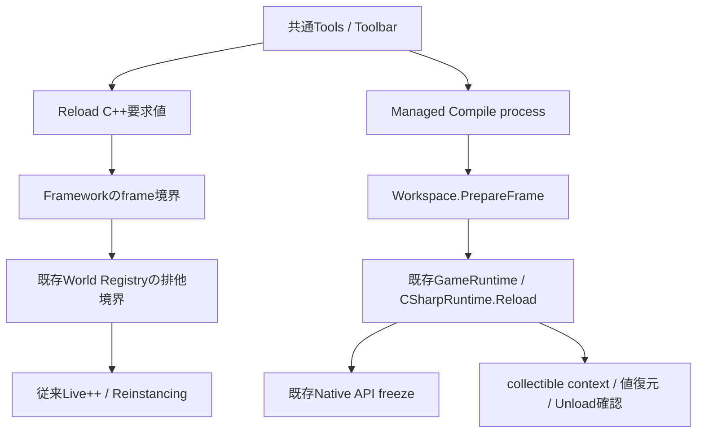

# Hot Reload Coordination — 改訂仕様 Phase 7-A

後続の[Phase 7-B](NativePatchRuntimeREADME.md)でRuntime契約、[Phase 7-C](NativeModuleLivePPREADME.md)で明示profileのGame DLL SDK接続を追加した。以下は7-A単位の実装記録。実SDK動作と全状態移行は未検証。

Phase 7を分割し、今回は既存Backendの安全境界と状態通知を実装する。
Managed Reloadと独立Game DLLへのLive++パッチの完全な共存は未完成である。
Game DLLのパッチ設定・Module有効化・API再登録・state移行を検証せずに対応済みとは扱わない。

## 調査結果と範囲

| 既存機能 | 確認結果 |
|---|---|
| LiveCodingAgent / NexusFramework / ReinstancingService | 同期Agent、GPU待機、snapshot・release・restore。従来単一exeの処理 |
| LivePP.props / LivePP.UPSTREAM.md | 記録SDKは2.11.4。標準配置のSDKヘッダーは今回のworkspaceに存在せず、SDK有効branchのコンパイルは未確認 |
| Build/Nexus.Common.props / Nexus.GameModule.props | 通常SDK / 独立DLLはLive++ opt-inしていない。LoaderもEnableModuleしない |
| GameModuleLoader / NativeGameSystemScope | ModuleとSystemの寿命、Bindingの世代更新・一時停止・逆順解除。DLLパッチBackendは未実装 |
| GameApiBridge / GameServices | 全Interop Worldの寿命と所有Thread、callback深さ、Reload freezeを管理 |
| CSharpRuntime / NativeManagedBridge | Prepare・Scene複製・Commit・Initialize・Complete。世代停止後の失敗時にWorldを保持 |
| GameScriptCatalog / RetiredGame | collectible AssemblyLoadContext、shadow copy、弱参照で解放確認。Unload要求だけを成功扱いしない |
| ScriptBehaviour / ScriptRuntime / ScriptComponent | resource解除、Lifetime cancel、Managed参照の解除、Property snapshotとEntity関連付け |
| EditorSession / EditorWorkspace / ManagedReloadCommands | 既存Compile process・Play epoch・Metadata差替え・Console。従来はToolbar描画内でPollしていた |
| PropertyEditService / TypeRegistry / LevelDocument / PersistentId | 保存値と同一性を再利用。新しいState Storeを追加しない |
| Event / Logger / RuntimeProtocol | 既存GameServicesの値Eventと診断。Managed delegateやNative objectをIPCへ追加しない |

System実行は既存Schedulerの逐次処理。独立PropertiesPanelクラスは確認できず不明で、共通Detailsを使用する。
Input / Audio / Physicsの追加Public APIやBackend全体の状況は今回の対象外で、状態移行対応を確認したとは扱わない。

## 公式仕様と判断

リポジトリの2.11.4記録を[公式Release情報](https://www.liveplusplus.tech/releases.html)と照合した。
実体SDKが標準配置にないため、ローカルで使用可能なSDKのVersion・有効Build設定を確定したとは扱わない。
[公式ドキュメント](https://liveplusplus.tech/docs/documentation.html)の同期Agent、Module有効化、hookのThread制約を確認した。
同期AgentのFrame境界と、停止プロセスのhookでlockを取る危険を踏まえ、hook内でWorld Registryを操作しない。
今回SDKの新しい関数は追加使用せず、既存ScheduleReload / WantsReload / Reload呼出しを維持した。

Live++によるコードパッチ、Game DLLのFreeLibrary / LoadLibrary、Managed AssemblyLoadContextの交換は異なる操作である。
DLL再生成をライブパッチの代わりに行う案は、Systemやゲームstateを失いEntityを作り直す可能性があるため採用しない。
フラグだけでGame DLLのLive++を有効にする案はABI・state・Binding再登録が不足するため採用しない。
まず未接続の操作を拒否し、既存Managed Backendの安全な適用経路を整える。

## アーキテクチャと依存方向

新しいReload Manager、System Manager、TypeRegistryは作らない。
Frame順序はFramework、World開始の排他は既存World Registry、Managed世代はCSharpRuntime、Compile processは既存ManagedReloadBuildが担当する。
Editorは結果enumと要求だけを扱い、.NET RuntimeやManaged objectを直接所有しない。
RuntimeからEditor / ImGuiへ依存を追加しない。Frameworkから既存RuntimeのWorld境界を呼ぶ。

## Native境界と状態

共通Tools / ToolbarへReload C++を追加した。要求は値で記録し、SDK操作は次のFramework境界へ戻す。
通常SDKのLive++無効ホストではUnavailableを表示し、実行可能に見せず、操作時に既存Console / Notificationへ理由を返す。
このボタンは従来ホストのコードパッチ用で、独立Game DLLのReloadボタンではない。

FrameworkはLive++のsnapshot / releaseより前にGameApiBridge.BeginLegacyPatchで境界を取得する。
Interop Worldが一つでも存在する場合は拒否する。Pause中も参照は生存しているため例外にしない。
取得中は別Threadも含め新規GameApiBridgeの生成を拒否し、検査直後に新Worldが開始する競合を防ぐ。
lockは検査とフラグ更新だけに使い、GPU待機やSDKのパッチ処理中は保持しない。
取得したThreadのRAIIだけがEndLegacyPatchする。Native / Managedの終了失敗はProcess再起動まで境界を取得不能にする。

拒否後はpending要求を自動適用しない。正常にPlayを停止した後、ユーザーがReload C++を明示再要求する。
Brokerのpending要求をキャンセルできたとは扱わず、Engine側のSDK pollingを保留する。再要求せずに停止しただけで適用しない。
既存のPublic ABIヘッダーも保護対象へ追加し、C#やDLLが持つ関数表のlayout変更を従来パッチで通さない。

Native表示はUnavailable / Idle / Queued / Reloading / Reload Success / No Changes / Compile Error / Compatibility Error / State Restore Error。
compile-error hookはatomicな結果フラグだけを更新し、World・System・Managedへ触らない。
復元失敗は既存Frameworkの失敗・終了経路へ渡し、安全なrollbackを保証しない。
独自ホストがFrameworkを迂回してSDK / LiveCodingAgent.Reloadを直接呼ぶ場合の調停は提供していない。

## Managed Compile・適用・失敗

Compileは従来どおり稼働中DLLと別のGUID Directoryへ出力する。失敗時は現在Assemblyを変更しない。
完了監視はToolbar描画からWorkspace.PrepareFrameへ移した。ImGui開始前・Schedulerが非実行の所有Threadで適用する。
Toolbarは状態だけを描画し、非表示や配置変更でCompile監視が止まらない。
Stop / 再Playでepochが変われば候補を適用せず、監視時に所有Compile processを終了する。
Workspace Shutdown / Reinstancingではpoller・Toolbar・Command callbackを解除し、processの所有参照を解放する。

Managed表示はIdle / Compiling / Reloading / Reload Success / Compile Error / Compatibility Error / State Restore Error / Cancelled。
Compile失敗はEditorのprocess結果、Metadata / Prepare失敗はCompatibility Error、旧世代停止後の失敗はState Restore Errorとして区別する。
前回のRuntime結果をMetadata読込失敗の結果として再利用しないよう、試行ごとのoutcome値を渡す。
適用中は同期処理のため、その途中状態を毎frame描画できるとは保証しない。

Managed手順は既存の成功確認 → Snapshot → 候補検証 → Scene複製 → 旧世代停止 → 参照解除 → Unload確認 → 新生成 → 状態復元を維持する。
callback実行中・Scheduler実行中・別WorldへのReloadは既存の入口検証で拒否する。
Native API / Eventは既存freezeで停止し、candidateのOnCreateからNative System内部stateを変更させない。
旧世代のcleanupも既存GameWorldの書込停止を維持する。

Abortや復元経路の失敗でも、CSharpRuntimeが独立した失敗フラグを保持し、GameRuntimeの通常更新を再開させない。
正常な再適用が完了した場合だけ解除する。手動Pauseの状態を勝手にResumeする機能は追加しない。
これは任意の副作用やSystem stateのrollback保証ではない。

## 参照・状態・所有権

| 対象 | 今回の扱い |
|---|---|
| Entity / Level / PersistentId | 既存Managed transactionで同一性を維持。既存Level形式を変更しない |
| Script公開Property | 既存snapshotとVersion検証で復元。private / staticの任意状態移行はしない |
| Managed object / Type / PropertyInfo | session / Catalog内で所有し、RetireGameで参照解除 |
| event / delegate / GCHandle / Thread / Task | TrackResource / Lifetimeとユーザーcleanup契約を維持。弱参照の解放確認が失敗すれば停止 |
| Native Binding Handle | Phase 5のscope・登録世代検証を維持。ManagedへGame DLLのfnptrを渡さない |
| Native System state | Managed Reloadでは再生成せず、freeze中の呼出しを拒否。Nativeパッチ移行は未実装 |
| Native callback | scope停止時に失効。失敗時はDLL pinとProcess再起動。今後のパッチBackendから再登録する接続は未実装 |
| Compile process | Workspace所有callbackが共有所有。ownTreeの終了で他の作業者のprocessを操作しない |

Clear / GCHandle解放やUnload要求だけで成功とする変更は行っていない。
WeakReferenceによる既存Confirmを維持し、未解放context・state復元失敗を既存Logger / Consoleへ通知する。

## 使用方法と次の実装単位

Managed Projectでは共通Reload C#を使う。Compileの結果と適用結果を別の状態として確認する。
Compatibility Errorなら現行コードが維持されたかログを確認し、State Restore Errorなら修正後にReloadを再試行する。
従来Live++ホストのReload C++はInterop session停止後に使う。独立DLLと通常SDKには未接続である。
この変更自体は固定ホスト・Registry・Workspaceの型を変えるため、ユーザーの通常再ビルドとホスト再起動が必要。

Phase 7-B以降には、利用SDK実体の確認、Gameホスト / DLLの明示opt-in、Module有効化、System stateとABI対応範囲、patch完了時のAPI再登録、Managed Facadeの再解決契約が残る。
この状態でPhase 7全体を完了扱いせず、Game DLLの自動Reloadを実行可能と案内しない。
既存Build / Packageや言語追加UIを先回りして実装しない。

## 変更ファイル

| ファイル | 変更内容 |
|---|---|
| Core/Framework/NexusFramework.cpp | GPU待機・SDK適用より前にInterop排他境界を取得 |
| Platform/Development/LiveCodingAgent.h | Native状態・要求・拒否API、責務コメント |
| Platform/Development/LiveCodingAgent.cpp | SDK操作と要求値の分離、拒否後の保留、結果通知、Publicヘッダー保護 |
| Runtime/Gameplay/GameApiBridge.h | 既存Registryを使うNativeパッチ境界宣言 |
| Runtime/Gameplay/GameApiBridge.cpp | World開始との排他・Thread限定解除・終了失敗後の禁止 |
| Runtime/Gameplay/GameModuleLoader.cpp | DLL終了失敗時に従来パッチも禁止 |
| Runtime/Scripting/CSharpRuntimeSettings.h | Managed backendの状態enum |
| Runtime/Scripting/CSharpRuntime.h | 状態通知と復元失敗フラグ |
| Runtime/Scripting/CSharpRuntime.cpp | 段階別結果・失敗後の実行停止・終了失敗通知 |
| Runtime/Application/GameRuntime.h | Runtime結果の値取得宣言 |
| Runtime/Application/GameRuntime.cpp | Managed状態の値通知 |
| Editor/Core/EditorSession.h | Runtime結果の転送 |
| Editor/Core/EditorWorkspace.h | Frame準備のpoller、試行ごとのoutcome |
| Editor/Core/EditorWorkspace.cpp | 共通Native操作・Backend状態表示・描画前Poll・終了時解除 |
| Editor/Core/EditorWorkspaceReinstancing.cpp | パッチ前に旧poller / Command callbackを解除 |
| Editor/Services/EditorCommandRegistry.h | 所有callbackの明示解除 |
| Editor/Services/ManagedReloadCommands.cpp | Compile / 適用結果の区別、epoch取消、描画と適用の分離 |
| Tests/NexusEditorTests.vcxproj | SDK無効のAgent実装を既存Editor検証対象へ追加 |
| Tests/GameServicesTests.cpp | SDKを起動せず境界・別Thread・World拒否を確認するソース |
| Tests/ManagedGameplayTests.cpp | 互換性・復元失敗・成功・回復の状態を確認するソース |
| Docs/LiveCoding.md | 現行の拒否契約への案内 |
| Docs/ManagedHotReloadREADME.md | 旧記録から新しい適用場所への案内 |
| Docs/HotReloadCoordinationREADME.md | 今回の調査・設計・制約・残作業 |
| ../README.md | Phase 7-AとPhase 7全体の未完了を明示 |

## 静的確認・未検証

include / namespace / 宣言・定義 / link対象、RuntimeとEditorの依存方向、Backend状態と所有権を照合する。
World登録・SDK適用・callback解除・Compile processの寿命、旧Handleと公開Property値の保存互換性を確認する。
検証ソースはユーザーが明示実行するもので、Agentは実行しない。
実施した照合では6つのvcxprojとLivePP.propsのXML・明示ソース・ProjectReference、変更24ファイルのUTF-8・競合記号・末尾空白、quoted include 102件に問題は見つからなかった。
Live++有効時だけ使う未配置SDKヘッダー1件はinclude存在確認から除外した。LivePP.local.propsも存在せず、外部Build引数によるSDK指定は不明。
git diff --checkはエラーなし。既存Launcher/Standalone/Program.csのLF→CRLF警告は今回の変更対象外。

ビルド、Game / Runtime / Editor、テスト、dotnet、Compile process、Reflection生成器、Live++ SDK操作は実行していない。
コンパイル・link、実パッチ、Brokerのpending動作、GUI状態表示、実際のCompile取消・Managed Reloadは未検証。
標準SDK配置がないためLive++有効branchのヘッダー照合も未実施。公式仕様との照合を実動作確認の代わりにはしない。
