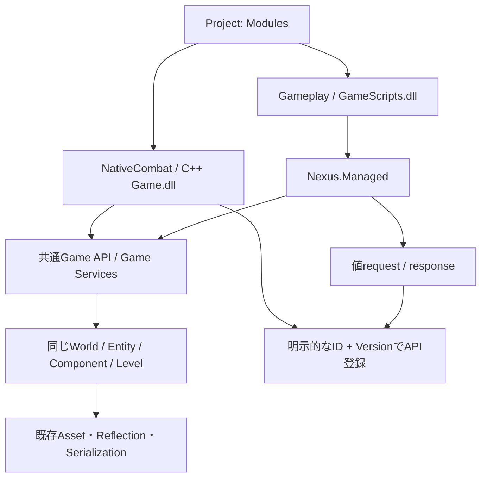

# Phase 7 — Hybrid C++ / C#

改訂[Phase 8](HybridProjectREADME.md)で複数Moduleの実行・途中追加UI・共通Build / Packageまで実装した。以下のPhase番号と実装制約は導入時の記録を含む。ビルド・動作検証は行っていない。

一つのProject / Level / WorldでNative Game DLLとManaged GameScriptsを同時実行する。
今回ビルド、Game / Editor / Launcher、dotnet、Reflection生成、テストは実行していない。
以下はソース実装と静的確認の記録であり、コンパイル・動作確認済みという記録ではない。

## 調査結果

| 既存構造・関連クラス | 再利用・変更判断 |
|---|---|
| ProjectDescriptor.Modules / ProjectSerializer / ProjectContext | 既に複数言語を表現できるため、Project形式は変更しない |
| ProjectTemplates / Project Browser / Standalone Launcher | staging生成と初期言語選択を再利用し、Hybridテンプレートを追加 |
| ProjectBuild / Build-Game / Write-GameBuildStamp | 排他判定を除き、DLL / Bootstrap / Scriptsを同じstampで照合 |
| ProjectHost / GameRuntime | 複数Module拒否と設定排他を拡張。単一LevelとGameApiBridgeを両Backendで共有 |
| GameModuleLoader / CSharpRuntime | Native開始後にManaged開始、逆順に停止する既存構造を再利用 |
| GameApiV1 / EntityHandle / ScriptComponent | 同じ世代付きEntity、Transform、Script保存・編集を使用 |
| TypeRegistry / PropertyEditService / DetailsPanel / LevelDocument | 既存Reflection・共通Inspector・共通保存を維持 |
| GameScriptCatalog / NativeManagedBridge / Reload | Nativeを生存させたままManaged世代だけを交換 |
| Event基盤 | Foundation / Runtime / Coreに汎用のGame Event busは見つからず、既存World router内へ有界の値queueを追加 |
| Asset参照 | 既存PrimitiveRenderComponentはAsset Root相対の文字列参照。新しいAsset Managerや実体のないAssetHandleは作らない |
| Live++ / Logger / IPC / Solution生成 | 共通ログと生成経路を維持。Managed ReloadをLive++へ転送しない |

## 設計判断・依存方向



現在の実行・生成Backendは**Native 1個＋Managed 1個**までを対応範囲にする。
同じ言語の複数Moduleを黙って無視せず、Host / Buildで拒否する。Projectモデル自体は引き続き複数Moduleを表現できる。
Managed Assembly内のScript型は複数利用できる。単言語Projectと旧V1 DLLも維持する。

Engine内部やCLR型を言語間契約にしない。Entityは既存World token / index / generation、型・機能は
安定した文字列ID、データは固定幅値とコピーbufferで渡す。ReflectionのTypeRegistryは引き続き共通。
Assetをpayloadで参照する場合も既存のAsset Root相対参照を明示的な値codecで扱い、Native Assetポインタを渡さない。
新しいManaged AssetロードAPIの追加は今回の範囲に含めない。

## Project生成と途中追加

Project Browser / CLIで`hybrid-gameplay`を選ぶ。初期言語は先頭へ並べるModuleを選ぶだけで、
Hybridテンプレートは明示宣言された両Moduleを生成する。Runtime起動順は常にNative → Managed。

```text
MyGame/
  MyGame.nxproject
  Assets/                 # 共通
  Levels/                 # 共通
  Config/BuildTargets.json
  Source/
    Host/Main.cpp         # 両Backendの配置だけを指定
    NativeCombat/Main.cpp # Public APIだけを参照
    Game/PlayerController.cs
  GameModule.vcxproj      # Game.dll
  ManagedBootstrap.vcxproj
  GameScripts.csproj      # Nexus.Managedだけを参照
  GameRuntime.vcxproj
  GameEditor.vcxproj
  Game.slnx
  Intermediate/
```

```json
"modules": [
  {"id":"Gameplay","name":"Gameplay","language":"CSharp","path":"Source/Game","type":"Game","dependencies":["NativeCombat"]},
  {"id":"NativeCombat","name":"NativeCombat","language":"Cpp","path":"Source/NativeCombat","type":"Game"}
]
```

Project形式はschema 1のまま。BuildTargetsも既存の`nativeModule`、`managedBootstrap`、`gameScripts`を併記する。
両ホスト → 共通Utility → Game DLLのProjectReferenceで依存を束ね、両成果物が揃ってから同じstampへhashを書く。
Game ModuleはPublic includeだけを参照し、Engine内部libへリンクしない。

既存Projectへ言語を途中追加する場合、**Project ID、既存Module ID、Level、Assets、Component保存値を維持**する。
既存RootへCreateを再実行したり、ユーザーコードをテンプレートで上書きしたりする操作は追加しない。

1. `.nxproject`のModulesへ不足する言語のGame Moduleを追加し、Source Directoryを用意する。
2. C# ProjectへC++を足す場合はGameModule.vcxprojを追加し、Public APIだけを使うDLLを作る。
   DLLのexportするModule IDは追加したdescriptorのIDと一致させる。既存Native IDがGameなら変更しない。
3. Native ProjectへC#を足す場合はGameScripts.csproj、Managed Utility、Managed Sourceを追加する。
   旧静的Cppテンプレートのゲームコードは、既存Native Game Module境界へ移してからHybridにする。
4. Hostに両Backendの配置macroを指定する。Hybrid/Host.cpp.inを参考に既存Hostへ差分を適用し、
   既存のReflection登録・GameLevelSetup・ゲームコードを保持する。
5. BuildTargetsへ不足する成果物フィールドを追加する。各ProjectReferenceとSolutionへ不足するProjectを加え、GUIDは一意にする。
   Sourceの既存配置を維持する場合は、GameModule / GameScriptsのCompile globをその配置に合わせる。
6. ユーザーが通常Buildしてホストを再起動する。Level / Assetの再作成・変換は不要。

途中追加の自動移行・既存コードへの自動パッチUIは未実装。上記は既存ファイルを破壊しない差分追加の手順。

## 明示的なPublic API登録

Native DLLは任意export`NexusConnectGameServices`を提供できる。
既存`NexusGetGameModule`とV1 create contextは変更しない。exportがないDLLは従来通り動作する。
Engineはcreate成功後に登録用clientを発行し、connectでAPIを登録してからManagedを開始する。

登録は`ID + Version + Native callback + DLL所有state`で行う。重複登録とManaged clientからの登録は拒否する。
callbackとstateはEngineが借用し、C#へ渡さない。DLLの内部型をReflectionで直接呼び出したり、P/InvokeでGame.dllを参照したりしない。

```csharp
var reply = World.InvokeNative("combat.impulse", 1, Entity, BitConverter.GetBytes(Impulse));
```

サンプル`combat.impulse v1`はlittle-endian float32一個を受け取り、同じEntityのTranslation.Yへ加算し、
結果のfloat32を返す。Native / ManagedともEntityポインタやRenderer内部を参照しない。
機能を変更する際はVersionまたは別IDを明示し、payloadの長さ・値域・応答容量をNative側でも検証する。

Invokeは一回だけ実行し、C#側は最大4096 byteのcaller-owned bufferを渡す。
長さ照会のために同じstateful処理を二回実行しない。Native callbackは検証後に副作用を適用し、借用bufferを保存しない。
callback中はWorld lockを保持せず、共通Entity APIへの再入を許可する。再帰は8段まで、実行中のclient失効は拒否する。
STL、CRT heap、例外、Managed object / delegate / GCHandleの所有権を境界越しに渡さない。

## 共通Event

`World.PublishEvent`と`World.TryPollEvent`は同じNative World routerのqueueへ接続する。
C#用Event ECS・Level・Asset Managerはない。Event callbackを登録させないため、Reload前のManaged delegateをNativeに残さない。

| 契約 | 内容 |
|---|---|
| Type ID | 1～128 byteのASCII識別子。英数字と`._-/:` |
| Version | 0以外のuint32。payload codecは利用Module間で明示する |
| Source | 無指定または同じWorldの生存Entity Handle。配送後に破棄されたSourceはIsAliveで判定 |
| payload / response | 最大4096 byte。呼出側bufferからEngineへコピー |
| client | World内最大32。Native loaderまたはManaged世代が所有する数値capability |
| queue | clientごと256件。同じWorldの**送信者以外**へ配送 |
| 満杯 | 部分配送せず失敗を返す。確保失敗時も配送済み分をrollback |
| Poll | 空ならlength=0 / OK。容量不足ならheaderと必要数だけ返して消費しない |
| 順序 | World内の連番順。Native Update → Managed Updateなので逆方向は次frameで受信可能 |
| 受信者 | Module単位のqueue。複数ScriptがPollする場合は競合消費になるため、ゲーム側で受信担当を決める |
| 保存 | 永続化・再送はしない。client終了・Managed世代交換で未受信queueを破棄 |

サンプルはNativeからcombat.hit、Managedからgameplay.pulseを配送する。
通知失敗を、既に成功したNativeのWorld操作が巻き戻ったとは扱わない。

## 初期化・終了・Reload

初期化：Level読込 / Setup → 単一GameApiBridge → Native create → Native API登録 → Managed context →
Script初期化 → Transform確定 → 実行World公開。途中失敗時は部分生成物を逆順で停止する。

更新：Native Module.Update → 既存Level Scheduler内のScriptSystem → 既存Transform等。
Pause中は両Backendを止め、片方だけ別Worldで進めない。

終了：Managed lifecycle / client失効 / ALC解放確認 → Native登録失効 → Native destroy / DLL解放 →
World token失効 → Level破棄。Native stateの解放元CRTを維持し、停止失敗時は既存Quarantineを使う。

C# ReloadではNative DLL、Native client、Native内部stateを再生成しない。
ただしNativeのopaque stateとqueueをScene.Cloneでは巻き戻せないため、Reload全体でManagedからの
Invoke / Publish / Pollを停止する。旧cleanupと新OnCreate / OnEnableでこれらを呼ばず、OnUpdateへ配置する。
旧World wrapperは失効し、新世代のclientは新しい数値ID・空queueで開始する。
新Script初期化失敗時はPhase 6のScene復元・Suspendを維持し、Native側もPauseする。
Native内部stateへの呼出しが拒否されたことを、Nativeの状態をsnapshot・restoreしたとは扱わない。
Live++のパッチとManaged Reloadは別Backendのまま。

## ABI・所有権・thread

追加APIはWindows x64 / pack 8 / Cdecl。GameServicesApiは56 byte、Event headerは40 byte、
bytes範囲は16 byte、Native services contextは80 byte、Managed context V4は216 byte。
双方でsizeofを照合し、既存Game API / Module V1、Managed context V1～V3は変更しない。

Module stateはDLL所有、GameWorldは安定API内のcapability、Script objectはManaged世代所有、
Event値と登録索引は既存World router所有。Native登録はDLL state破棄より先に失効させる。
World / Entity世代・client寿命・所有thread・Sceneの同一性をEngineで検証する。
Compile process以外のGame API・Event・lifecycle・Registry操作はRuntime所有threadに限定する。

## 変更ファイル

| ファイル | 変更内容 |
|---|---|
| Public/Nexus/GameServices.h | 共通値API・任意Native登録export・Event / buffer契約 |
| Public/Nexus/ManagedBootstrap.h | 既存Layoutを維持してV4 contextと開始関数型を追加 |
| Runtime/Gameplay/GameApiBridge.h / .cpp | 同じWorld routerのclient・登録索引・有界queue・Reload保護 |
| Runtime/Gameplay/GameModuleLoader.h / .cpp | 任意export解決、登録scope所有、Destroy前の失効 |
| Runtime/Application/GameRuntime.h / .cpp | 設定排他解除。同じLevel / Bridgeで両Backendを実行 |
| Runtime/Scripting/NativeManagedBridge.h / .cpp / CSharpRuntime.cpp | V4開始とHybrid ReloadのNative state保護 |
| Managed/Nexus.Managed/Interop.cs / GameWorld.cs / GameServices.cs / .csproj | ABI値、世代client、共通World.Invoke / Publish / Poll |
| Managed/Nexus.Managed.Bootstrap/EntryPoints.cs / GameplayEntryPoints.cs / ReloadEntryPoints.cs | V4検証、世代client生成・失効、Preflight中の書込抑止 |
| Editor/Core/EditorSession.h | Native設定時もManagedのCPU Metadataを維持 |
| Core/Hosting/ProjectHost.inl | 1 Native＋1 Managedの検証、言語ごとのModule ID解決 |
| Tools/Project/ProjectBuild.cpp / Build-Game.ps1 / Write-GameBuildStamp.ps1 | 両成果物のBuild・起動・同一stamp照合 |
| Tools/Project/ProjectTemplates.h / .cpp | TemplateのModule群宣言、初期言語順、両Source生成、個別GUID |
| Templates/hybrid-gameplay.nxtemplate | 共通生成経路のHybridテンプレート宣言 |
| Templates/Hybrid/Host.cpp.in / NativeCombat.cpp.in / PlayerController.cs.in | 共通APIと値Eventを使うゲーム例 |
| Templates/Hybrid/GameModule.vcxproj.in / ManagedBootstrap.vcxproj.in / Game.slnx.in / BuildTargets.json.in / README.md.in | Project依存・出力・利用方法 |
| Templates/managed-gameplay.nxtemplate / Launcher/Standalone/Program.cs | 説明更新とHybrid選択肢 |
| Tools/Engine/Publish-Engine.ps1 | 追加Managed SourceのSDK配布。Public headerとTemplatesは既存tree配布 |
| Tests/GameServicesTests.cpp / GameRuntimeTests.cpp / Tests/NexusEditorTests.vcxproj | CLR不要の通信・寿命・World分離・容量・thread検証ケース |
| Tests/Fixtures/NativeModule/Module.cpp / Fixtures/ManagedGameplay/Behaviours.cs / ManagedGameplayTests.cpp / Build/NexusManagedGameplayTests.vcxproj | DebugのHybrid実行・Native状態保持・Reload失敗保護ケース |
| Tests/ProjectSystemTests.cpp / Build/NexusProjectTests.vcxproj | Hybrid両初期言語と旧単言語の共通生成ケース |
| README.md / Docs/ManagedHotReloadREADME.md / 本README | Phase 7の進捗・制限・途中追加手順 |

## 静的確認・未対応

include / namespace / symbol、Native exportとManaged entry、ABI引数・Layout、callbackの所有権、
client失効とDLL解放順序、Reload中のNative state保護、Build / 起動の残存排他条件をソースで照合した。
XML・明示Source参照8ファイル、PowerShell Parser 3ファイル、Hybridテンプレート12ファイルの参照・置換・XML / JSON構文を静的確認した。
Managed SDK配布元17ファイル、Native include参照7ファイル、新規Sourceの末尾空白・競合マーカーとgit diff --checkも確認した。
テストコードは追加したが、ビルド・テスト・Reflection生成は実行していない。

未対応は同言語の複数Module、既存コードへの自動言語追加UI、任意の型付きEvent schema生成、Native RPCの自動rollback、
Managed Asset / Input / Audio / Physics APIの拡充。既存の共通データ管理はそのまま使用する。
Phase 8で統合Build / Package / IDE・配布構成を扱う。
