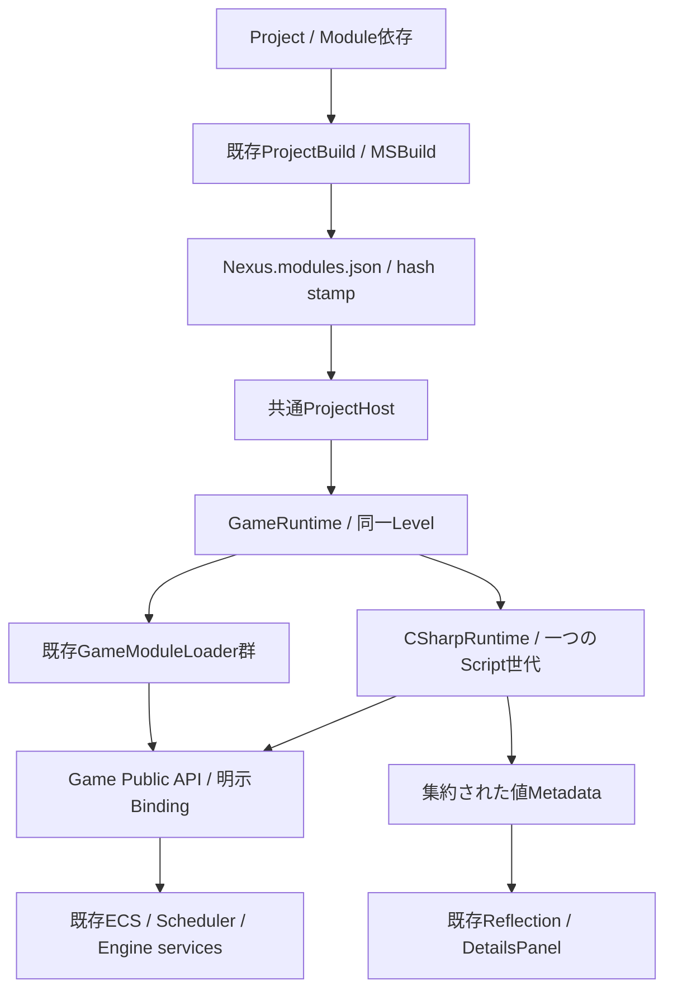

# Hybrid Project / Build / Packaging — Phase 8

新規Managed / Hybrid ProjectのBackendは[Mono](MonoRuntimeREADME.md)へ更新した。以下のCoreCLR / private .NETの記述は既存Projectの互換経路として残る。Monoは配置済みMono Runtime / BCL / GACを同梱する。

Phase 8ではC++のみ、C#のみ、複数のNative / Managed Moduleを持つHybridを共通Project・World・Editorで扱う。Module追加、ソース作成、共通Build、配布用Package生成までを接続した。その後の[実行検証](HybridVerificationREADME.md)でDebug / ReleaseのBuild、回帰テスト、実Editor / Runtime、Native / Managed Reload、private .NET付き配布物の起動を確認した。本書末尾の未実行記録はソース実装時点の履歴である。

[8-Aの調査記録](ProjectDeliveryREADME.md)、[Native API](NativeManagedApiREADME.md)、[共通Reflection](GameLogicReflectionREADME.md)、[Reload](HotReloadCoordinationREADME.md)も参照する。8-A時点の「各言語1 Module」「追加UI / Packageは後続」という制約は本実装で更新した。

後続の[統合監査](IntegrationAuditREADME.md)で、直接Script呼出しの計画検証、予約DLL名、BuildTargetsのstamp、設定変更とcopy競合、Rebuild伝搬を補完した。実行で判明したHosting寿命・PowerShell置換・SDK hookのThread条件も修正した。更新後のPackageにはtargetsHashを持つ再Build済みstampが必要である。最新の検証範囲と環境依存の制約は実行検証記録を参照する。

## 調査と既存機能の再利用

| 対象 | 現在の責務とPhase 8での扱い |
|---|---|
| ProjectDescriptor / ProjectSerializer / ProjectContext | .nxproject、共通保存先、ID、依存検証。保存形式はschemaVersion 1を維持 |
| ProjectTemplates / Project Browser | 最初のModuleと環境を生成。言語をProjectの恒久制限にしない |
| GameRuntime / GameModuleLoader | 既存Loaderを複数所有し、同一Worldへ依存順に接続。別Module Managerを追加しない |
| NativeGameSystemScope / SystemScheduler | Module単位の登録解除と既存ECS実行を継続。System実体は生成元DLLで解放 |
| Native API / GameWorld / typed Facade | 明示公開、署名・世代・Entity検証を継続。クラス全体の自動公開は行わない |
| CSharpRuntime / GameScriptCatalog / ScriptRuntime | Runtime所有のCLRと一つのcollectible世代。複数root Assemblyの型を集約 |
| TypeRegistry / ManagedScriptMetadata / PropertyDescriptor | 集約した値Metadataを既存Reflectionへ接続 |
| PropertyHandle / PropertyEditService / PropertyDrawerRegistry / DetailsPanel | 既存編集・Undo / Redoを使用。専用Inspectorを追加しない |
| LevelDocument / PersistentId / Asset管理 | 同じLevel・Asset・Script状態を使用。言語追加でデータ移行を要求しない |
| Event / Input / Audio / Physics / Rendering | 既存APIを継続。言語別バックエンドを追加しない。全機能のAPI網羅性は本Phaseでは未検証 |
| ProjectBuild / Build-Game / MSBuild / ProjectReference | Engine選択、v145、profile、配置、stamp、エラー通知を拡張 |
| Editor commands / Process / Console / StandaloneSession | 共通Panelと非同期Jobから委譲。実行中Worldをworkerが所有しない |
| Publish-Engine / Engine SDK | 既存のEngine発行を再利用して新しいScript / targets / headersを収録 |
| Live++ | Standard実行とNativeLivePatchを分離。複数DLLの同時patchはPhase 7の制約を維持 |
| Game Package / 可搬起動 | 既存実装を確認できなかったため、専用Scriptと値manifest readerを追加 |
| Asset cooking | 汎用cookerは未実装。既存Runtimeが読み込む生データとshaderを配布する |

実SDK 2.11.4の確認結果は[API調査記録](../ThirdParty/LivePP.API-AUDIT.md)に保持する。実SDKの接続・patch成功や任意ゲームの配布動作は不明・未検証である。

## ProjectとModule

```text
MyGame/
  MyGame.nxproject
  Assets/  Levels/  Config/
  Source/
    Game/                 # 初期テンプレートのコード
    NativeCombat/         # 追加Native Module / System
    ManagedGameplay/      # 追加Managed Module / Behaviour
    Host/                 # 新テンプレートの共通Host
  GameModule.vcxproj       # 初期Native DLLがある場合
  GameScripts.csproj       # 初期Gameplay Assemblyがある場合
  NativeCombat.vcxproj     # 追加Nativeの例
  ManagedGameplay.csproj   # 追加Managedの例
  GameEditor.vcxproj  GameRuntime.vcxproj  Game.slnx
  Directory.Build.props
  Intermediate/  Build/
```

実際の保存先は既存pathsを優先する。旧静的C++テンプレートのHostはSource/Game/Main.cppのまま保持する。
Moduleはid / name / language / path / type / dependenciesを持つ。SystemとDLLは1対1ではなく、一つのModuleに複数Systemを登録できる。
最大256 Module。依存先不在・重複・自己依存・循環は既存ProjectSerializerとScript helperで拒否する。

```json
"modules": [
  {"id":"Gameplay","name":"Gameplay","language":"CSharp","path":"Source/Game","type":"Game","dependencies":["NativeCombat"]},
  {"id":"NativeCombat","name":"NativeCombat","language":"Cpp","path":"Source/NativeCombat","type":"Game"},
  {"id":"Effects","name":"Effects","language":"CSharp","path":"Source/Effects","type":"Game","dependencies":["Gameplay"]}
]
```

dependenciesは初期化とroot Assemblyロードの順序であり、C++内部型のリンク公開やBehaviourのOnUpdate順序ではない。コード参照は明示的なPublic API / csproj ProjectReferenceで表す。NativeはManagedのOnCreateより先にAPIを公開するため、NativeからManaged初期化への依存は拒否する。旧静的Game setupはDLLより先に実行されるため、その初期化がDLLへ依存する場合はNative DLLへ移す。

Config/BuildTargets.jsonには従来の主Host / Game.dll / GameScripts.dll対応を残し、先頭以外の同言語ModuleだけをmoduleProjectsへ追加する。

```json
"moduleProjects": [
  {"id":"Effects","project":"Effects.csproj","output":"Build/Bin/x64/{configuration}/Managed/Effects.dll"}
],
"runtimeDependencies": ["ThirdParty/CustomRuntime.dll"]
```

Native出力はHost隣接、Managed出力はManaged/へ限定する。追加Moduleで安定API、主DLL、別Moduleを上書きする構成は拒否する。runtimeDependenciesはゲーム側が明示した追加DLLで、同じ名前のEngine / Module DLLやLive++ Agentと競合させない。

## 実行・所有権・依存方向



ModuleDeploymentは配置を設定値へ変換するだけでModuleを所有しない。PackageStartupもパスとinventoryだけを扱う。独立したRegistry / ECS / Asset Managerは増やさない。
Game ProjectはPublicヘッダーと安定Managed APIに依存する。Coreはゲーム固有Systemを知らず、RuntimeはEditor / ImGuiへ依存しない。Editorは設定・Metadata・結果文字列だけを所有し、CLRとゲームDLLはPlay側GameRuntimeが所有する。

1. Project / Engine / profile / 依存グラフを検証する。
2. HostがNexus.modules.jsonを読み、Project ID、DLL配置、Managed rosterを照合する。
3. Levelと既存Systemを構築し、同一WorldのGameApiBridgeを生成する。
4. Native DLLを依存順に開始し、既存SchedulerへSystemと明示APIを登録する。
5. Runtimeが.NETとBootstrapを接続し、GameScripts.modules.jsonのrootを依存順に同一collectible contextへロードする。
6. 全rootのScriptMetadataを集約してType ID / Aliasの衝突を検査し、既存ScriptSystemでEntityのBehaviourを実行する。
7. 終了はManagedのLifecycle・参照解除 → Native DLL逆順の登録解除・System / Module state破棄 → Bridge失効 → Level破棄。

DLLのcreate / destroyは同じCRTで対にする。STL・C++例外・Native pointerをManagedへ渡さず、既存C ABI DTO、世代付きEntity / API Handleを使う。作成途中の失敗も逆順cleanupし、破棄できなかったコードは既存quarantine契約でpinする。
登録・Update・破棄・Reloadは所有Threadの安全な境界で行う。更新callback中のStop要求はframe末へ遅延する。

## 言語の途中追加・ソース作成

EditorのTools → Project Modules / Build / Packageから、一覧・依存・Module追加・Behaviour / Native System作成を同じPanelで扱う。Play / 別Runtime実行中は変更操作を無効にする。

同じ操作をCLIからも行える。以下はユーザー向けの手順であり、この実装作業中には実行していない。

```text
NexusProjectTool module-add MyGame.nxproject Engine.nxengine NativeCombat Cpp
NexusProjectTool module-add MyGame.nxproject Engine.nxengine Effects CSharp NativeCombat
NexusProjectTool source-add MyGame.nxproject Engine.nxengine Effects EnemyController
NexusProjectTool source-add MyGame.nxproject Engine.nxengine NativeCombat BulletSimulation
NexusProjectTool module-order MyGame.nxproject
```

Module追加は既存Templateのコードを使い、必要なプロジェクト、Host参照、BuildTargets、solutionだけを差分編集する。既存UtilityのカスタムBuild設定、HostのSetup / Reflectionマクロ、Directory.Build.propsは保持する。.nxprojectを最後にcommitし、同一Projectの追加操作はlockで直列化する。読取時の元データと再照合し、他の編集が入ったファイルを上書きしない。失敗時のrollbackも自分が書いた内容が残っているファイルだけを対象にする。

C#追加では独立した名前空間とScript Type IDを生成する。C++追加では最小Crowd Systemと明示Bindingを持つNative DLLを生成し、Managedが存在すれば型付きFacadeも生成する。逆順で言語追加してもFacadeを作る。
Native Systemの追加生成は既存のRegisterCrowdBinding / RebindCrowdBinding契約を持つscaffoldを対象とする。任意C++の解析・自動Bindingではない。独自ModuleではPublic APIで明示登録する。
Native System追加後は通常のStandard BuildとHost再起動を行う。登録追加・header変更をLive++の関数本体patchだけで適用しない。新規Behaviourの生成IDはModule.behaviours.ClassNameとし、既存の型IDは維持する。英字開始以外や記号を持つ既存Module IDには一意なC#識別子を生成し、保存IDとAPI識別子は変更しない。
生成されたSetTargetサンプルのFacadeはGame名前空間にある。例えばGame.NativeCombatCrowdSimulation.SetTarget(entity, target)をBehaviourから利用できる。新しいSystemを生成した場合はGame.BulletSimulation.SetTargetが同じ境界を使う。

追加後はBuildとHost再起動を行う。ScriptComponentを既存DetailsからEntityへ追加し、集約MetadataのScript Typeを選択する。公開値は既存PropertyDrawerRegistry、Undo / Redo、LevelDocument保存を利用する。Level / Asset / PersistentIdの作り直しは不要。

## Build・IDE・エラー・Reload

Project panelのBuild / Rebuild / Rebuild Scriptsは既存ProjectBuildへ委譲する。Rebuild Scriptsは主・追加Managed Module、Bootstrap / API / Metadata toolへRebuild要求を渡し、C++ / Hostは差分Buildを使用する。全体RebuildはNative / Managed双方へRebuildを要求する。どちらも共通の配置・Metadata・stamp確定を通し、Play中のC#再コンパイルと適用は既存Reload C#を使用する。Open IDE、Native Reload、Managed Reload、Console、Asset Browser、Detailsは従来の共通操作を使用する。

直接Build-Game.ps1を使う場合は-RebuildManaged、IDEからはNexusManagedRebuild=trueが同じManaged再構築要求になる。いずれも単独Script DLLだけを書き換える操作ではなく、共有成果物の整合性を保つ開発時のBuild操作である。既定のBuildは従来どおり差分Buildを使い、Managed Reload候補の生成先は変更しない。

Editor内ではProject Job、Native Reload、Managed Reloadの継続状態を既存CommandRegistryへ公開し、共有出力を変更する操作を同時開始しない。Project Job中のPlayと別Runtime起動、Managed Compile中のNative Reloadも開始条件で拒否する。Stopは取消経路として利用できる。完了回収はWorkspaceのPrepareFrameで行い、ToolbarやProject panelを隠しても処理を進める。別Runtimeの起動要求では最新Project定義を読み直し、同じsnapshotでBuildとLaunchを検証する。Module追加後の既存Editor Host設定と型Catalogの更新には、前述のBuildとHost再起動が必要である。この調整はEditor内の操作を対象とし、外部CLI / IDEの実行は既存のprocess間lockと成果物検証に従う。

Build-Gameは選択EngineからSDK / v145 MSBuildを検出する。追加Nativeを依存順に準備し、主DLL / Host / Bootstrapを既存ProjectReferenceでBuild後、全追加Module・集約Metadata・配置を確定する。明示したManaged間参照は生成csprojにもProjectReferenceを追加する。Gameの中間ファイルはProject / Assemblyごとに分離する。
Managed Projectは同じSolutionで編集でき、独立したSolution Buildは無効にしてHost側へ生成を委譲する。追加DLLもcoordinatorが担当するため、Solutionから重ねてBuildしない。SlnxのBuild指定は[Microsoft配下の採用例](https://github.com/dotnet/versionsweeper/blob/main/dotnet-versionsweeper.slnx)を確認した。共有配置の更新はprocess間lockで直列化する。
全Managed rootを同じ世代へ置くため、追加Assemblyは一度別配置へ生成し、主Assemblyの依存物とSHA-256を照合してからマージする。同名で異なる依存DLLは選択順で上書きせず、バージョンの統一を要求する。

Runtime / Metadata exporterでも同じGameScriptCatalogを使い、rootの実Assembly identityをmetadataだけで確認してからロードする。同じidentityのrootを異なるfilenameで重複宣言できない。各ModuleのResolverが同じ依存名へ異なるpathを返した場合は内容hashを照合し、相違があれば登録順で選ばず失敗させる。解決された依存物は同世代のshadow内に限定する。確認対象は宣言したrootとResolverの有効候補であり、未使用copyや別RIDのファイルを単に同名という理由で拒否しない。安定Nexus.Managedの共有とBootstrap / Metadata内部参照の拒否は、CLRと同じ大文字小文字を区別しない名前照合を使う。これはAssemblyの所有と解決契約であり、任意Game codeのsandboxではない。

```text
NexusProjectTool build-editor MyGame.nxproject engine-registry.json Debug
NexusProjectTool rebuild-runtime MyGame.nxproject engine-registry.json Release
NexusProjectTool verify-runtime MyGame.nxproject engine-registry.json Release
```

Nexus.modules.jsonとGameScripts.modules.jsonはBuild生成物で、手編集しない。stampにはProject定義、Host、主 / 追加Module、Managed依存物、追加runtime DLL、配置manifestのhashを記録する。全工程が成功した後だけstampを確定する。古いHost templateからの共通Buildも同じ順序に統合する。
Engine / configuration / buildId / profile不一致、SDK不在、コンパイル失敗、出力衝突はログ付きの失敗にする。稼働中Hostのlink / DLL置換が拒否された場合はHostを閉じてCLI / IDEからBuildする。別Engineや旧Assemblyへ黙ってfallbackしない。

複数Managed rootのReloadは世代全体を一括で候補Build・Metadata検証・snapshot・参照解除・Unload確認・再生成・状態復元する。一つのModuleだけを残して旧世代をrootしない。compile失敗は稼働中Assemblyを維持する。Type / Property ID、Alias、Versionの既存保存契約を継続する。
Standardは複数Native DLLに対応する。Live++専用profileは従来どおりNative DLL一つ・固定state・development Debug / Developに限定する。任意layout変更、複数Native DLL同時patch、DLL交換の自動rollbackはPhase 8の保証に含めない。

## Packageと配布起動

```text
NexusProjectTool package MyGame.nxproject Engine.nxengine D:/Packages/MyGame
NexusProjectTool package MyGame.nxproject Engine.nxengine D:/Packages/MyGame-WithRuntime "C:/Program Files/dotnet"
NexusProjectTool verify-package D:/Packages/MyGame/Bin/GameRuntime.exe
```

Package操作はBuildを暗黙実行しない。選択configurationのStandard Runtimeと全Moduleのstamp / hashが必要。配布には対応するRelease EngineでBuildする。開発profileやLive++ AgentはPackageへ含めない。
既存の出力先を上書きせず、Project / Engine外の新規絶対ディレクトリを要求する。新規stagingでcopyとhashを完了してから公開し、衝突、Root外参照、reparse point、途中で変化した入力を拒否する。上限は100,000ファイル / 20 GiB、manifestは1 MiB。

Project / Engine / BuildTargets / stamp / Module manifestは読取時のbytesでhashを固定する。実行コードはBuild stampのhashとcopy時にも照合し、Managed依存libraryを含めてstamp未収録のファイルは配布しない。Native IDと配置先は共通Module計画と照合し、Bootstrap / GameScriptsの起動ファイルの欠落を拒否する。全copy後にも固定した入力を再確認してから公開する。これは同時Buildとの整合性検査であり、配布先での実ロードや実行成功を証明するものではない。

```text
MyGame-Package/
  MyGame.nxproject             # IDと共通データ参照を保持
  Assets/  Levels/  Config/
  Source/                     # 必須Rootだけ。開発コードは配布しない
  EngineData/Shaders/  EngineData/Resources/
  Bin/GameRuntime.exe
  Bin/Nexus.modules.json
  Bin/Game.dll  Bin/OtherNative.dll
  Bin/Managed/                # 安定API / Bootstrap / 全Game root / deps / Metadata
  Bin/nethost.dll              # Managedがある場合
  Bin/NexusGame.package.json   # 配布パス・Engine identity・全コピー内容のhash
  DotNet/host/fxr/             # Runtime同梱を明示した場合
  DotNet/shared/Microsoft.NETCore.App/
  Notices/
```

Bin/GameRuntime.exeを引数なしで起動すると隣接Package manifestを検証し、配布ProjectとEngineData、任意のprivate .NET Rootを解決する。開発マシンのEngine registry / 絶対SDK配置 / .nxbuildを起動契約に使わない。元データと同じLevelDocument / Asset loaderを使用する。Source / Intermediate / PDB / IDE環境をゲーム依存にしない。
verify-packageはinventoryの静的hash検証であり、ゲーム起動や正常な描画を保証する操作ではない。inventoryは署名・DRMではない。

### .NET配布方式

[Microsoft公式Hosting仕様](https://learn.microsoft.com/en-us/dotnet/core/tutorials/netcore-hosting)に従い、nethost / hostfxrのcomponent hostingはframework-dependentとする。通常の.NET self-contained EXEと同一視しない。[一般の配布方式](https://learn.microsoft.com/en-us/dotnet/core/deploying/)との違いである。

DotNetRoot省略時は対象マシンの互換.NET 10 x64 Runtimeを使用する。明示時はruntimeconfigに適合する同major / minorのRuntimeと対応hostfxrを選び、公式Runtimeのhost / shared配置をコピーする。PEのAMD64、coreclr / hostfxr / nethost、Root内配置を静的検査する。DotNetHostの既存dotnet_root指定で同梱Runtimeを選び、CoreCLR内部APIは使わない。Runtimeと利用可能なライセンス文書もコピーする。SDK全体は不要。
配布先のOS・GPU / DirectX要件、独自Native依存、Runtimeのサービス更新、実際のhostfxr選択は実機確認が必要である。Single-file、trimming、NativeAOT、Managed単体self-contained publishはこの構成の対象外。

## 設計案の比較・採用理由

| 比較 | 判断 |
|---|---|
| 新Module Manager / Scheduler | 既存GameRuntimeとLoaderの所有列で十分なため追加しない |
| Moduleごとに別Managed World / CLR | ECS・Entity・Reflectionを分断するため採用しない |
| Assemblyごとに独立collectible世代 | 相互参照と状態復元が複雑になるため全Game rootを同一世代へまとめる |
| Browserで既存Projectを再生成 | ユーザーのSource / IDを失うため差分追加と比較付きcommitを使う |
| Editorが.NET / DLLを直接所有 | Runtime責務に反するため値設定・Metadata・Process結果だけにする |
| Engine SDK配布を完成ゲーム配布に流用 | 内容と起動契約が異なるためPackage Scriptを分ける |
| 新しいAsset cooker | 既存loaderで生データ配布できるため導入しない |
| 任意Systemの自動Binding | 既存の明示契約・型付きFacadeを再利用し、対象を限定する |

## 今回の変更ファイル

以下のパスはProject/を基準とする。8-A分は調査記録の一覧も参照する。

| ファイル | 変更 |
|---|---|
| Runtime/Application/GameRuntime.h | 複数Native設定・Loader列の所有宣言 |
| Runtime/Application/GameRuntime.cpp | 依存順開始 / 更新、逆順終了、部分失敗cleanup、複数DLL patch拒否 |
| Runtime/Application/GameApplication.h | 共通Runtimeへの設定転送 |
| Editor/Core/EditorSession.h | 編集WorldへDLLをロードしない設定転送 |
| Editor/Core/EditorApplication.h | HostからPlay Runtimeへの複数Module設定 |
| Runtime/Project/ProjectContext.cpp | 同言語複数Moduleの許可、Native → Managed初期化制約維持 |
| Runtime/Project/ModuleDeployment.h | Module配置検証、Package inventory・可搬起動設定 |
| Core/Hosting/ProjectHost.inl | 共通manifestの適用、Package起動、開発Panel / Reload接続 |
| Managed/Nexus.Managed/ScriptMetadata.cs | root集合の型・Alias・Property Metadata集約 |
| Managed/Nexus.Managed.Bootstrap/ScriptRuntime.cs | 集約Metadataによる既存Behaviour実行 |
| Managed/Nexus.Managed.Bootstrap/GameScriptCatalog.cs | roster、複数Resolver、同一世代、全Assembly参照解除 |
| Managed/Nexus.Managed.Bootstrap/GameplayEntryPoints.cs | 初期ロードのroot集合使用 |
| Managed/Nexus.Managed.Bootstrap/ReloadEntryPoints.cs | 世代全体の検証・復元 |
| Managed/Nexus.Managed.Metadata/Program.cs | 全rootを共通形式へexport |
| Tools/Project/ProjectBuild.h | 追加Module・runtime依存の値計画 |
| Tools/Project/ProjectBuild.cpp | 型・配置・衝突・hashとprofileの検証 |
| Tools/Project/Project-ModuleOrder.ps1 | 複数Module実行可能性と初期化順序の共通検証 |
| Tools/Project/Build-Game.ps1 | Module生成完了後の配置 / stamp統合 |
| Tools/Project/Complete-GameDeployment.ps1 | 追加Build、roster、集約Metadata、manifest |
| Tools/Project/Managed-Deployment.ps1 | 同世代の依存ファイル衝突検査とマージ |
| Tools/Project/Write-GameBuildStamp.ps1 | Project / Module / Managed / runtime依存のhash |
| Tools/Project/Build-Scripts.ps1 | 候補世代の全Managed Module Build |
| Tools/Project/Add-GameModule.ps1 | 既存Projectへの比較付き差分追加 |
| Tools/Project/Add-GameSource.ps1 | Behaviour / 明示Native System / Facade生成 |
| Tools/Project/Package-Game.ps1 | 検証・staging・Runtime任意同梱・inventory |
| Tools/Project/ProjectTool.cpp | module-add / source-add / package / verify-package |
| Editor/Services/ProjectDevelopmentCommands.h | 言語共通Panel / Commandの登録 |
| Editor/Services/ProjectDevelopmentCommands.cpp | 非同期Job・一覧・作成・Build・Package入力 |
| Editor/Services/ManagedReloadCommands.cpp | Project定義を候補Buildへ渡す |
| Build/Nexus.GameDeployment.targets | IDEからもstamp前に共通配置を実行 |
| Build/Nexus.ManagedGameplay.targets | Metadataの集約段階への分離、Project別obj |
| Build/NexusEditorSupport.vcxproj | 新Editor実装のcompile対象 |
| NexusEngine.vcxproj | 既存一括構成でも新Editor実装をcompile |
| Tools/Engine/Publish-Engine.ps1 | 新targets / ScriptのSDK収録 |
| Templates/Shared/Directory.Build.props.in | Managed Project別の中間生成先 |
| Templates/NativeModule/Host.cpp.in | 初期言語に固定されない共通Host |
| Templates/Hybrid/Host.cpp.in | 共通manifestによるHybrid Host |
| Templates/ManagedGameplay/Host.cpp.in | 後からNativeも追加可能なHost |
| Templates/ManagedBootstrap/Host.cpp.in | Bootstrap互換Host |
| Templates/NativeModule/GameEditor.vcxproj.in | 共通配置targetのimport |
| Templates/NativeModule/GameRuntime.vcxproj.in | 同上 |
| Templates/ManagedBootstrap/GameEditor.vcxproj.in | 同上 |
| Templates/ManagedBootstrap/GameRuntime.vcxproj.in | 同上 |
| Templates/Hybrid/ManagedBootstrap.vcxproj.in | Metadata生成の集約待ち |
| Templates/ManagedBootstrap/ManagedBootstrap.vcxproj.in | 同上 |
| Templates/Hybrid/Game.slnx.in | C#編集Projectを共通Solutionへ追加、生成はHostへ委譲 |
| Templates/ManagedGameplay/Game.slnx.in | C#のみの初期Projectも同じIDE / Host構成にする |
| Templates/native-module.nxtemplate | Directory.Build.props生成 |
| Templates/hybrid-gameplay.nxtemplate | 同上 |
| Templates/managed-gameplay.nxtemplate | 同上 |
| Templates/managed-bootstrap.nxtemplate | 同上 |
| Tests/ProjectSystemTests.cpp | 複数計画、配置衝突、Package改変 / 欠落の検証ソース追加 |
| Docs/HybridProjectREADME.md | 完了範囲・構成・手順・制約・静的確認 |
| Docs/ProjectDeliveryREADME.md | 8-Aが履歴であることと本書への案内 |
| Docs/CppCSharpREADME.md | 最新Phase 8への案内 |
| Docs/HybridGameplayREADME.md | 最新Phase 8への案内 |
| ../README.md | Phase 8進捗更新 |

## 静的確認と未検証

include / namespace / 宣言・定義 / compile・link対象 / ownership / Handle validity / API compatibility / 保存互換 / Lifecycle / Thread制約をソースで照合した。PowerShellはWindows PowerShell ParserのAST解析、Project XML / template JSONは構文と参照元を検査した。UTF-8 BOMを使い、日本語コメントをWindows PowerShellでも解釈できる形式に揃えた。
本書の変更一覧57ファイルの存在とUTF-8、115件のlocal include、4つの利用側Projectのcompile入力を検査した。PowerShell 14ファイルのAST解析とXML 43ファイルの構文検査、全Templateの参照元・出力先重複検査でエラーはなかった。git diff --checkもエラーなし。既存の改行警告を解消するための無関係な変更は行っていない。
検証用ソースを追加したが実行していない。ビルド、テスト、Game / Runtime / Editor、dotnet、Reflection exporter、Publish、Package、Live++ Agentは起動していない。

Phase 8要求のソース経路は揃えた。複数DLLの実ロード・停止、Managed複数rootのCompile / Metadata / Reload、DLL依存の衝突、途中追加transaction、既存ProjectのBuild、Editor操作、.NETなし環境へのprivate Runtime配布、別マシンでの描画・音声・入力・Asset参照はユーザーによる動作確認が必要。
汎用Asset cooking、任意C++の自動Binding、Native Extension、任意状態移行、複数Native DLL同時Live++ patchは本Phaseで実装していない。将来は同じmanifest・公開API・既存保存基盤を拡張し、言語別の世界やInspectorを追加しない。
