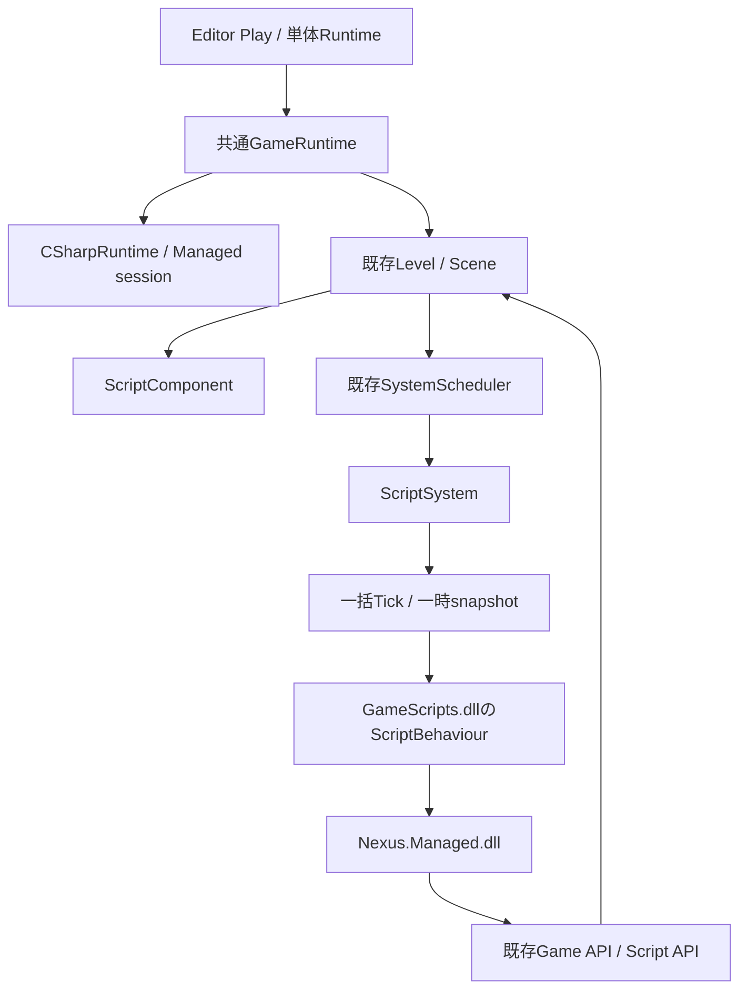

# Phase 4 — C# Gameplay / 既存ECS統合

この文書はPhase 4時点の記録。公開Property・安定ID・保存の追加は[Phase 5](ManagedReflectionREADME.md)を参照。
改訂仕様Phase 4の再利用範囲、World検証・登録解除・Component値取得の補完は[改訂版README](CSharpGameLogicREADME.md)を参照。

ScriptBehaviourを既存Entity / Component / Level / SystemSchedulerへ接続した。
今回ビルド、Reflection生成器、Game / Editor / Launcher、dotnet / CLI、テストは実行していない。
以下は実装と静的調査の記録であり、コンパイルや実動作を確認したという記録ではない。

## 調査結果

| 領域 | 既存構造と採用した接続点 |
|---|---|
| World / ECS | LevelがSceneを唯一所有し、EntityIdはindex + generation。Scriptも同じComponentStorageへ格納 |
| 更新順 | SystemSchedulerのSimulation → Transform。既存Animation / Game Systemの後、Transform計算より前へScriptSystemを追加 |
| Entity操作 | GameApiBridge / NexusGameApiV1の生成・破棄・列挙・Local Transform一括転送を再利用 |
| Managed Hosting | CSharpRuntime / NativeManagedBridge / DotNetHostを拡張し、Phase 3のStart / Stop V1は維持 |
| Editor Play | EditorSessionは編集Sceneを複製してGameRuntimeへ渡す。C#専用WorldやEditor sessionは作らない |
| Reflection / 保存 | NEXUS_REFLECT_COMPONENT → 既存生成器 → ComponentReflection / TypeRegistry → LevelDocument / LevelSerializer |
| Details | Native ScriptComponentの型名・enabledは既存Drawerで編集する。Managed公開PropertyはPhase 5 |
| Build | Phase 3のUtilityとHosting targets、ProjectBuildの配置・stamp照合へGameScriptsを追加 |
| Asset / Renderer | 既存Level内のCube / Camera / Skyを使用。C#専用Asset ManagerやRendererを追加しない |
| IPC / Live++ | 既存通信とNativeパッチを再利用する前提を維持し、Managed Reload処理は追加しない |

依存解決は[Microsoftのplugin実装例](https://learn.microsoft.com/en-us/dotnet/core/tutorials/creating-app-with-plugin-support)を確認し、
GameScriptsと安定APIの型同一性を保つAssemblyLoadContext / AssemblyDependencyResolverを使用した。
Interopは[UnmanagedCallersOnlyのblittable制約](https://learn.microsoft.com/en-us/dotnet/api/system.runtime.interopservices.unmanagedcallersonlyattribute?view=net-10.0)に従う。

## 設計判断と依存関係



Native側はScriptComponentの型名・有効状態と実行Handleを持ち、Managed側はbehaviourのobjectと
lifecycle状態だけを所有する。Managedのinstance辞書はECSではなく、WorldのEntity / Componentを複製しない。
ScriptComponentは現段階ではEntityあたり一つ。既存の他Componentと同じStorage・保存経路を使う。
ゲーム側GameScriptsはNexus.Managedだけを参照し、Bootstrap、Engine内部、Renderer、ImGuiへ依存しない。

ScriptSystemはScene反復中にcallbackを呼ばず、型名等をNative所有snapshotへコピーする。
一回のTickで全Scriptを同期・更新した後、Entity世代・関連付けtoken・型名を再照合してinstance IDを確定する。
callbackでComponent削除・再追加やEntity slot再利用があっても、古いComponent参照へ書き込まない。
World交換・Unloadが検出された場合も旧SceneをdereferenceせずRuntimeを停止する。

## Handle / ownership / thread

| 値・所有物 | 契約 |
|---|---|
| EntityHandle | Phase 2と同じWorld token + index / generation。ManagedはNativeポインタを保持しない |
| ScriptInstanceHandle | Managed session内で再利用しないuint64 ID。GCHandleではなく、保存・別Worldへの転用をしない |
| attachment | ScriptComponentの関連付けの寿命token。同じEntityへの削除・再追加を区別する |
| ScriptComponent | 既存Scene所有。永続項目はscriptType / enabled。instance / attachmentは実行時のみ |
| ScriptSystem | LevelのScheduler所有。Bridgeを借用し、CSharpRuntime停止時に先にDetach・登録解除する |
| ScriptBehaviour | Managed ScriptRuntime所有。Native WorldやComponentは所有しない |
| Entity wrapper | 数値Handleと失効可能なGameWorld capabilityだけを保持する参照型。Transformは値コピー |
| GameWorld | 関数表とWorld tokenを保持し、Stopで失効。user static等にwrapperが残っても旧Worldへ到達させない |
| snapshot | Interop呼出し中だけ借用。Managed側は型名をコピーし、bufferアドレスを保存しない |
| thread | Native lifecycleとScript APIは開始threadのみ。Managed wrapperとNative API、ScriptSystemが検証する |
| 自前worker等 | Engine APIを他threadから呼ばない。event / worker等はOnDestroyで解除・停止する。自動追跡は未対応 |

EntityのIsAlive、HasTransform、HasScript、Transform取得・更新、Destroy、SetScript、RemoveScript、ScriptEnabledと、
WorldのCreateEntity、Entities、Logを提供する。TransformはLocal値40 byteを一括転送し、Matrix計算は既存Systemへ委譲する。
Entity.SetScript<T>は現在の関連付けを置換する明示操作で、新しい関連付けは次の同期で生成する。
他の任意Component、Asset、Input / Audio / PhysicsのManaged APIは今回追加していない。

## lifecycleと更新順

| タイミング | 処理 |
|---|---|
| 開始 | Levelロード / Play複製 → 既存Setup → Hosting開始 → GameScriptsロード → ScriptSystem登録 |
| 初期同期 | 型の解決・public parameterless constructor → EntityをBind → OnCreate → enabledならOnEnable |
| 初期描画前 | OnUpdate(0)を余分に呼ばず、既存TransformSystemで初期Matrixを確定 |
| frame | 既存Simulation → ScriptSystemのsnapshot同期 / OnUpdate → 既存Transform段階 → 描画抽出 |
| Pause | Level / Scriptの両方を更新しない |
| 無効化 | activeだったScriptへOnDisable。無効状態でも初回OnCreateは実行する |
| 有効化 | faultのないScriptへOnEnable、そのframeの更新対象にする |
| 解除・置換・破棄 | activeならOnDisable → OnDestroy → Unbind / 参照解除 |
| Runtime停止 | ScriptSystemをDetach・登録解除 → 全behaviour停止・参照解除 → Host参照解放 → World token失効 → Level破棄 |

初期化時の型不明・constructor / OnCreate / OnEnable失敗は開始エラーとして実行Worldを破棄し、編集Worldを保持する。
更新中のユーザー例外は該当instanceをfault状態へ移し、OnDisableとLogger診断を行って他のScriptを継続する。
fault状態はenabledの再切替だけでは解除せず、関連付けの置換・再追加または次のPlayで新しいinstanceを作る。
Native / Managed境界やWorld同期自体が失敗した場合はRuntimeを停止する。

自己破棄後のOnDestroyではNative Entityがすでに無効な場合がある。IsAliveを確認し、破棄済みTransformを参照しない。
callbackによる他のEntityの有効状態変更は後続の照合または次frameで反映する。
新規EntityへのScript追加は次のsnapshotで初めて実行し、同じsnapshot内で再帰的に生成し続けない。
callback内から要求されたRuntime StopはSystemSchedulerとManagedのstackが戻るまで遅延する。
Start中なら公開前に開始を中止し、OnDestroy中の再入Stopは無視する。

## 共通Reflection / Serialization

ScriptComponentのNEXUS_REFLECT_COMPONENT宣言にはscriptType / enabledだけを列挙した。
既存のComponentReflection・TypeRegistry・PropertyEditService・DetailsPanel・Level保存を利用し、
C#専用InspectorやLevel形式は作らない。instance IDとattachment tokenは保存せず、Clone後の実行開始でもリセットする。
現在のscriptTypeはGameScripts内のFullName（例：Game.PlayerController）。
Managed公開Property、Expose属性、安定Script Type / Property IDやrename AliasはPhase 5へ残す。

生成済みReflectionファイルは手編集・再生成していない。ユーザーの通常Engine Buildで既存のReflection targetが
ScriptComponentを検出・登録する。新テンプレートを生成するProjectTool / Runtimeも更新したEngineで用意する必要がある。
ScriptComponentを含むLevelをBootstrapだけ・C++だけの実行Backendで黙って再生することは拒否する。

## AssemblyとBuild構成

- Nexus.Managed：安定API。Entity / GameWorld / LocalTransform / ScriptBehaviourとInterop値を定義する。
- Nexus.Managed.Bootstrap：公式Hostingから呼ばれ、sessionとbehaviour objectを管理する。
- GameScripts：ゲームProjectのC#コード。安定APIだけを参照する。

Phase 3のStart / Stop ABI V1を維持し、Gameplay専用のStartGameplay V2と一括Tickを追加した。
V2 contextは136 byte、Script APIは40 byte、bindingは56 byte。Native static_assertとManaged entryのsizeofで照合する。
GameScriptsのAssemblyLoadContextはNexus.ManagedだけをBootstrapと共有し、同名の別API型を複製しない。
Phase 4は非collectible contextをAssemblyパス単位でProcess内再利用する。Worldやbehaviourはcacheしない。
コード変更の反映にはホスト再起動が必要で、StopをAssembly Unload成功とは扱わない。

Project BrowserのManaged Gameplay (C#)、またはtemplate-id managed-gameplayを選択する。

```text
Source/Game/PlayerController.cs       # ユーザーのゲームコード
Source/Host/Main.cpp                  # 配置だけを共通Runtimeへ渡す
GameScripts.csproj                   # Nexus.Managed.dllのみを参照
ManagedBootstrap.vcxproj             # 両ホストが共有するBuild Utility
GameRuntime.vcxproj / GameEditor.vcxproj / Game.slnx
Levels/Startup.level                 # 既存Cube + ScriptComponent
Build/Bin/x64/<Configuration>/Managed/
  Nexus.Managed.dll
  Nexus.Managed.Bootstrap.dll / runtimeconfig.json / deps.json
  GameScripts.dll / GameScripts.deps.json
```

実際のBootstrap runtimeconfig / depsのファイル名はassembly名と同じprefixを持つ。
.NET 10 SDK / Runtimeと明示win-x64 Host Pack指定はPhase 3と同じ。
UtilityがBootstrap / APIを準備してからGameScriptsをBuildし、APIをGameScripts出力で上書きしない。
Managed/Directory.Build.propsはRestoreとBuildの両方でProject別中間Directoryを設定し、SDKのSourceを汚さない。
SolutionのBuildはUtilityで直列化し、GameScripts.csprojは直接IDEで開ける形で生成する。
SolutionへのC# Project表示やOpen IDE操作の完成はPhase 8へ残し、同時の二重Buildを避ける。

Build stampは新構成では安定APIを含むBootstrap一式5ファイルとGameScripts DLL / depsを照合する。
安定APIを持たない旧Phase 3 SDKの4ファイルstampは、Bootstrapのみの構成として引き続き受け入れる。
SDK収集には追加API / Bootstrap Source / props / targetsを加えたが、今回BuildやSDK発行は行っていない。

## 変更ファイル

| ファイル | Phase 4の変更 |
|---|---|
| Runtime/Scene/Components/ScriptComponent.h | 共通ECS Component、永続型情報と実行Handle |
| Public/Nexus/ScriptApi.h | Component設定・解除・有効状態・関連付けtokenのC ABI |
| Public/Nexus/ManagedBootstrap.h | V1維持、Gameplay context V2とTick |
| Runtime/Gameplay/GameApiBridge.h / .cpp | 同じSceneのScriptComponent操作を公開 |
| Runtime/Scripting/ScriptSystem.h / .cpp | 既存Schedulerに一括同期・更新を統合 |
| Runtime/Scripting/NativeManagedBridge.h / .cpp | StartGameplay / Tickの解決とthread検証 |
| Runtime/Scripting/CSharpRuntime.h / .cpp / CSharpRuntimeSettings.h | GameScripts配置、System登録とDetach順序 |
| Runtime/Application/GameRuntime.h / .cpp | Backend検証、callback内Stopの遅延と再入拒否 |
| Managed/Nexus.Managed/Nexus.Managed.csproj | 安定API assembly |
| Managed/Nexus.Managed/Interop.cs | Native ABIと対応するPODとBootstrap用friend宣言 |
| Managed/Nexus.Managed/Entity.cs / GameWorld.cs | 世代・thread・World寿命を検証する公開API |
| Managed/Nexus.Managed/ScriptBehaviour.cs | 5つのlifecycleとBind / Unbind |
| Managed/Nexus.Managed.Bootstrap/GameplayEntryPoints.cs | Gameplay V2と一括Tickの例外境界 |
| Managed/Nexus.Managed.Bootstrap/ScriptRuntime.cs | instance所有、同期・fault隔離・lifecycle |
| Managed/Nexus.Managed.Bootstrap/GameScriptCatalog.cs | 安定API共有とGame assembly解決 |
| Managed/Nexus.Managed.Bootstrap/EntryPoints.cs / .csproj | V1互換とGameplay参照解放、安定API参照 |
| Managed/Directory.Build.props | Project別の中間配置 |
| Build/Nexus.ManagedBootstrap.targets / Nexus.ManagedGameplay.targets | Bootstrap → API → GameScriptsの準備 |
| Build/NexusRuntime.vcxproj / NexusEngine.vcxproj / Tests/NexusEditorTests.vcxproj | ScriptSystemのコンパイル対象 |
| Core/Hosting/ProjectHost.inl | GameScripts配置を設定へ転送 |
| Tools/Project/ProjectTemplates.cpp | csprojにも既存のXML / MSBuild literal escapingを適用 |
| Templates/managed-gameplay.nxtemplate | Gameplayテンプレート登録 |
| Templates/ManagedGameplay/Host.cpp.in / ManagedBootstrap.vcxproj.in | ホスト結合点と共通Utility |
| Templates/ManagedGameplay/GameScripts.csproj.in / PlayerController.cs.in | ゲームProjectと最小サンプル |
| Templates/ManagedGameplay/Startup.level / BuildTargets.json.in / README.md.in | 共通Level、配置契約、生成Projectの説明 |
| Tools/Project/ProjectBuild.h / .cpp | GameScriptsと安定APIのstamp照合 |
| Tools/Project/Build-Game.ps1 / Write-GameBuildStamp.ps1 | Backend検証と追加成果物の記録 |
| Tools/Engine/Publish-Engine.ps1 | 安定APIと追加Bootstrap Source / targetsの収集 |
| Launcher/LauncherApplication.cpp / Launcher/Standalone/Program.cs | テンプレート選択と対応範囲 |
| Tests/NativeGameModuleTests.cpp | 関連付けtokenと有効状態のNative回帰ケース |
| Tests/ManagedGameplayTests.cpp / Build/NexusManagedGameplayTests.vcxproj | 明示実行用Gameplay統合テスト |
| Tests/Fixtures/ManagedGameplay/GameScripts.csproj / Behaviours.cs | lifecycle、自己破棄、生成、fault、停止要求のケース |
| README.md / Docs/CppCSharpREADME.md / CSharpRuntimeREADME.md / GameRuntime.md / 本README | 進捗・設計・制限 |

## 静的確認と確認限界

include / namespace / symbolはNative / Managedの宣言、entry名、ABI配列、ScriptSystemの全コンパイル元を照合した。
ownership / lifecycleはECS反復後のcallback、再追加token、World交換検出、Sceneより先のDetach、Stop再入・frame遅延を確認した。
API consistencyはPhase 3 V1維持、V2 / Script表のLayout、GameScripts配置と安定APIの型共有を確認した。
XML、PowerShell Parser、10ファイルのテンプレート参照・置換（ampersandを含むSource配置）、Reflection markerと保存項目、diff空白を静的に確認した。

テストはソースを追加した段階で未実行。既存Nativeテストには.NET不要の関連付け確認だけを追加した。
別ProjectのNexusManagedGameplayTestsには、lifecycle、初期OnUpdateなし、Transform順序、Pause、有効切替、
Component再追加、自己破棄、次frame生成、fault隔離、Stop遅延、編集World分離、共通Serializationを用意した。
実際のコンパイル・リンク、Reflection生成、assemblyロード、callback呼出し、保存・復元の成功はユーザーの確認待ち。

## 未対応

Phase 5のManaged公開Property / metadata / 安定ID / Alias / 保存、Phase 6の再コンパイルとcollectible ALCのUnload確認、
Phase 7のNative / Managed Module同時実行、Phase 8のIDE / Package統合は未対応。
Managedの任意Component API、Assetロード、Input / Audio / Physicsも今後の公開API拡張が必要であり、
今回の最小Entity / Transform / Script統合でC#の全ゲーム制作APIが完成したとは扱わない。
