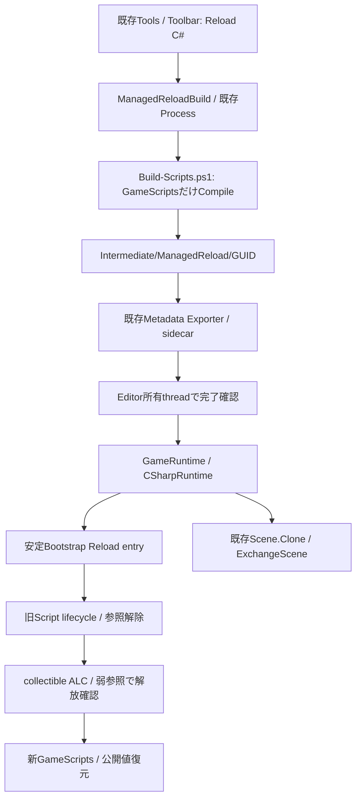

# Phase 6 — Managed Hot Reload

後続の[統合監査・Runtime Lifecycle](IntegrationAuditREADME.md)でPrepare取消とCommit後のAbortを分離した。Clone失敗時は現行Behaviourを維持し、再接続失敗時は停止状態を保持する。新世代の確定とNativeサービスの再開を確認してから成功を通知する。変更したEngine / Bootstrapは通常Buildで揃える。ビルド・実機動作は未検証。
障害による停止とユーザーPauseは区別する。復旧に成功すると障害停止は解除するが、明示されたPauseは維持する。quarantineはReloadによる復旧対象にせず、Host再起動を要求する。

cleanupの成功もGC解放とは別に確認する。Lifetime取消、OnDisable、OnDestroy、TrackResourceのDispose、World capability解除、ALCのUnloading callbackに失敗したSessionは、残りの解除・Unload確認を続けても成功へ戻さない。通常Tick中の解除失敗はRuntimeの停止経路へ返し、Reload中はWorldを保持した停止状態でHost再起動を要求する。Preflight候補の解除失敗も同じ契約に従い、単なる互換性エラーとして旧世代を再開しない。保持する診断は文字列とboolに限定し、例外objectで旧Assemblyをrootさせない。[統合監査・第6回](IntegrationAuditREADME.md)に変更範囲を記録した。

これは旧仕様の実装記録。改訂仕様の[Phase 7-A](HotReloadCoordinationREADME.md)では、Compile監視と適用をToolbar描画からPrepareFrameへ移し、Backend別の結果通知と失敗後の実行停止を補完している。

この文書はPhase 6時点の記録。Hybrid時のNative状態保護と共通servicesは[Phase 7](HybridGameplayREADME.md)を参照。

GameScriptsだけを再Compileし、既存Worldと公開Property値を引き継いで新世代へ交換する。
ビルド、Game / Editor / Launcher、dotnet、Reflection生成、テストは実行していない。
以下はソース変更と静的確認の記録であり、コンパイル・実動作の確認結果ではない。

## 調査結果

| 既存構造・関連クラス | 確認結果・再利用 |
|---|---|
| GameScriptCatalog | Process staticの非collectible Assembly cacheがUnloadを妨げるため、世代所有へ変更 |
| DotNetHost / NativeManagedBridge / CSharpRuntime | 公式Hostingと安定BootstrapはProcess寿命のまま、追加entryでReloadを実行 |
| GameRuntime / ScriptSystem / GameApiBridge | frame境界、Stop再入の遅延、数値World / Entity / attachmentを再利用 |
| ScriptMetadata / ScriptComponent.propertyState | 固定ID・Alias・kind別の公開値snapshotと復元を再利用 |
| Scene.Clone / Level.ExchangeScene | 新OnCreateの失敗からEntity / Componentを保護するtransactionに利用 |
| EditorSession / EditorWorkspace / TypeRegistry | 編集Worldを維持し、共通Details用のCPU Metadataだけを差替え |
| PropertyEditService / EditorHistory | schema交換前に旧PropertyHandle履歴を解除し、未保存状態は保持 |
| Process / ProjectBuild / EngineInstallation | 選択Engine・引数分離・非表示process・Job・終了code・ログの既存基盤を再利用 |
| EditorCommandRegistry / Toolbar / MainMenuBar | 同じReload C# commandをToolsとToolbarから実行 |
| ProjectHost / Modules / BuildTargets / SDK配布 | 既存managed-gameplayホストだけへ操作を接続。Project言語やLevel形式は変更しない |
| Logger / Console / Live++ / IPC | 共通ログへ診断。Live++や既存Native通信へManaged Reloadを転送しない |

## 設計判断・依存方向



RuntimeはCompileやEditorを参照しない。外部で準備された絶対Assemblyパスを受け取るだけ。
EditorはCompile processとCPU Metadataを所有し、CLR / Assembly / behaviourを所有しない。
GameScriptsは安定APIのNexus.Managedだけに依存する。Bootstrapと安定API自体はReloadしない。

Game依存も公式AssemblyDependencyResolverで同じcollectible世代へロードする。
安定APIだけをBootstrapと共有し、BootstrapへのGame側参照は拒否する。
公式の[Unloadability手順](https://learn.microsoft.com/en-us/dotnet/standard/assembly/unloadability)に従い、
NoInlining helper内で強参照を解除した後、別stackでWeakReferenceとGCによる完了確認を行う。
Unloadの呼出しだけでは成功と判定しない。

## Compileと成果物

最初の通常ホストBuildで、安定API / Bootstrap / Metadata Toolを準備する。
Metadata Toolの配置をホスト隣接`ManagedTools/`へ変更したため、今回の変更を使用する最初のBuild後はホストを再起動する。

Reload C#はGameScripts.csprojだけをCompileし、通常DLL、ホスト、Bootstrap、安定API、nxbuild stampを上書きしない。
現在のmanaged-gameplayテンプレートと同じProject RootのGameScripts.csprojを対象にする。

```text
Game/
  GameScripts.csproj
  Source/Game/
  Intermediate/ManagedReload/<GUID>/
    compile.log
    obj/
    Managed/
      GameScripts.dll
      GameScripts.deps.json
      GameScripts.metadata.json
```

Processは既存のUnicode argv分離・非表示起動・ownTreeを使う。10分でCompileを中止し、Workspace破棄時も
自分が開始したCompileだけを終了する。Compile中のゲーム更新は継続する。
非ゼロ終了、Metadata生成失敗、Play停止・再Playを挟んだ結果は適用せず、旧Assemblyを維持する。
ログは世代別compile.logと既存Console / 通知から確認する。

ロード時は依存物もProcess / GUID単位の専用shadowへコピーし、実行中DLLとCompile先を分離する。
reparse pointを辿らず、4096ファイル・512 MiBで制限する。解放済みshadowだけを所有パス確認後に掃除する。
解放未確認・ロード途中失敗のshadowやCompile成果物は診断用に残る場合があり、実行中に強制削除しない。

## Reload flow・ライフサイクル

1. **Compile成功**：新DLLとMetadataが揃った場合だけ所有threadへ戻す。
2. **候補Registry検証**：Native型を含む既存Registryのコピー上で旧Managed型を除き、新Metadataの衝突を検査する。
3. **State Snapshot**：公開値を既存ScriptComponentへ確定する。getter実行中のWorld書込は禁止する。
4. **Preflight**：別collectible contextで型ID、constructor、保存値のsetter適用を検証する。WorldにはBindしない。
5. **Preflight解放確認**：検証用object / Type / PropertyInfoをhelperから落とし、弱参照が消えることを確認する。
6. **Scene transaction開始**：既存SceneのCloneへ切り替え、元Sceneを保持する。Level、Asset、World tokenは維持する。
7. **旧lifecycle停止**：Lifetime cancel → OnDisable → OnDestroy → TrackResourceのDispose → Unbind。
8. **旧参照解除**：Runtime / behaviour / metadata / Catalog / World capabilityを解除し、旧ALCへUnloadを要求する。
9. **旧Unload確認**：有限回のGC後も弱参照が生存する場合、新世代を開始せず失敗とする。
10. **新Assemblyロード**：検証済みshadowの内容から新collectible世代を作る。
11. **再生成・復元**：公開値をBind / OnCreate前に適用し、OnCreate → OnEnableを実行する。OnUpdate(0)は呼ばない。
12. **Commit**：初期化とTransform確定が成功した場合だけ元Sceneを解放し、新Metadataを共通Detailsへ反映する。

旧世代のcleanupではEntity / Transform / Script関連付けへの書込を禁止する。
購読解除やworker終了処理に限定し、Reloadを理由にEntityを作り直さない。
新OnCreateは通常通りWorldを操作できるが、失敗時はCloneを破棄して元Sceneを復元する。
ファイル・ネットワーク・外部static event等の副作用はScene transactionの対象外なので、lifecycle側で解除を完了する。

成功後の次Playも、このEditorセッションで選択した新Assemblyを使用する。
通常起動用成果物は変更しないため、Editor再起動・配布前には通常のホストBuildで成果物を更新する。
NativeのSceneポインタを保持する拡張はScene交換後に再解決する。Managed wrapperは数値Handleだけなので転用できる。

## 失敗時の扱い

| 失敗箇所 | 結果 |
|---|---|
| Compile / Metadata / Registry衝突 | 旧Assembly・現在のWorldで継続 |
| Preflight / 検証context解放 | 旧Assemblyで継続。残存contextがあれば次Reloadを拒否 |
| 旧Unload未完了 | 元Sceneを復元し、ScriptをSuspend / Pause。新Assemblyを開始しない |
| Unloading callbackの例外 | 例外を文字列に変換して強参照を残さず、解放成功とは扱わない。Process再起動が必要 |
| 新ロード / OnCreate / Transform初期化 | 失敗世代を停止し元Sceneを復元。ScriptをSuspend / Pause |
| Suspend後の通常Update / Resume要求 | Worldを破棄せず停止状態を維持 |
| 修正後のReload再試行 | 残存contextの解放が確認できれば再生成可能。Pause解除はユーザー操作 |
| 通常Stopでの解放失敗 | 既存Quarantine経路で同じRuntimeの再Playを拒否し、Process再起動を要求 |

既にUnloadを要求した旧ALCをそのまま再開したとは扱わない。
初期化後の失敗で旧ゲームコードまで自動復帰する処理は追加せず、Worldを保持して修正・再試行できる状態にする。
Reload中のStop要求は既存GameRuntimeの再入防止を使い、Managed stackとScene transactionが戻るまで遅延する。

## 参照・Handle・threadの監査

| 対象 | 対策・契約 |
|---|---|
| Assembly / Type / PropertyInfo | 世代所有。static Assembly cacheを削除し、Runtimeごと破棄 |
| static | Game世代内の値は新世代で初期化。安定Assembly等から旧objectをrootさせない |
| event / delegate | OnDestroyまたはTrackResourceで解除。解除忘れは弱参照解放失敗として検出 |
| GCHandle | EngineはGame objectのGCHandleを作らない。ゲームが作る場合は停止前にFreeが必要 |
| Thread / Task | Lifetimeでcancel通知。OnDestroyで終了を待つ。協調停止なしの強制abortはしない |
| native / managed callback | Engineが保持するのは安定Bootstrap entryだけ。Game世代の直接関数ポインタ登録APIは提供しない |
| 任意P/Invoke側の登録 | 生ポインタはGCRootではなく弱参照では安全性を保証できない。外部登録側が停止前に解除する責任を持つ |
| Native-held reference | 数値session ID、World / Entity / attachment、呼出中のbufferだけ。Game delegate / object / GCHandleを保持しない |
| 旧World wrapper | 世代終了でInvalidateし、外部に残ってもNative APIを操作させない |
| ScriptInstanceHandle | 同じsessionの次IDを新Runtimeへ引き継ぎ、旧数値IDを再利用しない |
| EntityHandle | 既存World token・index / generationを維持。attachmentを検証して旧instanceの書戻しを防ぐ |
| thread | Compileは子process、ReloadとECS・lifecycle・Registry差替えは所有threadのframe境界のみ |

公開値だけを復元し、private値・Game static・Task・delegateは復元しない。
型変更・rename時はPhase 5のkind別保持・固定ID / Aliasを使い、任意のmigrationは行わない。
新規テンプレートとEntity.SetScriptは固定ScriptType IDを優先する。既存LevelでscriptTypeに旧FullNameが
保存されている場合は、そのFullNameもAliasesへ残す。既存Levelの型名を暗黙に書き換えない。
Metadata差替えでは旧PropertyHandle履歴を解除する。編集Levelの値・未保存状態は維持し、C#用Inspectorは追加しない。
GC確認はProcess全体に停止時間を生じ得る。終了しないfinalizerや非協調workerを安全に強制停止する機能ではない。

## 変更ファイル

| ファイル | 変更内容 |
|---|---|
| Managed/Nexus.Managed.Bootstrap/GameScriptCatalog.cs | 世代所有・shadow copy・collectible ALC・弱参照・所有shadow掃除 |
| Managed/Nexus.Managed.Bootstrap/ReloadEntryPoints.cs | Prepare / Commit / Abort / Complete、Preflight、強参照解除・解放確認 |
| Managed/Nexus.Managed.Bootstrap/EntryPoints.cs / GameplayEntryPoints.cs / .csproj | session所有権、世代ID、通常StopでのUnload、追加Source登録 |
| Managed/Nexus.Managed.Bootstrap/ScriptRuntime.cs | 公開値snapshot、ID継続、cancel・resource解除とmetadata参照解除 |
| Managed/Nexus.Managed/ScriptBehaviour.cs / GameWorld.cs | Lifetime / TrackResource、旧capability失効、cleanup中のWorld書込禁止 |
| Managed/Nexus.Managed/Entity.cs | SetScriptで固定ScriptType IDを優先し、class renameへの依存を減らす |
| Managed/Nexus.Managed/ScriptMetadata.cs | Exporterの既定値用objectもresourceを解除してから解放 |
| Managed/Nexus.Managed.Metadata/Program.cs | 世代Catalog対応、NoInliningでExporter解放確認 |
| Public/Nexus/ManagedBootstrap.h | 旧Layoutを変更しないReload entryの関数型 |
| Runtime/Scripting/NativeManagedBridge.h / .cpp | Reload解決・段階呼出し・Suspend状態 |
| Runtime/Scripting/CSharpRuntime.h / .cpp / CSharpRuntimeSettings.h | Scene transaction、初期化・復元・停止順序、配置コメント |
| Runtime/Scripting/ScriptSystem.h / .cpp | Scene交換後の再接続と実行Handle再構築 |
| Runtime/Gameplay/GameApiBridge.h / .cpp | 所有threadのReload transactionでWorld接続を再確定 |
| Runtime/Application/GameRuntime.h / .cpp | frame境界、Stop遅延、Suspend中のWorld保持、新Assembly選択の継続 |
| Runtime/Reflection/TypeRegistry.h / ManagedScriptMetadata.h / .cpp | Catalog所有型だけを候補Registryから解除 |
| Editor/Core/EditorSession.h / .cpp | Reload委譲、CPU Metadata差替え、CompileのPlay世代照合 |
| Editor/Core/EditorWorkspace.h / .cpp | Registry候補検証・共通Details更新、履歴解除、Suspend中のResume抑止 |
| Editor/Services/ManagedReloadCommands.h / .cpp | 既存Processを使う非同期Compile、完了照合、共通Tools / Toolbar操作 |
| Core/Hosting/ProjectHost.inl | Managed Gameplayホストに選択Engineと設定を接続 |
| Tools/Project/Build-Scripts.ps1 | 別世代出力へのGameScripts専用Compile・Metadata生成 |
| Build/Nexus.ManagedGameplay.targets | Metadata ToolをManagedToolsへ準備 |
| Build/NexusEditorSupport.vcxproj / NexusEngine.vcxproj | 新Editor Sourceを両コンパイル先へ登録 |
| Tools/Engine/Publish-Engine.ps1 | Reload entry SourceとBuild-ScriptsのSDK配布 |
| Tests/Fixtures/ManagedGameplay/Behaviours.cs / Fixtures/ManagedReload/GameScripts.csproj | 別コード世代、初期化失敗、worker / GCHandle残存のfixture |
| Tests/ManagedGameplayTests.cpp / Build/NexusManagedGameplayTests.vcxproj | 再Reload、旧継続、状態保持、Scene復元、解放失敗・再試行の明示実行用ケース |
| Templates/ManagedGameplay/README.md.in / Startup.level | 新規Projectの操作・lifecycle契約・固定型ID |
| README.md / Docs/ManagedReflectionREADME.md / 本README | Phase 6の進捗と制限 |

## 静的確認・未対応

Native / ManagedのReload entry名・引数順序・Cdecl・既存V1 / V2 / V3のLayout維持をソース上で照合した。
include / namespace / symbol、所有権、helperとGCの順序、Scene復元、API整合性、Source登録・SDK一覧を静的確認した。
XML構文・明示Compile参照先10ファイル、PowerShell Parser 2ファイル、Managed SDK配布一覧16ファイルを確認した。
Native include先4ファイル、テンプレートの固定IDとHost接続、新規Sourceの末尾空白・競合マーカー、git diff --checkも確認した。
テストSourceとfixtureのBuild定義を追加したが、ビルド・テスト・Reflection生成は実行していない。

今回の操作は同一ProcessのEditor Play向け。別window RuntimeへのIPC Reload転送、自動ファイル監視、
外部IDEとの統合、Compileキャンセル専用UI、成果物キャッシュ掃除UIは未対応。
Native / Managed Module同時実行はPhase 7、Package / 配布と統合Build操作はPhase 8。
