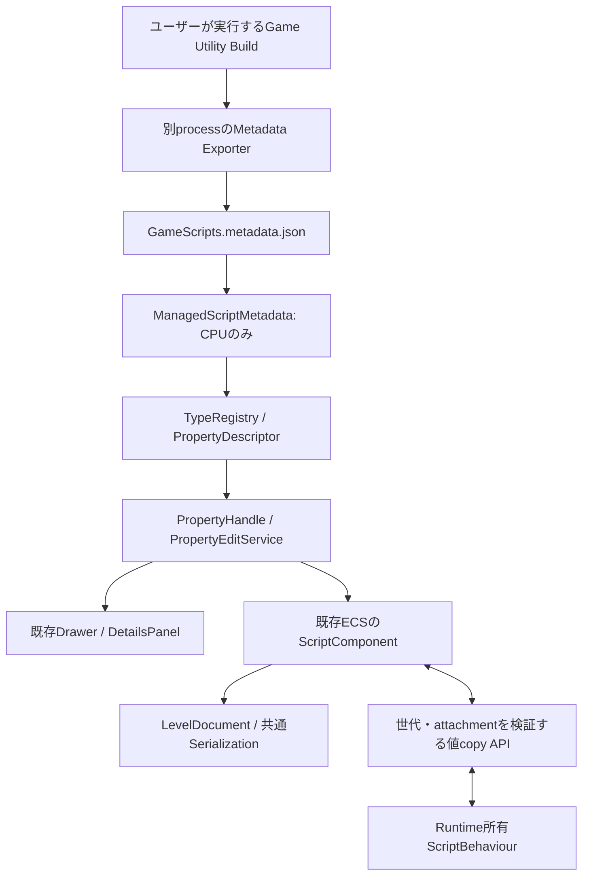

# Phase 5 — Managed Reflection / 共通Editor・Serialization

この文書はPhase 5時点の記録。Compile・Unload確認・Metadata差替えは[Phase 6](ManagedHotReloadREADME.md)を参照。
改訂仕様Phase 6の共通編集・保存の補完と保存Version保護は[Game Logic Reflection](GameLogicReflectionREADME.md)を参照。

[Phase 4](ManagedGameplayREADME.md)の共通Worldを維持し、C#の公開Propertyを既存Reflectionへ接続した。
ビルド、Game / Editor / Launcher、dotnet、テスト、Reflection生成器は実行していない。

## 調査結果

| 既存構造 | 再利用した責務 |
|---|---|
| ProjectDescriptor / ProjectTemplates / ProjectBuild | 言語中立のModule定義、managed-gameplay生成、配置・SHA256照合 |
| GameRuntime / CSharpRuntime / NativeManagedBridge | Playと単体起動のManaged所有権、ABI境界、所有thread |
| ScriptComponent / ScriptSystem / GameApiBridge | 同じECS、世代付きEntity、attachment、snapshot同期 |
| TypeRegistry / PropertyDescriptor / PropertyValue | UI非依存の型・値accessor |
| PropertyHandle / PropertyEditService / EditorHistory | 永続Entity IDによる解決、複数編集、Preview、Undo / Redo |
| PropertyDrawerRegistry / ReflectedPropertyEditor / DetailsPanel | 既存の型別DrawerとOtherカテゴリ、Component追加一覧 |
| EditorSession / EditorWorkspace | 編集Levelと値Metadata所有、Workspace初期型登録 |
| ComponentReflection / ReflectionValue / LevelDocument / LevelSerializer | 共通のClone、Level保存・復元、旧フィールドの既定値 |
| Logger / Console / Live++ / IPC | 診断経路を再利用。Managed用Inspector・通信・Native reload基盤は追加しない |
| Nexus.ManagedGameplay.targets / Publish-Engine.ps1 | 共通Utilityによる準備、SDK配布ファイル一覧 |

## 設計判断・依存関係



EditorはCLRもManaged objectも所有しない。ビルド時の別processでReflection情報と既定値を出力し、
EditorはJSONの値だけを読む。Runtimeは実際にロードしたAssemblyから同じ公開契約を生成する。
GameScriptsの参照先は安定APIのNexus.Managedだけで、Bootstrap、Renderer、ECS内部、Editorへ依存しない。
Native adapterはRuntime/Reflectionに配置し、ImGui / Editor / .NETへ依存させない。

Metadataは既存TypeRegistryへ`ManagedScript:<Script Type ID>`のTypeDescriptorとして登録する。
contains / get / setはその都度EntityからScriptComponentを解決し、ComponentやManaged objectのポインタをcacheしない。
既存Detailsの汎用カテゴリが登録済みPropertyを表示するため、C#専用Inspectorはない。
対応型はbool、int32、float、string、System.Numerics.Vector2 / 3 / 4。
static、indexer、非public accessor、init-only、null、未対応型、非有限数値を拒否する。
公開条件は[公式PropertyInfo API](https://learn.microsoft.com/en-us/dotnet/api/system.reflection.propertyinfo?view=net-10.0)のaccessorとindex引数で判定する。

```csharp
[ScriptType("game.player", Version = 1)]
public sealed class PlayerController : ScriptBehaviour
{
    [Expose(Id = "moveSpeed", Label = "Move Speed", Aliases = new[] { "speed" })]
    public float MoveSpeed { get; set; } = 5.0f;
}
```

Id未指定時はScriptのFullName、Property名を使用する。公開後のrenameには固定Idの維持かAliasesが必要。
FullNameも型の互換名なのでPhase 4のLevelを作り直す必要はない。ID / Aliasの重複は失敗として扱う。
Propertyはpublic get/setが必要で、fieldは対象外。constructor / getterはWorldに依存せず、副作用を持たせない。
既定値の取得ではExporterがparameterless constructorとgetterを呼び、BindやOnCreateは実行しない。

## 保存形式と互換性

ScriptComponentへ`propertyState`文字列を追加した。既存Reflectionのstring codecを使うため、
別Level形式やJSON用の新Serialization基盤は導入しない。旧Levelでは空文字列が既定値になる。
payloadは既存Inspector生成の型別公開方針で隠し、Metadata由来の型付きPropertyから編集する。

```json
{
  "schemaVersion": 1,
  "types": {
    "game.player": {
      "version": 1,
      "values": { "moveSpeed": { "Float": 5.0 } }
    }
  }
}
```

型ID・Property ID・kind別に値を保持する。型を切り替えても他の型のscopeを削除せず、
削除済みProperty・旧kind・旧Aliasレコードも残す。型が変わり現在kindの値がない場合は既定値を使い、
旧kindを自動変換しない。新ID、Aliasの順で探索し、新たな保存値は正規IDへ書く。
Versionは保存契約の識別情報であり、任意のmigrationコードや自動変換はまだ実装しない。
ScriptComponent自体を削除する操作では、そのComponentが所有する状態も削除される。

Metadataは1 MiB、状態は256 KiB、JSONの深さ・重複キー・ID・文字列・値型に上限と検証を設ける。
未知レコードの内容は保持するが、schema構造が不正なら編集・復元を失敗させる。
Editorのsetterは変更候補を検証してからComponentの文字列を置換する。
PropertyEditServiceの既存履歴はIDとPropertyValueだけを保持し、CLR寿命やComponent位置へ依存しない。

## ライフサイクル・境界

1. 共通UtilityでBootstrap / 安定API → GameScripts → Metadata Toolを準備し、別processでsidecarを生成する。
2. 全型・既定値の検証後にsidecarを置換する。失敗時はUtilityが失敗し、新しいBuild stampを作らない。
3. 起動時のProjectBuildはDLL / deps / Metadataの配置とSHA256を照合する。旧Gameplay成果物は再Buildが必要。
4. EditorSessionはsidecarだけをロードし、EditorWorkspaceは既存型登録後にadapterのDescriptorを登録する。
5. Playは既存Levelの複製を使用し、RuntimeがV3 entryでProperty copy APIを渡す。Editorの編集Worldは変更しない。
6. Runtimeは型IDを解決してobjectを作り、保存値をsetterへ適用してからBind → OnCreate → OnEnableを呼ぶ。
7. 初期同期と各Tick末に公開値をまとめてComponentへsnapshotする。PropertyごとのInteropは行わず、値不変時はwriteを省略する。
8. Getter / setter失敗は既存のbehaviour fault処理へ流し、初期復元失敗ではPlay開始をrollbackする。
9. 停止は既存のScriptSystem Detach → Managed lifecycle終了・参照解除 → Hosting参照解除を維持する。

Property APIはx64で24 byte、V3 contextは160 byte。V1 Bootstrap 24 byte、V2 Gameplay 136 byte、
既存Script API 40 byteのLayoutと旧entryは維持する。双方でsizeofを照合する。
readは必要byte数を返す二段階コピー、writeは呼出し中だけUTF-8を借用する。STL / Managed参照はABIを越えない。
World token、Entity index / generation、Script attachment、所有threadをNative側で再検証し、
旧instanceが削除・再追加後のComponentへ値を書き戻せないようにする。

## 変更ファイル

| ファイル | 変更内容 |
|---|---|
| Managed/Nexus.Managed/ExposeAttribute.cs | Expose、ScriptType、固定ID・Alias・Version |
| Managed/Nexus.Managed/ScriptMetadata.cs | 共通公開契約、値codec、Metadata出力、状態復元・snapshot |
| Managed/Nexus.Managed/Interop.cs / GameWorld.cs | friend、24 byte copy API、UTF-8 caller buffer |
| Managed/Nexus.Managed/Nexus.Managed.csproj | 追加Sourceの明示登録 |
| Managed/Nexus.Managed.Metadata/Nexus.Managed.Metadata.csproj / Program.cs | ビルド時Exporter、既存GameScriptCatalogのソース再利用 |
| Managed/Nexus.Managed.Bootstrap/GameplayEntryPoints.cs / ScriptRuntime.cs | V3、型ID解決、OnCreate前の復元、Tick末snapshot |
| Public/Nexus/ScriptPropertyApi.h / ManagedBootstrap.h | 公開C ABI、V1 / V2互換を維持したV3 |
| Runtime/Reflection/ManagedScriptMetadata.h / .cpp | sidecar読込、共通Descriptor、状態検証・値accessor |
| Runtime/Reflection/ReflectedInspector.h | 型側の明示方針で保存専用値をInspector生成対象から除外 |
| Runtime/Scene/Components/ScriptComponent.h | 共通Reflection保存用のpropertyState、範囲検証 |
| Runtime/Gameplay/GameApiBridge.h / .cpp | Entity世代・attachment・threadを検証するcopy API |
| Runtime/Scripting/NativeManagedBridge.h / .cpp / CSharpRuntime.cpp | V3開始entryの解決とcontext組立て |
| Editor/Core/EditorSession.h / .cpp / EditorWorkspace.cpp | CLR非依存Catalog所有と共通Reflection登録 |
| Build/Nexus.ManagedGameplay.targets | 既存Utility内のExporter準備・実行定義 |
| Build/NexusRuntime.vcxproj / NexusEngine.vcxproj / Tests/NexusEditorTests.vcxproj | adapter実装の全コンパイル先、テストSource登録 |
| Tools/Project/ProjectBuild.cpp / Write-GameBuildStamp.ps1 | sidecarをGameplay成果物のhash照合へ追加 |
| Tools/Engine/Publish-Engine.ps1 | 安定API追加Source、Metadata ToolのSDK配布 |
| Templates/ManagedGameplay/PlayerController.cs.in / README.md.in | MoveSpeed公開例と生成Projectの利用説明 |
| Tests/ManagedReflectionTests.cpp / GameRuntimeTests.cpp | CLR不要の共通履歴・保存・Alias・型変更保持・境界検証ケース |
| Tests/ManagedGameplayTests.cpp / Fixtures/ManagedGameplay/Behaviours.cs | OnCreate前の復元・snapshot・再生成ケース |
| README.md / Docs/ManagedGameplayREADME.md / 本README | Phase 5の進捗・設計・制限 |

## 静的確認

include / namespace / symbol、NativeとManagedのentry名・Layout、所有権、thread、attachment、
Bind前復元と既存終了順序、PropertyValueの型対応、全コンパイル先とSDK配布一覧をソース上で照合した。
XML構文・Compile参照先7ファイル、PowerShell Parser 2ファイル、Managed SDK配布一覧15ファイルを静的確認した。
git diff --checkに加えて、新規Phase 5ファイル9件の末尾空白・競合マーカーとadapterのinclude先も確認した。
回帰テストSourceは追加したが、テスト実行・ビルド・Reflection生成は行っていない。
実際のコンパイル、Details操作、保存・再Playはユーザーによる確認が必要。

## 未対応・次Phase

Phase 6のcollectible AssemblyLoadContext、Compile失敗時の旧Assembly維持、Unload確認と参照解放監査は未実装。
今回の保存値は再生成で復元可能だが、実行中のAssembly reload機能はまだ提供しない。
Metadata更新もBuild後のEditor再起動が必要で、TypeRegistryの動的差替えや履歴migrationは行わない。
enum、Quaternion、Asset / Entity参照、コレクション、カスタム型、Expose field、任意migrationは今後の拡張対象。
Native / Managed同時Module実行はPhase 7、IDE / Package統合はPhase 8。
既存Input / Audio / Physics / AssetのManaged公開APIも別途拡張が必要。
