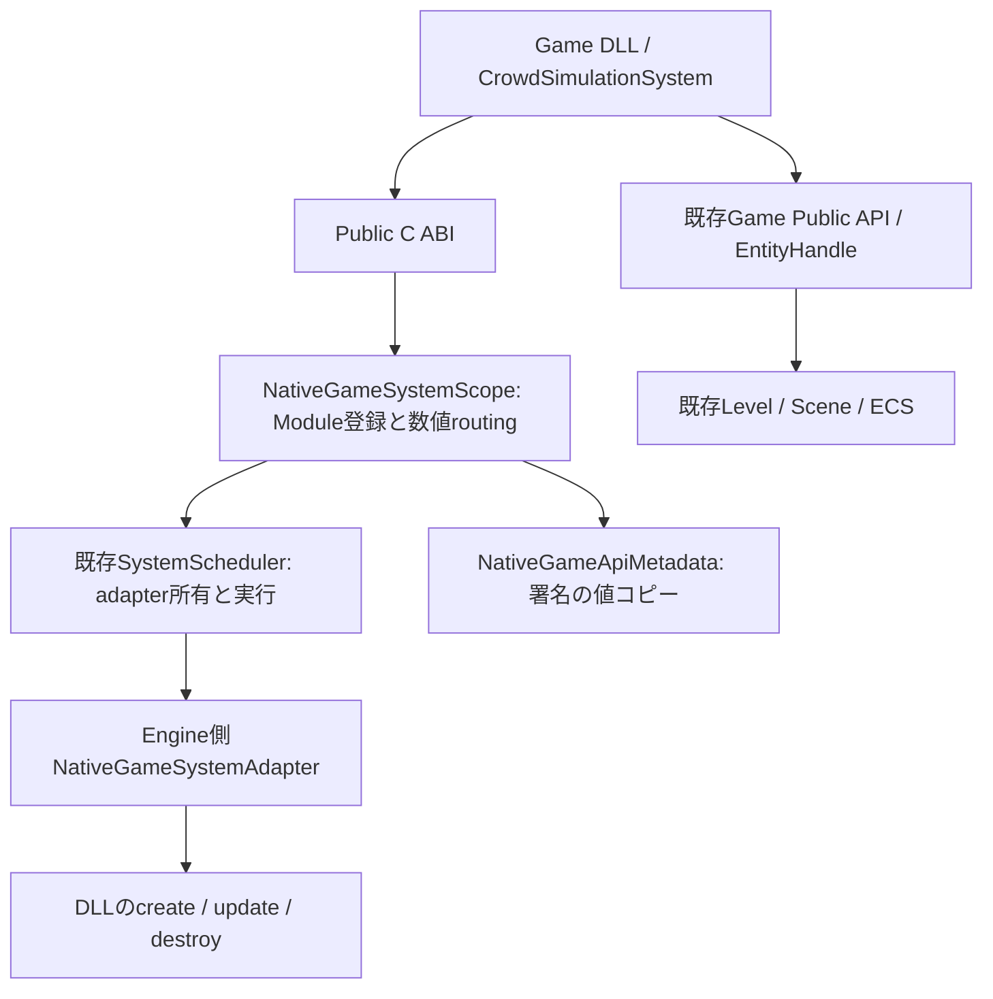

# Native Game System — 改訂仕様 Phase 3

この文書はPhase 3の設計記録。型付きManaged呼出しとV2登録exportの追加は[改訂仕様Phase 5](NativeManagedApiREADME.md)を参照。

Game Projectが所有するC++ Systemを、既存Level / ECS / SystemSchedulerへ登録する。
System登録と公開API契約の宣言を分け、後続Phase 5で必要になる型・Version・所有Module・登録世代を保持する。
旧仕様のPhase 3（.NET Hosting）とは別の実装単位であり、以前のManaged / Hybrid実装は維持する。

## 調査結果と再利用

| 既存機能・ファイル | 現在の責務と今回の扱い |
|---|---|
| ProjectDescriptor / ProjectSerializer / ProjectTemplates / LauncherApplication | 共通Project、Modules、初期言語、生成・起動。Project形式とUIは変更しない |
| GameModule.h / GameModuleLoader / GameRuntime | Native DLLの識別・create / update / destroy。任意exportを追加して既存起動順へ統合 |
| Level / Scene / EntityId / PersistentIdComponent | 共通World、Component格納、世代付きEntity、永続ID。二重実装しない |
| SystemScheduler / ISceneSystem | LevelがSystemを所有しphase順・同phase登録順で逐次実行。所有adapterの登録・解除を拡張 |
| TransformUpdateSystem / AnimationUpdateSystem / Game/SampleGame.cpp | Transform phase、Animation、既存ゲームSystem。既存登録を維持 |
| ComponentReflection / ReflectionRegistration | Component IDとnativeTypeの対応。read / write宣言の解決に再利用 |
| TypeRegistry / PropertyDescriptor / PropertyHandle / PropertyEditService / PropertyDrawerRegistry / DetailsPanel | Entity Propertyの編集・保存。関数署名のRegistryは未実装だったためSystem関数をPropertyに偽装しない |
| LevelDocument / LevelSerializer / ManagedScriptMetadata | 既存データ・Managed公開値の保存。今回のSystem stateはLevel保存対象に追加しない |
| GameApiBridge / GameServices.h | World・Thread・Entityの検証、既存byte-command / Event。System登録からEvent busや自動Bindingを作らない |
| AssetCatalog / ModelAssetLibrary | 既存Asset管理を維持。新しいAsset Managerは追加しない |
| LiveCodingAgent / LivePP.props / LivePP.UPSTREAM.md | 既存Live++統合。記録SDKは2.11.4。今回Native DLLのパッチ更新機能は追加しない |
| Foundation/IPC/RuntimeProtocol / EditorSession / Logger | Editorとの通信、Play制御、共通ログ。System objectをEditorへ渡さない |
| Nexus.GameModule.props / NativeModuleテンプレート | Publicヘッダーだけを参照する独立DLL。Engine libやECS内部へのリンクを増やさない |

`PropertiesPanel`という独立クラスは調査範囲で確認できず、不明。既存`DetailsPanel`と`Docs/PropertiesPanel.md`を確認した。
Input / Audio / PhysicsのGame Public APIは未実装。内部各Backendの網羅的な実装状況は今回の調査では不明であり、利用可能とは扱わない。
専用System Scheduler、System間の汎用DAG解析、関数Reflectionは従来未実装。

## 採用構造と依存関係

`NativeGameSystemScope`はModule単位の登録窓口・非所有追跡・失効を担当する。Systemを実行・所有する第二のManagerではない。
数値scopeのroutingはweak参照であり、呼出し中だけscope情報を保持する。routing lockを解放してからゲームcallbackを呼び、再入でdeadlockさせない。
SchedulerがEngine側adapterを所有し、adapterはDLL所有の不透明stateを借りる。DLL stateのnew / deleteは同じDLLで完結する。

DLLから`ISceneSystem`実体や`std::unique_ptr`を直接渡す案は、C++ vtable / RTTI / CRT / allocatorの依存をPublic ABIへ持ち込むため採用しない。
別System Managerを作る案は所有・実行順序を重複させるため採用しない。Engine内だけのadapterで既存Schedulerへ接続する。
Property用TypeRegistryへ関数を追加する案は既存の編集・Serialization責務を広げるため採用しない。
必要だった関数署名の値containerだけを`NativeGameApiMetadata`として追加し、Component型解決は既存Reflectionを使う。

Game DLLは`Public/Nexus`だけへ依存する。RuntimeはEditor / ImGui / CrowdSimulationSystemを参照しない。
Native Game Systemはゲーム固有処理であり、RendererやPhysics Backendを交換するNative Extensionとは契約を分ける。汎用Extension機構は追加しない。

## ABI・登録・取得

既存`NexusGameModuleV1`と`NexusGameApiV1`のレイアウトは変更しない。
任意のC export `NexusRegisterGameSystems(void* module, const NexusNativeSystemsRegistrationV1*)`を追加する。
exportのない旧DLLは従来経路でロードする。新exportのあるDLLは同じWorldを所有するLevelが必要。

Windows x64 / pack 8 / `__cdecl`。公開構造体には固定幅数値、借用文字列・配列、明示的関数表だけを渡す。
STL、C++参照、RTTI、例外、Engine allocatorを境界へ渡さない。callbackは例外を外へ出さない契約で、EngineもcatchしてFAILEDへ変換する。
破損pointerやアクセス違反の回復を保証するものではない。

| 構造体 | x64 byte数 | 内容 |
|---|---:|---|
| NexusNativeSystemContextV1 | 88 | 共通Game API、World、System世代 |
| NexusNativeSystemDescriptorV1 | 96 | ID、Version、after、read / write、DLL callback |
| NexusNativeSystemsApiV1 | 32 | add / find / access |
| NexusGameApiTypeV1 / NexusGameApiParameterV1 | 24 / 40 | 型と引数ID |
| NexusNativeFunctionDescriptorV1 | 64 | 関数ID、Version、引数・戻り値、Thread制約 |
| NexusNativeFunctionInfoV1 | 32 | 関数世代、System、署名の概要 |
| NexusNativeSystemPublicApiV1 | 24 | declareFunction / findFunction |
| NexusNativeSystemsRegistrationV1 | 72 | Module scopeと独立した二つの関数表 |

構造体サイズとVersionを検証する。IDは空でない128 byte以下のASCII（英数字と `._-:/`）。
文字列・配列は呼出し中だけ借用し、必要なID・署名はEngineへコピーする。
初期化時に最大64 System、Componentアクセスはread / write各32型、afterは64件まで。
afterは同じModuleで既に登録済みのSystemのみを許可し、前方参照・自己依存・循環を拒否する。
一般DAGのソートやModule間依存は実装しない。SystemはSimulation phase、同phaseは登録順、Transform phaseはその後。
既存Simulation Systemの前へ挿入する優先度指定は実装しない。

`systems.add`と`systems.find`は数値Handleを返す。取得後の操作は`systems.access`のNative callback中だけ実体を借用する。
System pointerをcallback外へ持ち出さず、Native内部型へのcastもゲームDLL内だけで行う。
scopeとHandleはProcess内で再利用しない世代値。別scopeのHandle、停止済みscope、異なるVersionは拒否する。
個別Systemの公開解除APIは用意せず、Module scopeのCloseでまとめて解除する。
Schedulerから登録adapterを外部で直接Removeしてはならない。解除は追跡情報を所有するscopeに任せる。

すべての登録・検索・借用・更新・終了はRuntime所有Thread上で行う。Worker Threadからの呼出しは拒否する。
Systemの借用・更新中に同じSystemへ再入する操作も拒否する。登録はexport完了時にSealし、以後のSystem追加・署名変更を拒否する。
Scheduler実行中の追加・解除は許可しない。read / writeは既存ComponentReflectionのIDから解決する診断Metadataである。
公開World APIはEntity構造変更も可能なため、adapterはアクセス範囲が限定されないことを明示し、型一覧だけで並列安全とは判断しない。
Queryの高速な内部Storageアクセスは今回公開せず、既存Entity列挙と値APIを利用する。

## 公開APIの契約

`systems.add`だけでは関数を公開しない。`publications.declareFunction`がSystem / Function ID・Version・引数・戻り値を別途宣言する。
Enum32は永続typeIdを必須とし、それ以外の型に追加typeIdを指定しない。引数は最大16、宣言はscopeあたり256件、ownerThreadOnlyは1のみ。
同じSystem / Function ID / Versionの重複は拒否する。異なる関数Versionの併記は可能。

値種別はVoid / Bool / Int32 / UInt32 / Float32 / Vector2 / Vector3 / Vector4 / UTF8 / EntityHandle / Enum32。
Propertyの値モデルと意味を合わせるが、内部enumの数値には依存しない。これは署名契約であり、呼出し用データレイアウト・Marshallerではない。
文字列・配列の実呼出しABI、Managed Facade、Native関数の登録・実行は後続Phase 5で扱う。配列型は現時点では宣言もできない。
MetadataはcallbackもSystemも所有しない。Engine内の閲覧用span / pointerは次の宣言やClearまでの借用であり、DLL / Managedへ返さない。
既存GameServicesのbyte-command / Eventは引き続き別経路であり、この宣言から自動接続しない。

## 初期化・実行・終了と所有権

1. Levelと既存Systemをホストが生成し、GameApiBridgeがWorld tokenを発行する。
2. LoaderがDLLのABI / Engine / Project / Moduleを照合し、Module.createを呼ぶ。
3. 任意System exportでscopeを作り、System.create → Scheduler登録 → 関数契約宣言を行いSealする。
4. 既存GameServices接続、既存Managed Runtime初期化へ進む。
5. 毎frame、Module.update後に既存SchedulerがSystemをphase順で実行する。Native System.UpdateをModule.updateから二重に呼ばない。
6. 終了時は既存Managedを停止し、既存servicesを失効させる。scopeの公開Metadata・routingを失効させる。
7. Systemを逆登録順でDLL内destroyし、Engine adapterをSchedulerから解除する。
8. Module.destroy → FreeLibrary → GameApiBridge失効 → Level破棄へ進む。

Levelはscopeより長く生存させ、Level.Unload / 破棄前にModuleを停止する。EntityとComponentの所有者は常に既存Scene / Level。
SystemのEntity参照はWorld / index / generationで検証する。Entity削除に合わせ、サンプルは不要な目標入力を除く。
adapterはScene pointerを保存せず、毎回Levelの現在SceneとWorld対応を確認する。Scene交換はframe境界と既存BridgeのRebind契約を守る。
これはNative System固有stateのSnapshot / 復元を保証しない。既存Managed ReloadとNative stateの連携は後続Phase 7で監査する。

## 失敗とReload制約

不正引数・不明Component / afterはINVALID_ARGUMENT、System / Function / scope未登録はINVALID_HANDLE、異なるVersionはINCOMPATIBLE_ABI。
所有Thread違反はWRONG_THREAD、重複・登録時機・再入・Native callback失敗はFAILED。出力Handleは失敗時に0へ初期化する。
System.createが失敗してstateを一部生成した場合も同じDLLのdestroyで解放する。登録途中の失敗はLoaderがscopeをCloseする。
System.Update失敗は既存Level / GameRuntimeのエラー経路へ返し、半分更新したWorldを成功扱いしない。

正常終了では最初にroutingを失効し、古いHandleを再利用できなくする。
destroy失敗時はLoaderがDLLを解放せず、quarantineしホスト再起動を要求する。安全なrollbackは保証しない。
実行中・再入中のCloseではadapterのcallbackを切り、stateを意図的に残してDLL pinを要求する。Engine adapterはLevel終了まで残る場合がある。
誤Threadの終了はSchedulerを変更せず失敗とし、DLLをpinする。所有Thread外のLevel破棄や継続実行をサポートする契約ではない。
GameRuntimeはcallback中の停止要求を既存のframe境界へ遅延する。Loader単体利用でも同じ停止時機を守る必要がある。

ManagedへGame DLLの関数pointerを渡す経路は追加しない。数値世代とscope失効は将来のBinding更新に使用できるが、Live++パッチ後の再登録や更新調停は未実装。
Live++によるコードパッチとFreeLibraryによるModule破棄を同一操作にしない。Native DLL propsには今回Live++を組み込んでいない。
内部ISceneSystemのvirtual契約も拡張したため、この変更の適用にはユーザーによるEngine再ビルドと再起動が必要。現在の実行状態へのパッチ適用は保証しない。

## 使用例

既存`native-module`テンプレートを選択すると`Source/Game`（ProjectのSource設定に従う）へ次を生成する。

- `CrowdSimulationSystem.h / .cpp`：Game固有System、共通Transformの値取得・変更。
- `Main.cpp`：ModuleのEntity生成、System登録、SetTarget署名宣言、findと限定借用。
- `README.md`：生成Project内での所有権と操作方法。

`CrowdSimulationSystem::SetTarget`はHandleの有効性と有限座標を確認し入力をコピーする。targets_は入力要求でありComponentの別Storageではない。
Module.updateは目標(5, 0, 0)を渡し、後続SchedulerのSystem.Updateが速度1で移動する。Matrixは既存Transform phaseが確定する。
ビルドは従来のGameModule.vcxprojとPublic SDKを使う。既存のcpp再帰列挙でサンプルを含め、Engine内部のinclude / linkは追加しない。
生成サービスは既存ProjectTemplatesを使い、Browserにゲームコード生成処理を追加しない。
既存Level / Asset / Project JSONの変更・再作成は不要。既存SampleGameやHybridテンプレートの実装方式も置き換えない。

## 参考にした設計原則

[Godot GDExtensionのC example](https://docs.godotengine.org/en/4.5/tutorials/scripting/gdextension/gdextension_c_example.html)の明示的なentry / 登録境界、
[UnrealのModule開始契約](https://dev.epicgames.com/documentation/unreal-engine/API/Runtime/Core/IModuleInterface/StartupModule)のModule寿命、
[UnityのNative Plugin](https://docs.unity.com/en-us/engine/6000.7/manual/scripting/compilation-and-code-reload/plug-ins/native/overview)のNative境界を参考にした。
各EngineのRegistry・Inspector・継承体系を移植せず、Nexusの既存Scheduler / Reflection / Public C ABIを優先する。

## 変更ファイル

| ファイル | 変更内容 |
|---|---|
| Public/Nexus/NativeGameSystems.h | System生成・実行・取得のC ABI |
| Public/Nexus/NativeGameSystemApi.h | Systemとは独立した公開関数署名のC ABI、任意export |
| Runtime/Gameplay/NativeGameSystemScope.h | Module寿命の登録窓口 |
| Runtime/Gameplay/NativeGameSystemScope.cpp | 既存Scheduler adapter、数値routing、検証、逆順破棄 |
| Runtime/Gameplay/NativeGameApiMetadata.h | System非所有の値Metadataモデル |
| Runtime/Gameplay/NativeGameApiMetadata.cpp | 署名の検証・コピー・検索 |
| Runtime/Gameplay/GameApiBridge.h | LevelとWorld対応の検証宣言 |
| Runtime/Gameplay/GameApiBridge.cpp | 既存World / Thread検証の再利用 |
| Runtime/Gameplay/GameModuleLoader.h | Level引数とscope所有 |
| Runtime/Gameplay/GameModuleLoader.cpp | 任意exportの登録・Seal・停止・DLL pin |
| Runtime/Application/GameRuntime.cpp | 既存LevelをLoaderへ渡し、Native Systemの更新失敗もframe境界で停止する |
| Runtime/Scene/SystemScheduler.h | 所有adapter登録・解除、実行中確認とアクセス制約 |
| Runtime/Scene/SystemScheduler.cpp | 既存phase順への登録と実行中解除拒否 |
| Templates/NativeModule/CrowdSimulationSystem.h.in | サンプルSystem宣言 |
| Templates/NativeModule/CrowdSimulationSystem.cpp.in | 共通ECSを操作するサンプル実装 |
| Templates/NativeModule/Main.cpp.in | 登録・署名宣言・取得・利用例 |
| Templates/NativeModule/README.md.in | 生成Projectの説明 |
| Templates/native-module.nxtemplate | 生成ファイルを追加 |
| Tests/NativeGameSystemTests.cpp | 順序・失効・Thread・再入・部分生成失敗などの検証ソース |
| Tests/Fixtures/NativeModule/Module.cpp | 独立DLLによる登録とModule以前のSystem破棄を観測 |
| Tests/NativeGameModuleTests.cpp | Runtimeの既存Schedulerへの追加を確認するassert |
| Tests/GameRuntimeTests.cpp | 検証ソースの呼出し登録 |
| Tests/NexusEditorTests.vcxproj | Runtime実装と検証ソースのcompile対象 |
| Build/NexusRuntime.vcxproj | Runtime実装のcompile対象 |
| NexusEngine.vcxproj | 単体Projectのcompile対象 |
| Docs/NativeGameSystemsREADME.md | 改訂仕様Phase 3の設計・制約 |
| ../README.md | 新仕様と旧Phase履歴を区別した案内 |

## 静的確認と未検証

include / namespace / 宣言・定義 / 各compile対象 / Public ABIサイズのassert / テンプレート参照をソースで照合する。
所有権、逆順停止、Handle失効、Thread制約、既存Serialization形式を変更しないことを確認する。
XML / JSON解析とテンプレートのメモリ内置換だけを行い、生成ツールも実行しない。
実施した照合では3つのvcxprojのXML・全明示ソース参照・重複登録、テンプレート11ファイルの参照と出力先、
変更に関係する19ソースのquoted include 45件、Publicヘッダーの内部依存、UTF-8・競合記号・末尾空白、git diff --checkに問題は見つからなかった。
gitは既存Launcher/Standalone/Program.csのLF→CRLF警告を出したが、このPhaseでは同ファイルを変更していない。
追加したassertはユーザーの将来検証用ソースであり、Agentは実行しない。

ビルド、テスト、Game、Runtime、Managedコード、Reflection generatorは実行していない。コンパイラによる構文・link・ABI検証、DLLの実Load / Unload、失敗経路の動作は未検証。
任意Component Query、Native stateのLevel保存、EditorへのSystem Property公開、Managed Facade、Binding生成、Module間System依存、Native Extensionは未実装。
後続Phaseでは既存Managed / Reflectionを再利用し、必要なPublic APIだけを型付きで公開する。既存byte-command呼出しをこの契約の完成とは扱わない。
