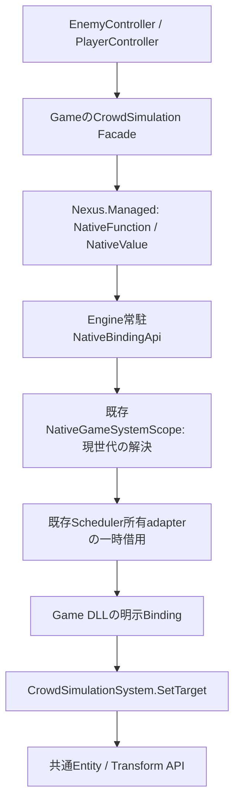

# Native / Managed API Integration — 改訂仕様 Phase 5

これはPhase 5の設計記録。予約status 10とパッチ時のBinding一括差替え・安全な再解決は[Phase 7-B](NativePatchRuntimeREADME.md)で追加した。通常のNative失敗の再送は禁止したままである。

Game Moduleが公開したNative Game Systemの関数だけを、C#の型付きFacadeから呼び出す。
Phase 3のSystem scope・Scheduler・関数Metadataと、Phase 4のHosting・World wrapperを拡張した。
System登録、公開署名宣言、呼出先のBindingは別操作であり、C++クラス全体の自動公開は行わない。

## 調査結果・既存責務

| 既存機能 | 確認結果 / 再利用 |
|---|---|
| NativeGameSystemScope / SystemScheduler | Moduleの非所有追跡とLevelのSystem所有。既存scopeのroutingとadapterのbusy検査を利用 |
| NativeGameApiMetadata / NativeGameSystemApi.h | System ID・Function ID・Version・引数・戻り値・Threadの値Metadata。呼出先は未実装だった |
| GameModuleLoader / GameRuntime | DLL識別照合・生成・逆順破棄・pin。Loaderが既知Module IDをscopeへ渡す |
| GameApiBridge / GameServices | 世代付きEntity解決、World Thread、既存Event・byte-command・Reload中の呼出停止を再利用 |
| NativeManagedBridge / EntryPoints / GameWorld | 安定Bootstrapとsession。V1〜V4を維持し、V5でEngine常駐のdispatchだけを追加 |
| ComponentReflection / TypeRegistry / PropertyDescriptor | 前者はSystemのComponentアクセス型解決に利用済み。後者はProperty編集用で関数呼出しを持たない |
| PropertyHandle / PropertyEditService / PropertyDrawerRegistry / DetailsPanel | 既存Property編集経路を維持。BindingをInspectorとして実装しない |
| LevelDocument / LevelSerializer / PersistentId / AssetCatalog | 共通保存・Asset。今回Handleやcallbackを保存しない |
| Logger / Console / RuntimeProtocol | 既存の診断・IPCを維持。EditorはSystem実体・Managed objectを所有しない |
| LiveCodingAgent / LivePP.props / Nexus.GameModule.props | 既存Live++と独立Game DLL。Game DLLの自動パッチ・API再登録は未実装 |
| ProjectTemplates / NativeModule / Hybrid | 既存生成サービス・SDK配布を再利用し、Game所有サンプルを追加 |

独立したPropertiesPanelクラスは確認できず不明。任意Input / Audio / Physics / AssetのPublic Game APIは未実装。
各Backend全体の内部実装状況は今回の調査では不明であり、Bindingがそれらを提供するとは扱わない。

## 設計・依存方向・代替案

API RegistryのためのSystem所有Managerは追加しない。既存scopeがModule IDと数値世代から現在のSystemを解決する。
scopeのBinding一覧はMetadataの登録IDとDLL callbackだけを借用し、System state・Managed delegateを所有しない。
Systemの所有・実行は既存Scheduler、関数の型情報は既存NativeGameApiMetadataが担当する。
新しいクラスはManagedの安全な値・数値Handle wrapperだけであり、別TypeRegistryや汎用RPCを作らない。

DLLのfnptrをC#へ返す案はUnload・再登録で失効管理できないため採用しない。
既存byte-commandを全ての型付きAPIに流用する案は署名照合とSystem世代が不足するため採用しない。
Property用TypeRegistryへ関数を追加する案は編集・保存と実行の責務が混ざるため採用せず、Phase 3の関数Metadataを利用する。
ReflectionのProperty値と意味が重なる型も、内部enum値やC++のメモリlayoutには依存させない。

RuntimeからEditor / ImGuiへの依存は追加しない。Game DLLはPublicヘッダーだけに依存し、NativeとManagedのゲームコードは互いの内部型を参照しない。
System / Level / Asset / Eventの言語別実装は作らない。

## 公開と解決

1. `systems.add`で既存SchedulerへSystemを登録する。
2. `publications.declareFunction`でID・Version・引数順・Enum ID・戻り値を宣言する。
3. `bindings.bind`でその宣言に限ってDLL callbackを結び付ける。
4. C#の`BindNativeFunction`はModule / System / Function / 各Versionと署名を照合する。
5. `NativeFunction.Invoke`は数値scope / System / Binding世代をEngineで再検証してから実行する。

引数名は診断Metadata、型互換性は順序・値種別・Enum IDで判定する。
同一Worldに同じModule IDのscopeが複数ある場合は曖昧として失敗し、任意のModuleを選ばない。
Module IDはLoaderが照合したProject Module ID。Module名からDLL pathやC++型を推測しない。
Handleはscope / System / functionのuint64三要素。functionはBindingの登録世代で、公開Metadata自体の宣言IDとは区別する。

初期登録はV2任意export `NexusRegisterGameSystemsV2`で行う。LoaderはV2があれば優先し、なければ従来V1 exportへ進む。
V1の72 byte contextは変更しない。V2はprefixのABI=2 / size=96であり、そのままV1関数へ渡してはならない。
通常はLoaderが初期登録後にSealする。宣言の追加は初期化時だけ、再Bindingは一時停止中の既存宣言だけに許可する。

## ABI・型変換・buffer

Windows x64 / pack 8 / Cdecl。C++のSTL、参照、非trivial型、例外、allocatorを境界へ渡さない。
固定layout・明示的UTF-8・呼出し中だけのpinを使用する。参考：[Microsoft Native Interop指針](https://learn.microsoft.com/en-us/dotnet/standard/native-interop/best-practices)。

| 構造体 | byte数 | 用途 |
|---|---:|---|
| NexusNativeValueV1 | 56 | kind / count / int64 / float[4] / EntityHandle / data |
| NexusNativeBindingHandleV1 | 24 | scope / System / Binding世代 |
| NexusNativeBindingRegistrationV1 | 24 | bind / setEnabled |
| NexusNativeSystemsRegistrationV2 | 96 | 既存登録prefixとBinding登録表 |
| NexusNativeBindingApiV1 | 24 | Engine常駐resolve / invoke |
| NexusManagedGameplayContextV5 | 240 | V4 prefixとBinding dispatch |

| 型 | 境界表現・制約 |
|---|---|
| Void | 全fieldを0にした戻り値。引数には使わない |
| Bool | integerの0 / 1。C++ boolやManaged boolを直接渡さない |
| Int32 / UInt32 / Enum32 | integerへ拡張して格納し、値域を検証。Enumの安定typeIdは解決時に照合 |
| Float32 / Vector2 / Vector3 / Vector4 | number配列の1〜4要素。有限値だけを許可 |
| EntityHandle | 同じWorldのindex / generationを毎回解決。破棄済みEntityは拒否 |
| UTF8 | data + count byte。最大4096 byte、厳密UTF-8。終端NUL不要、空はnullptr / 0 |
| Float32Array | data + count要素。最大1024個、全値が有限。要素の読み取りはmemcpy |

配列の初期対応はfloat32だけ。任意型配列・配列内文字列・object・pointer・任意C++ templateは未対応で、推測してMarshalしない。
使わないDTO fieldは0にする。入力は呼出元の値を借用し、callback外へ保存しない。
callbackの戻り値がUTF8 / Float32Arrayなら、渡されたresultBufferへ書き、dataをその先頭へ設定する。
空の結果はdata=nullptr / count=0。DLL所有bufferを返すことは禁止し、Engineはそのpointerをdereferenceする前に拒否する。
最大16引数、結果bufferは最大4096 byte。容量不足はBUFFER_TOO_SMALL等で失敗を返し、Engineは自動再呼出ししない。
Managedは一時bufferをfixedでpinし、結果をManaged所有のstring / float[]へコピーしてから解放する。
Native callbackが契約に反してbuffer外へ書く等のメモリ破壊は防げない。任意Nativeコードのsandboxではない。

## 所有権・Lifecycle・更新

LevelとSystemSchedulerがadapterを所有し、Game DLLだけがSystem stateを生成・破棄する。
ManagedはWorld capabilityと数値Binding Handleだけを保持する。NativeFunctionはsession停止後にGameWorldからアクセスを拒否される。

開始はLevel / World発行 → Native Module.create → System登録・宣言・Binding → Seal → Managed V5開始。
毎frameは既存のNative System → ScriptSystem → Transform phase。C#が渡したCrowdの目標入力は次frameにSystemが処理する。
終了はManaged ScriptSystem解除・参照解放 → 既存services失効 → Binding / Metadata / scope失効 → System逆順破棄 → Module state破棄 → DLL解放 → World / Level終了。
破棄失敗時は既存LoaderがDLLをpinし、正常なUnloadやrollbackができたとは扱わない。

呼出しはWorld所有Threadだけに限定する。同じSystemへの再入を拒否し、Native例外はFAILEDへ変換する。
callback中は既存Worldの呼出深さを記録し、Reloadのfreezeと競合させない。routing / World lockを保持したままDLLを呼ばない。
GameRuntimeの停止要求は既存どおりcallback終了後へ遅延する。所有objectのcallback中delete、WorkerからのAPI呼出しはサポートしない。

## Binding失効とReloadへの備え

`bindings.setEnabled(scope, 0)`はidle Scheduler・所有Thread・callback非実行時だけ許可する。
停止時にBinding世代を更新し、古いHandleを再開後にも復活させない。
停止中に同じ宣言へbindを再実行すると新しいcallback・世代へ置き換わる。setEnabled(1)後はFacadeが再解決する。
enabled中の置換、Scheduler更新中の登録・停止、System借用中の変更は拒否する。
Handle失効のエラーで自動再実行はしない。ゲーム側が状態を確認して明示的に再解決する。

既存Managed Reloadのfreezeを新dispatchにも適用し、候補OnCreateからNative内部stateを変更させない。
旧世代のGameWorld失効で保持済みNativeFunctionも無効になる。新世代には新World wrapperを作る既存経路を利用する。

記録SDKはLive++ 2.11.4で、[公式Release情報](https://www.liveplusplus.tech/releases.html)と照合した。
[公式hook仕様](https://liveplusplus.tech/docs/documentation.html)には停止Threadとlockに関する制約があるため、hookからこのRegistryを直接更新しない。
今回実装したのはframe境界で呼べる停止・再登録の契約であり、Live++通知との自動接続は改訂Phase 7の対象。
コードパッチとDLL Unload / Reloadを同じ操作と扱わず、System stateの自動移行・未検証rollbackを保証しない。
安定API / Bootstrap / Engineを変更したため、適用にはユーザーによる再ビルドとホスト再起動が必要。

## Error Handling

| status | 動作 |
|---|---|
| 1 INVALID_ARGUMENT | 型・値域・個数・UTF8・buffer・署名記述が不正 |
| 2 INVALID_HANDLE | 旧Binding世代、旧scope、別World、破棄済みEntity |
| 3 WRONG_THREAD | 登録Worldと異なるThreadから呼出し |
| 4 BUFFER_TOO_SMALL | Native callbackが容量不足を通知 |
| 5 FAILED | callback例外・再入・更新中変更・Reload freeze・曖昧scope |
| 6 INCOMPATIBLE_ABI | System / Function Versionまたは署名が不一致 |
| 7 SYSTEM_NOT_REGISTERED | Module / Systemが未登録 |
| 8 FUNCTION_NOT_REGISTERED | 関数未宣言または呼出先が未Binding |
| 9 BINDING_DISABLED | 対象scopeが一時停止中 |

通常のNative呼出し失敗はNativeApiException.Statusで通知し、ゲームの呼出元が処理できる。
Scriptで未処理なら既存ScriptRuntimeが該当behaviourをfault状態へ移し、既存Logger / Consoleへ報告する。
callback途中の失敗や不正戻り値検出でも、既に行ったWorld変更を巻き戻したとは扱わない。

## 使用例・性能

Hybridテンプレートは既存のCrowdSimulationSystem.h / .cppをNativeCombat内へ生成する。
CrowdBinding.hがSetTarget(EntityHandle, Vector3) → Voidを明示公開し、C#のCrowdSimulation Facadeが宣言順と型を照合する。
EnemyControllerは`CrowdSimulation.SetTarget(Entity, new Vector3(5, 0, 0))`だけを呼ぶ。
初期LevelのPlayerControllerもこの経路を使う。EnemyControllerを配置する場合は既存ScriptComponentのTypeをgame.enemyにする。
Entity / Level / Assetは再作成しない。C++だけのnative-moduleテンプレートでも同じBindingを公開するが、Module IDはGameとなる。
旧combat.impulse / Eventのサンプルも維持し、System APIからEventを二重実装しない。

最小Facadeは毎回resolve + invokeを行う。多数の呼出しではNativeFunctionをbehaviour内で保持して解決回数を減らせる。
Framework内の単純な値box・pin用allocationは残る。毎Entity / 毎Propertyの大量呼出しを性能保証せず、大量処理はfloat配列を受ける明示バッチAPIを検討する。
今回は計測せず、汎用Job / RPC / 自動Binding / buffer pool等を先回り実装しない。

## 変更ファイル

| ファイル | 変更内容 |
|---|---|
| Public/Nexus/NativeGameBindings.h | DTO・数値Handle・登録V2・Engine dispatchのC ABI |
| Public/Nexus/NativeGameSystemApi.h | 明示float配列の値種別追加 |
| Public/Nexus/ManagedBootstrap.h | V1〜V4を維持したV5 context |
| Runtime/Gameplay/NativeGameSystemScope.h | Module ID・Binding context・Engine dispatchの宣言 |
| Runtime/Gameplay/NativeGameSystemScope.cpp | 既存scope内の明示Binding・世代・署名・値検証・呼出し |
| Runtime/Gameplay/NativeGameApiMetadata.cpp | float配列の署名を検証 |
| Runtime/Gameplay/NativeGameApiMetadata.h | Property編集と独立したPublic API値Metadataのコメントを明確化 |
| Runtime/Gameplay/GameApiBridge.h | 呼出し深さ・freeze連携の宣言 |
| Runtime/Gameplay/GameApiBridge.cpp | 既存World検証と呼出深さの再利用 |
| Runtime/Gameplay/GameModuleLoader.cpp | 任意V2 export優先、Module IDをscopeへ伝達 |
| Runtime/Scripting/NativeManagedBridge.h | V5開始宣言 |
| Runtime/Scripting/NativeManagedBridge.cpp | 安定V5 entry解決 |
| Runtime/Scripting/CSharpRuntime.cpp | V5 contextで既存sessionを開始 |
| Managed/Nexus.Managed/NativeBindings.cs | 安全な値・署名・Handle・Marshal wrapper |
| Managed/Nexus.Managed/Nexus.Managed.csproj | 明示compile対象へ追加 |
| Managed/Nexus.Managed/GameWorld.cs | session単位の関数表受渡し・失効 |
| Managed/Nexus.Managed.Bootstrap/EntryPoints.cs | 世代Worldへdispatchを渡し停止時に解除 |
| Managed/Nexus.Managed.Bootstrap/GameplayEntryPoints.cs | V5 layout検証、旧entryを維持した共通開始 |
| Templates/NativeModule/CrowdBinding.h.in | Game固有の明示Binding |
| Templates/NativeModule/Main.cpp.in | V2登録exportへ移行 |
| Templates/NativeModule/README.md.in | 公開方法とModule ID |
| Templates/native-module.nxtemplate | Bindingヘッダー生成 |
| Templates/Hybrid/NativeCombat.cpp.in | 既存commandに加えてCrowd登録 |
| Templates/Hybrid/CrowdSimulation.cs.in | 型付きFacade |
| Templates/Hybrid/EnemyController.cs.in | Facadeを使う最小Script |
| Templates/Hybrid/PlayerController.cs.in | 既存初期Levelでも呼出経路を利用 |
| Templates/Hybrid/README.md.in | 寿命・更新順・失敗・使用方法 |
| Templates/hybrid-gameplay.nxtemplate | 共通SystemとFacade / Scriptの生成 |
| Tools/Engine/Publish-Engine.ps1 | 既存SDKの明示配布一覧へNativeBindings.csを追加。発行は実行しない |
| Tests/NativeGameSystemTests.cpp | Public ABIの型・値・世代・例外・再入等の検証ソース |
| Tests/Fixtures/NativeModule/Module.cpp | 独立DLLで型付きSystem APIを明示公開 |
| Tests/Fixtures/ManagedGameplay/Behaviours.cs | 安全な値APIだけを使う統合fixture |
| Tests/ManagedGameplayTests.cpp | 共通EntityとMatrixへの反映・DLL解放の検証ソース |
| Docs/NativeGameSystemsREADME.md | Phase 3記録から現行仕様への案内 |
| Docs/NativeManagedApiREADME.md | 調査・設計・ABI・使用例・制約 |
| ../README.md | 改訂Phase 5への案内 |

## 静的確認・未実装・未検証

include / namespace / 宣言・定義 / compile対象 / ABIレイアウト / Template参照を静的に確認する。
登録・System・Moduleの所有権、Worldと世代、Thread、callbackの借用、Reload freeze、停止前の参照失効を照合する。
Project / Levelの保存形式は変更せず、Binding Handle・callback・DTO pointerをSerializationへ追加しない。
実施した確認では8つのProject XML・明示ソース・ProjectReference、3テンプレート合計39ファイルの参照・重複出力・生成Project XMLに問題は見つからなかった。
変更ファイルのUTF-8・競合記号・末尾空白・include、Public ABIの依存方向、ManagedソースのSDK明示コピー一覧も照合した。
Publish-Engine.ps1はParserによる構文解析のみ実施し、発行や内部Build処理は実行していない。
git diff --checkはエラーなし。既存Launcher/Standalone/Program.csのLF→CRLF警告は今回の変更対象外。

ビルド、テスト、Game / Runtime / Editor、dotnet、Reflection生成器は実行していない。
コンパイル・link・実際のNative / Managed呼出し、DLL Unload、例外・失敗経路・Reloadとの動作は未検証。
自動Binding生成、全C++型・templateの公開、任意型配列、汎用RPC、Native Extension、System state移行、Live++調停全体は未実装。
