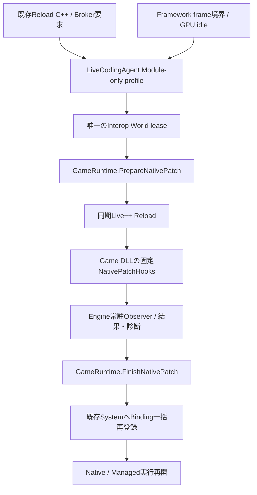

# Game DLL専用Live++ Backend — 改訂仕様 Phase 7-C

最新の[実行検証記録](HybridVerificationREADME.md)では、SDK 2.11.4でのBuild、Agent接続、GPU起動とNative実コードパッチを確認した。以下の7-C時点の未検証記録とは区別する。実SDKのreceiver Threadから通知されたhookは値snapshotだけを検査し、World操作は所有Threadへ限定する。

後続の[Phase 8-A](ProjectDeliveryREADME.md)で共通Build / Verify / Binding / Standalone起動のprofile対応を追加し、[公式SDKの実体とAPIを静的照合](../ThirdParty/LivePP.API-AUDIT.md)した。以下は7-C時点の実装記録。実SDKのビルド・パッチ動作は引き続き未検証。

Phase 7-Bの固定state契約を、明示的な開発profileで同期Live++ Agentへ接続した。
通常Buildは変更せず、Game DLLだけをEnableする。EXE / EngineのReinstancing、Managed Assembly交換、DLL Unload / Reloadは別の操作として維持する。
実SDKを用いたビルド・link・パッチは未検証。任意の状態移行を含むPhase 7全体が完成したとは扱わない。

## 調査・既存機能の再利用

| 既存機能 | 責務と今回の判断 |
|---|---|
| LiveCodingAgent / NexusFramework | Framework所有の同期SDK接続とframe境界。専用profileを追加し、既存EXE経路は維持 |
| LivePP.props / LivePP.UPSTREAM.md | 従来EXE設定と記録SDK 2.11.4。新profileとの併用を拒否 |
| GameRuntime / GameModuleLoader | World / DLLの所有。7-BのPrepare / Finish / Abandonを使用 |
| NativeGameSystemScope / SystemScheduler | 既存ECSのSystem・Bindingを停止し、一括再登録。別System Managerは不要 |
| GameApiBridge | World・Thread・callback深さ・freezeを再利用。唯一のInterop Worldへのパッチleaseを追加 |
| ProjectHost / ProjectContext | 既存Module SourceとProject Rootを絶対パスへ解決。Projectの言語や保存形式は変更しない |
| EditorWorkspace / Logger / Console | 既存Reload C++要求・状態表示・診断を再利用。新しいPanelやIPCは追加しない |
| CSharpRuntime / Managed Reload | 既存Backendを維持。Native準備中の競合を拒否し、実行を再開してから別に扱う |
| NativeFunction / Reflection / LevelDocument | 7-Bの失効Handle再解決、既存共通Property / 保存を維持 |
| Build props / Publish-Engine | 通常SDKにもimport先を同梱。SDK本体・ライセンスを取得・配布しない |

標準のSDKヘッダーとLivePP.local.propsは存在しなかった。外部指定のSDK・有効Build・ライセンス状態は不明。
記録バージョン2.11.4と[公式仕様](https://liveplusplus.tech/docs/documentation.html)を参照した。API / Agent DLLのversion照合はSDKのAgent生成処理を利用するが、その成功を確認していない。
公式のEnable / Disableは非同期通知で戻り値がなく、呼出しを完了確認と解釈しない。ロード済みDLLへ同じoptionで通知し、DisableをUnloadより先に呼ぶ。
使用SDKのローカルAPIヘッダー・実装・サンプルとの照合はユーザー環境で必要である。
PropertiesPanel独立クラス、Input / Audio / Physicsの全状態移行、独自workerの安全停止は今回未確認。

## アーキテクチャ・採用理由



既存EXE Agentを無条件に流用する案は、Engine / EditorのReinstancingとDLL state保持が競合するため採用しない。
SDK自動Module検出を使う案は、Engineや第三者DLLまで対象にする危険と明示契約との不一致があるため採用しない。
新しいReload ManagerやSDK Agentを言語ごとに増やさず、既存LiveCodingAgentを相互排他的なprofileで使う。
Module内の通常hookはそのModuleに属するため、DLLに固定hook翻訳単位を生成する。EXEのhookが別DLLの結果を通知すると推測しない。
Observerは結果と短命のUTF-8診断だけをEngineへ渡す限定C ABIであり、ゲーム機能の公開Registryではない。

依存方向はHost → Platform Backend → RuntimeのReload契約。RuntimeはHostが注入した登録・解除の二つの安定Engine entryを呼び、Platform実装をincludeしない。
二つのentryが必要なのはRuntimeの寿命とSDK登録を結び付けるためで、新しいManagerや汎用plugin interfaceは追加しない。RuntimeからEditor / ImGuiへは依存しない。
Game DLL → Public C ABIとSDK hookだけを参照し、Engineの内部クラスやlibへ依存しない。
Editorは要求と結果を利用し、DLL / System state / Managed Objectを所有しない。

## 明示Build profileと使用方法

1. 対応するdevelopment Engine checkoutとLive++ SDK・ライセンスをユーザー環境で準備する。
2. 更新後のNative Module / Hybridテンプレートを使う。既存ProjectにはNativePatchHooks.cppと今回の生成Project設定を反映する。
3. 生成されたGameEditor.vcxprojまたはGameRuntime.vcxprojをDebug / Develop x64で通常Buildし、全入力と成果物の整合を確定する。
4. MSBuildのglobal propertyとして`NexusNativeModuleLivePP=true`と絶対パスの`NexusLivePPDir`を指定する。ローカルpropsにだけ指定してProjectReferenceへ伝播すると推測しない。
5. 専用profileのホストを起動する。EditorではNative Moduleを使うPlay開始後にReload C++を要求する。StandaloneではBrokerの要求を同じframe境界で処理する。
6. 固定stateの関数本体だけを編集する。ヘッダー・所有権・署名・Build設定の変更には再ビルド・ホスト再起動を使う。

例はユーザーが実行するためのものであり、Agentは実行していない。

```powershell
msbuild GameEditor.vcxproj /p:Configuration=Debug /p:Platform=x64 /p:NexusNativeModuleLivePP=true /p:NexusLivePPDir=C:\SDK\LivePP
```

Game / Managed成果物は`Build/Bin/LivePP/x64/Debug`、IntermediateにもLivePP区分を付ける。
Engineのlib / objもNexus.Common.propsで別Build Rootへ分ける。通常版の成果物を専用Backendと誤混在させない。
Engine本体は固定とし、/Gy /Gw /hotpatch、完全PDB、/FUNCTIONPADMIN、COMDAT最適化抑止などの設定はパッチ対象Game DLLへ限定する。
Release、installed Engine、従来LivePP.propsの有効化との併用は拒否する。SDKなしの通常Buildには追加依存を要求しない。
専用profileの通常Build / PackageをEditorの既存Buildボタンへ自動統合する変更は今回行っていない。
生成ホストはbuild stampへ専用配置のDLL / Managed成果物を記録する。BuildTargets.json自体は変更せず、通常LauncherのBuild / Verifyは従来配置を使う。
専用profileは出力したホストを直接起動する開発手順とし、通常Launcherが自動選択・配布する構成にはしていない。
Publish-Engineは新propsだけを通常SDKへ含める。配布用RuntimeにSDK・開発Source・有効profileを要求しない。

## 初期化・登録・終了・所有権

- GameRuntimeがLevel / Bridge / DLL / System / Managed側を従来順に初期化して所有する。
- livePatch設定時だけBackendへ非所有登録する。同時に一つ、登録・SDK操作・Reload・解除は所有Threadに限定する。
- Agent生成前にRuntimeが起動した場合は値設定とRuntime参照を保留する。Agent生成後にObserver設定 → Enable通知を行う。
- Agentが先にある場合はRuntime登録時に同じ接続を行う。無効なSDK AgentではReload状態はUnavailableのままとする。
- DLLのmutexが通知とObserver解除を直列化する。別Threadのhookは診断・atomic結果と不変の入力snapshotだけを扱い、Worldへ触れない。
- Runtime停止時はDisable通知 → Observer解除 → Managed停止 → Native登録失効・System破棄 → Module state破棄 → FreeLibrary → World / Level破棄。
- Framework Agentが先に終了する場合も、DLLが存在する間にDisable通知とObserver解除を行う。その後Runtimeが通常停止する。
- Observer解除を確認できない場合はDLL / stateをpinする。Backend contextをまだ参照しうる場合はSDK Agent / contextもProcess終了まで保持する。

Entity / System / Module stateの所有者は変更しない。Handle・公開APIの世代管理は既存scopeのままで、C#にGame DLL関数pointerを渡さない。
Module-only登録はGameRuntimeの寿命に結び付ける。GameModuleLoaderを直接操作してSDKへ自動登録されると解釈しない。

## 同期更新・結果・失敗

FrameworkがGPU idleを待ち、唯一のInterop Worldへのleaseを取得する。lease中は別Threadを含め新規Interop Worldを拒否する。
Runtimeが両言語とAPI / Eventを停止し、固定Sourceを照合してから同期Reloadへ入る。
BackendはPublic配下・Engine Build配下・Project直下のprops / targets / vcxproj・NativePatchHooks.cppの内容と集合も固定する。
所有ThreadでWorld / Module契約を確認してからSDKへ進む。pre-patch hookはLoaderと共通の入力読取でheader内容・翻訳単位一覧と固定入力を再検査し、検査後の編集競合を適用前に検出する。SDKのreceiver ThreadからRuntimeの所有Thread検査を迂回して呼び出さない。
SDKが報告する変更ファイルもSource Root内のCPP / CC / CXXに限定し、hook翻訳単位・ヘッダー・範囲外・空の変更リスト・報告されたlayout変更を拒否する。
互換性拒否後は、SDKのpending候補を破棄できたと推測して再要求を受け付けない。Sourceを元へ戻した場合もProcess再起動が必要である。

SDK hookには取消戻り値がない。pre-patch時に準備状態・固定入力が崩れていれば、旧stateへ新コードを適用する前にProcessを終了する。SDK操作・準備・適用後のstate検査と再登録は所有Threadに限定し、hook Thread自体が同一であることは要求しない。
これは通常のCompile Errorの扱いではない。通常の固定入力変更はSDK Reloadを呼ぶ前にCompatibility Errorとして拒否する。
post-patchを確認したときだけFinish(true)へ進み、7-BのABI検査と全Binding再登録を行う。
pre通知だけでpostを確認できない、hook契約違反、SDK例外は結果不明として停止・pinし、成功や自動rollbackと扱わない。
Compile / Link失敗では既存コードを維持し、既存Logger / ConsoleへUTF-8診断を送る。診断本文が利用できなければBroker出力を案内する。
非適用時はFinish(false)で既存Binding世代を保持する。再登録失敗はState Restore Errorで停止し、Pause操作で再開しない。
結果は既存NativeReloadStateとして表示する。Managed Reloadの状態は従来どおり別表示とする。
RuntimeのStop要求は同期更新完了まで遅延する。完了後のStopもleaseとObserver解除の順序を維持する。

## 互換性・制約・今後

新しいObserver ABIはpack 8 / Windows x64で24 byte。既存Module / Binding / Managed context ABIと保存形式は変更しない。
通常のNative DLLにはObserver exportを要求しない。livePatchの明示指定時だけ対応テンプレートと専用Backendを要求する。
固定入力比較はCompilerの全依存グラフやビルド成果物との一致の証明ではない。起動前の通常BuildとSource整合は開発者の契約である。
CPP内の永続layout、static / globalの構造・所有権、外部ヘッダーやPCH / Module / Compiler optionの変更をこの仕組みが安全に自動判定するとは扱わない。
Backendが保護する範囲外の入力変更、独自worker / 外部callback、複数DLL・複数World、Brokerから対象Moduleを手動追加する運用、debugger停止中の外部適用は対象外。
SDKのhookが無効化された運用は使用しない。無通知の外部パッチをRuntimeで検出できる保証はない。
Asset / Level / Entity同一性、Script Property、Native stateは固定stateのbody-only更新に限り保持する。任意状態・Event subscription・Taskの自動移行は行わない。
今後は実SDK 2.11.4での静的API照合・ユーザーによるBuildと動作確認、Compiler入力との検証強化、必要性に基づく複数Module協調、Build UI統合を進める。

## 変更ファイル

| ファイル | 変更内容 |
|---|---|
| Public/Nexus/NativeGamePatch.h | Observer C ABIと結果イベント |
| Platform/Development/LiveCodingAgent.h | Runtime登録・解除・専用同期Backend API |
| Platform/Development/LiveCodingAgent.cpp | SDK接続・保留登録・固定入力・hook結果・安全終了 |
| Runtime/Gameplay/GameModuleLoader.h | 明示profile / Project Root設定、pre検査宣言 |
| Runtime/Gameplay/GameModuleLoader.cpp | 準備済み固定stateの再検査 |
| Runtime/Gameplay/GameApiBridge.h | 唯一のWorldへのpatch lease契約 |
| Runtime/Gameplay/GameApiBridge.cpp | World・Thread・callback検査と新規World拒否 |
| Runtime/Application/GameRuntime.h | Backend通知検査・異常終了契約 |
| Runtime/Application/GameRuntime.cpp | 登録所有権・停止前解除・pin・pre検査 |
| Core/Framework/NexusFramework.h | 開発Standaloneの明示設定 |
| Core/Framework/NexusFramework.cpp | 専用BackendのGPU idle / frame境界 |
| Core/Hosting/ProjectHost.inl | 既存Project Module Sourceの解決と明示opt-in |
| Editor/Core/EditorWorkspace.cpp | Reload不能時の案内を現在のBackendへ合わせる |
| Build/Nexus.NativeModuleLivePP.props | 専用profile・SDK / 構成検査・Game DLL設定 |
| Build/Nexus.Common.props | Engine lib / objのprofile分離 |
| Build/Nexus.Game.props | Host profile import |
| Build/Nexus.GameModule.props | Game DLL profile import |
| Build/NexusRuntime.vcxproj | SDK Backend profile import |
| LivePP.props | 既存EXE profileとの併用拒否 |
| Tools/Engine/Publish-Engine.ps1 | 通常SDKへの新props同梱 |
| Tools/Project/Write-GameBuildStamp.ps1 | 専用配置の成果物を既存stamp形式へ記録 |
| Templates/NativeModule/NativePatchHooks.cpp.in | DLL内SDK hookと寿命を同期したObserver |
| Templates/NativeModule/GameModule.vcxproj.in | Game DLL出力のprofile分離 |
| Templates/NativeModule/GameEditor.vcxproj.in | Editor出力のprofile分離 |
| Templates/NativeModule/GameRuntime.vcxproj.in | Runtime出力のprofile分離 |
| Templates/Hybrid/GameModule.vcxproj.in | Hybrid DLL出力のprofile分離 |
| Templates/Hybrid/ManagedBootstrap.vcxproj.in | Hybrid Managed成果物のprofile分離 |
| Templates/ManagedBootstrap/ManagedBootstrap.vcxproj.in | 共用Utilityのprofile整合 |
| Templates/ManagedBootstrap/GameEditor.vcxproj.in | Hybridで再利用するEditorのprofile整合 |
| Templates/ManagedBootstrap/GameRuntime.vcxproj.in | Hybridで再利用するRuntimeのprofile整合 |
| Templates/native-module.nxtemplate | 固定SDK hookの生成 |
| Templates/hybrid-gameplay.nxtemplate | 共通hookをHybridへ生成 |
| Templates/NativeModule/README.md.in | profileと固定stateの利用案内 |
| Templates/Hybrid/README.md.in | HybridでのReload操作と制約 |
| Tests/NativeGameModuleTests.cpp | SDK非依存World leaseの検証ソース |
| Docs/NativeModuleLivePPREADME.md | この実装・所有権・運用と制約 |
| Docs/NativePatchRuntimeREADME.md | 7-Cへの案内 |
| Docs/HotReloadCoordinationREADME.md | 7-A記録と現在のBackendを区別 |
| Docs/LiveCoding.md | 従来EXE設定と専用profileを区別 |
| ../README.md | 7-Cの実装範囲を案内 |

## 静的確認・未検証

変更40ファイルの存在・UTF-8・conflict marker・末尾空白、79件のlocal / Public include参照とpreprocessor条件の対応を静的に確認した。
変更対象14件と既存利用側5件のProject / props XML、明示compile対象の存在、Native / HybridのテンプレートJSON（14 / 19ファイル）と参照元・出力先重複を確認した。
Publishとbuild stampのPowerShellを構文解析した。Script自体やMSBuild評価・SDKマクロ展開は実行していない。
namespace / 宣言・定義 / link対象、Public ABIをソースで照合し、Thread / callback / Observer解除、所有権、固定入力、Handleと保存互換性を確認した。
2件の外部SDK includeは標準配置に実体がなく、SDK API / hook macroの展開・コンパイル・linkは未検証である。
`git diff --check`はエラーなし。対象外Launcher/Standalone/Program.csの既存改行警告は変更していない。
SDK非依存の検証ソースも実行していない。実SDKのEnable / Disable、hook Threadと呼出順序、再パッチ、Compile / Link失敗、停止・再Play、Managed併用は未検証。
ビルド、テスト、Game / Runtime / Editor、dotnet、Reflection生成器、Publish、SDK取得・Live++操作は実行していない。
