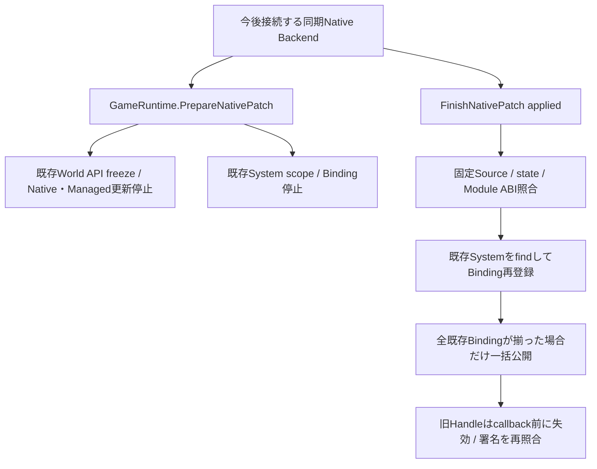

# Native Patch Runtime契約 — 改訂仕様 Phase 7-B

後続の[Phase 7-C](NativeModuleLivePPREADME.md)でModule-only SDK Backendと同期Frame接続を追加した。以下は7-B単位の実装記録であり、SDK接続の現在の範囲・制約は7-Cを参照する。

Phase 7-Aに続き、独立Game DLLを保持したまま関数本体をパッチするためのRuntime契約を追加した。
この単位ではSDKのModule有効化・無効化・同期Agentへの接続は行っていない。Editorの既存Reload C++は7-Aの拒否境界を維持する。
Phase 7全体の完了、実パッチ成功、Game DLLの自動Reload対応とは扱わない。

## 調査結果と採用範囲

| 既存機能 | 今回の判断 |
|---|---|
| LiveCodingAgent / NexusFramework / LivePP.props | 従来exeのBackend。Game DLLのロードがAgent生成より先の場合もあり、そのまま流用しない |
| GameModuleLoader / GameRuntime / EditorSession | DLL・Worldの所有とframe境界。準備・完了APIをここへ追加 |
| NativeGameSystemScope / NativeGameApiMetadata | 既存Schedulerへの非所有追跡、署名、Handle世代。Binding候補の一括公開を追加 |
| GameApiBridge | 所有ThreadとWorld、callback深さ、Native API / Event freezeを再利用 |
| NativeFunction / GameWorld / NativeManagedBridge | 安定Engine関数表だけを保持。予約statusによる再解決を追加 |
| CSharpRuntime / ScriptSystem | Managed側の更新とReload。Nativeパッチ準備中は同じGameRuntimeで実行を止める |
| TypeRegistry / PropertyHandle / PropertyEditService / DetailsPanel | 既存共通編集。Native stateの直接編集・別Inspectorは追加しない |
| LevelDocument / PersistentId / Asset管理 | 既存Worldを保持。保存形式、Entity、Assetを作り直さない |
| GameServices / Logger / Console / IPC | 既存Eventと診断を維持。新しい通信Managerは作らない |
| NativeModule / Hybridテンプレート | 共通Crowd Systemを再利用し、永続stateを固定ヘッダーへ移動 |

記録SDKはLivePP.UPSTREAM.mdの2.11.4。標準配置のSDK実体はなく、外部指定の有無・有効Buildの実体は不明。
[公式Module lifecycle](https://liveplusplus.tech/docs/documentation.html)では、動的DLLはUnload前のDisableModule通知が必要である。
公式APIの非同期処理を考慮したAgent所有・Module登録の接続が未実装なので、フラグだけの有効化を行わない。
PropertiesPanel独立クラスは不明で、既存Detailsを維持する。Input / Audio / Physicsの全Backend状態移行は未確認。

## 設計・代替案・依存関係

ModuleとSystemを破棄・再生成する案は、既存ゲームstateを失いEntity生成を二重実行するため採用しない。
全Systemの状態を汎用Serializerで移す案は、所有権・Thread・GPU資源を自動復元できず、過剰な抽象化になるため採用しない。
今回は固定stateを保持し、関数本体だけを更新する限定契約を採用する。
新System Manager・TypeRegistry・Reload Managerは作らず、Loaderと既存scopeの責務を拡張した。
Game DLLはPublic C ABIだけを参照し、RuntimeからEditor / ImGuiへ依存を追加しない。

## Public契約と固定state

任意export `NexusGetNativePatchContract`は、stateを参照せずNexusNativePatchContractV1を返す。
Windows x64 / pack 8 / Cdecl、40 byte。ABI / size、非0のstateSchema、Moduleのsizeof / alignof、System群のlayout fingerprintを持つ。
schemaはサイズだけでなく意味・所有権を変えた場合にも更新するゲーム側の契約である。
任意export `NexusRebindGameSystems`は既存Systemをfindし、宣言済み関数のBindingだけを再登録する。
このexportでSystem / Entityの生成・破棄や新しい署名の宣言を行わない。

永続Module / System stateは固定ヘッダーへ置く。NativeテンプレートではNativeModuleState.h、HybridではNativeCombatState.hとCrowdSimulationSystem.hを使う。
CPP内の永続layout、global / staticの構造・所有権変更、関数やABIの変更、独自workerや外部callbackの未停止状態はV1契約の対象外。
System Scheduler外のworkerが必要なModuleは、その停止・合流を保証するBackend契約が別途必要。
サイズ一致はC++ ABI互換性の証明ではなく、同サイズの並替えや意味変更を自動検出できたとは扱わない。

NativeGameModuleSettings.patchSourceDirectoryを明示した場合だけ契約exportとSourceを検証する。
空なら旧Moduleの起動を維持する。Sourceがない配布ゲームに開発Sourceを要求する変更ではない。
指定するdirectoryは実際のNative ModuleのSource集合でなければならない。
ロード時に.h / .hpp / .inlの内容と.cpp / .cc / .cxxのファイル集合を記録し、準備・完了時に比較する。
ヘッダー変更、翻訳単位の追加・削除は通常再ビルド・再起動を要求する。CPP本体の差分は許可する。
上限は2048ファイル、ヘッダー各2 MiB・合計16 MiB。symlinkを含むSourceは拒否する。
Source比較はABI証明ではない。Compiler入力・Build設定・Engine Public SDKの固定、並行編集との同期は今後のBackend側でも保証する必要がある。

## 準備・適用・取消のLifecycle

1. LoaderがModule識別情報と任意契約を照合し、同じDLLでstateとSystemを生成する。
2. 所有Threadのidle frame境界でGameRuntime.PrepareNativePatchを呼ぶ。
3. 実行中callback・Managed Reloadとの競合を拒否し、既存API / Eventをfreezeする。
4. scopeがBindingとSystem.Update / Native借用を止める。既存世代・state・Sceneは保持する。
5. Backendが同期的にパッチを行い、実際の適用有無を確定する。
6. 非適用ならFinishNativePatch(false)で旧Binding表・Handleをそのまま再開する。
7. 適用された場合は固定契約・Module識別情報を再取得し、既存Systemへの全Bindingを候補へ再登録する。
8. 全て揃った場合だけ表をswapし、Managed API freezeを解除して更新を再開する。

Prepare中はNative / Managed双方のUpdateを呼ばず、Managed Reloadも拒否する。Pause操作でこの停止を解除できない。
準備中のStop要求は完了まで遅延し、Backendが使用中のDLLをFreeLibraryしない。
Backendは所有Threadから準備・完了を対にし、ゲームcallbackへ戻る前に結果を確定する。途中状態でFrameを継続する契約ではない。
完了通知なしにRuntimeを破棄した場合は、適用有無を推測せずDLL / stateをpinする。

Module / System stateの確保元は引き続きDLL、adapterの所有者は既存Scheduler、Worldの所有者はGameRuntimeである。
body-only更新ではNative stateを移動・再生成しないため、その値とEntity / Level同一性を維持する。
この値保持を任意のstructural changeやSystem state migrationへ拡張して解釈しない。
Asset / Level / Script Propertyの保存形式、PersistentId、instanceの所有権は変更しない。

## Bindingの候補と失敗

Prepareでは既存Binding世代を変えず、enabledだけを停止する。Compile失敗・No Changesで旧Handleを失わない。
パッチ中のbindは別vectorへ積み、重複・新しい未公開関数を拒否する。
候補が全既存Bindingを含む場合だけ新しい世代の表を公開する。部分再登録を外部へ見せない。
一度適用されたことを通知した後、不完全再登録をfalseで取り消して旧表へ戻すことはできない。

適用後にSource・state契約・Module ABIを確認できない場合は、旧stateへ新しいdestroyを適用しない。
System callbackを切断し、DLLと不透明stateをProcess終了まで保持する。再開・再利用をせず、従来パッチも禁止する。
ABI確認後の再Binding失敗ではWorldを保持してPauseし、通常更新を再開しない。修復を推測せず停止・再起動を要求する。
既に行ったNative副作用のrollbackは保証しない。

## Managed Handleの再解決

予約status 10 `NEXUS_GAME_STALE_BINDING`を追加した。Engineがscope / Systemの存在を確認し、対象世代がないと判断したcallback実行前にだけ返す。
DLL callbackが10を返した場合はEngineがFAILEDへ変換し、再送可能と誤認させない。
NativeFunctionはModule / System / Function ID、Version、署名の値だけを保存する。
Invokeが10を受けた場合のみ署名を再照合し、一度だけ再送する。Entity不正、無効scope、Native実行後の失敗、無効な戻り値は再送しない。
明示Refreshも提供する。異なるVersionや署名へのfallbackは行わない。
Game DLL関数pointer、Native object、GCHandleをManagedへ保持させない。結果bufferとpinは従来どおり呼出し中だけである。
追加再解決のallocationは残り、性能保証や未計測のbuffer poolを追加しない。

## Error・操作・未接続部分

Runtime結果はIdle / Prepared / Succeeded / NotApplied / CompatibilityError / StateRestoreErrorの値で取得できる。
EditorSessionにも転送APIを用意したが、既存Reload C++操作をこの境界へ自動接続していない。
現行のLiveCodingAgentは従来exe用で、Interop Worldがある場合はPhase 7-Aどおり拒否する。
このRuntime契約を使うためにBeginLegacyPatchの拒否を外したり、applied=trueを実パッチの代わりに呼んだりしてはならない。

今後の7-CではModule-onlyの明示Build profile、Agent生成前ロードの扱い、Enable / Disableの完了とUnload順序、同期frame接続、適用結果の確定、固定ヘッダーの全範囲を接続する。
公式の[動的Module仕様](https://liveplusplus.tech/docs/documentation.html)に従い、DLLがロード中の間にDisableを通知する必要がある。
ライセンスやSDKを取得・配置した状態、SDK有効branchのコンパイル成功を確認したとは扱わない。
この変更を適用するには通常再ビルド・ホスト再起動が必要で、変更自体を現在のホストへパッチ適用する保証はしない。

## 変更ファイル

| ファイル | 変更内容 |
|---|---|
| Public/Nexus/NativeGamePatch.h | 固定state契約と再登録exportのC ABI |
| Public/Nexus/NativeGameBindings.h | callback前限定の予約status 10 |
| Runtime/Gameplay/NativeGameSystemScope.h | 準備・完了・安全切断API |
| Runtime/Gameplay/NativeGameSystemScope.cpp | 候補Binding、一括公開、非適用保持、System停止、status正規化 |
| Runtime/Gameplay/GameModuleLoader.h | 明示Source設定・契約・patch lifecycle |
| Runtime/Gameplay/GameModuleLoader.cpp | Source / ABI検証、再登録、適用失敗時のpin |
| Runtime/Application/GameRuntime.h | Native patch結果と境界API |
| Runtime/Application/GameRuntime.cpp | 両言語の更新停止、Managed Reload排他、Stop遅延 |
| Editor/Core/EditorSession.h | Runtime境界と結果の転送 |
| Managed/Nexus.Managed/NativeBindings.cs | 論理ID保持とcallback前限定の再解決 |
| Templates/NativeModule/NativeModuleState.h.in | Native Module stateを固定ヘッダーへ移動 |
| Templates/NativeModule/Main.cpp.in | 固定stateヘッダーと任意export |
| Templates/NativeModule/CrowdBinding.h.in | Crowdの再Bindingと固定layout契約 |
| Templates/NativeModule/README.md.in | 現在の対応範囲・未接続の説明 |
| Templates/Hybrid/NativeCombatState.h.in | Hybridの永続stateヘッダー |
| Templates/Hybrid/NativeCombat.cpp.in | 固定契約・再Binding export |
| Templates/Hybrid/README.md.in | Handle更新とBackend未接続の説明 |
| Templates/native-module.nxtemplate | 新しい固定ヘッダーを生成 |
| Templates/hybrid-gameplay.nxtemplate | Hybridの固定ヘッダーを生成 |
| Tests/NativeGameSystemTests.cpp | 表の一括公開、取消、部分失敗、予約statusの検証ソース |
| Tests/Fixtures/NativeModule/Module.cpp | SDKなしの契約・再登録fixture |
| Tests/NativeGameModuleTests.cpp | 更新停止、state / Entity保持、Stop遅延、Source変更拒否の検証ソース |
| Tests/ManagedGameplayTests.cpp | キャッシュしたHandleの再解決・二重実行防止の統合検証ソース |
| Docs/NativeManagedApiREADME.md | Phase 5からの案内 |
| Docs/HotReloadCoordinationREADME.md | Phase 7-Aからの案内 |
| Docs/NativePatchRuntimeREADME.md | 今回の契約と未接続部分 |
| ../README.md | Phase 7-Bと7-C残作業を明記 |

## 静的確認・未検証

対象27ファイルの存在・UTF-8・conflict marker・末尾空白、68件のlocal / Public include参照を静的に確認した。
7つのProject XMLと明示的なcompile / ProjectReferenceの存在・重複を確認した。
Native / HybridのテンプレートJSON（13 / 18ファイル）、参照元の存在、出力先の重複とProject XMLを確認した。
include / namespace / 宣言・定義 / compile対象 / Public ABIサイズ・enum値、Managed constructorの呼出しをソースで照合した。
Module・System・Binding・Sceneの所有権、完了前の停止、結果確認前のstateアクセス、Handle失効、Thread、保存互換性を確認した。
適用成功通知後の再登録失敗を非適用として取り消せないこと、Loader単独の終了も未確定時はpinすることを確認した。
`git diff --check`はエラーなし。今回対象外のLauncher/Standalone/Program.csに既存の改行警告があるが変更していない。
追加したfixtureはSDKを呼ばずBackend結果を模擬するコードで、実パッチの検証ではない。Agentはfixtureも実行しない。

ビルド、テスト、Game / Runtime / Editor、dotnet、Reflection生成器、Live++操作は実行していない。
コンパイル・link、実パッチ、実際の再Binding・pin・取消・Managed再解決・Module有効化は未検証。
SDK接続、Build opt-in、任意state移行、worker停止、structural change、Engine Extensionは未実装。Phase 7全体は未完了である。
