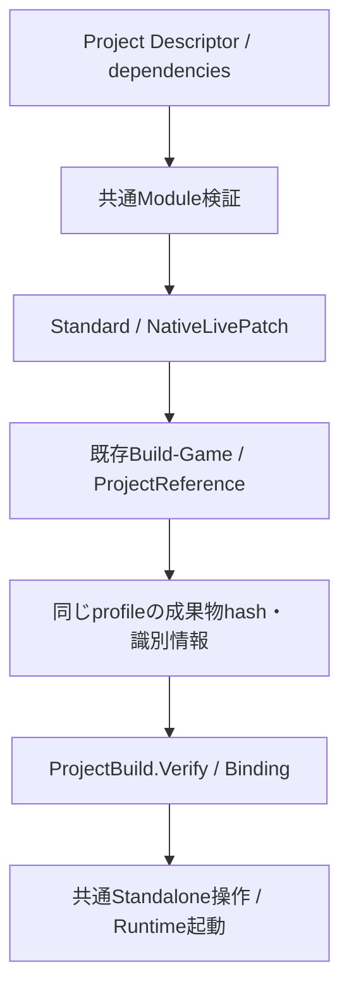

# Hybrid Project / Build / 配布基盤 — 改訂仕様 Phase 8-A

これは8-A時点の調査・実装履歴である。Phase 8全体の最新実装、複数Module実行、言語追加UI、Package生成、既知の制約と未検証事項は[Phase 8完了報告](HybridProjectREADME.md)を参照する。以下の「後続」「未対応」は8-A時点の状態を表す。

Phase 8を分割し、今回はModule依存の値モデルと共通Build profileを実装した。
あわせて7-CのSDK実体未確認と、専用profileがEditor起動検証・Standalone Buildで通常版へ戻る問題を調査・修正した。
複数同言語Moduleの実行・追加UI・Package生成本体は後続単位であり、Phase 8全体の完成とは扱わない。

## 調査結果・再利用

| 既存構造 | 現在の責務・今回の判断 |
|---|---|
| ProjectDescriptor / ProjectSerializer / ProjectContext | 複数Moduleと共有データの保存・検証。依存先の順序・循環検出は未実装だったため最小拡張 |
| ProjectTemplates / Project Browser / ProjectTool | 既存staging生成と共通CLIを再利用。既存Projectへの再生成・上書きは行わない |
| ProjectBuild / Build-Game / Write-GameBuildStamp | Build・検証・起動は通常版だけを選んでいた。7-Cの専用配置を一貫して選ぶprofileを追加 |
| StandaloneSession / ProjectHost | 非同期Buildと同じProjectのRuntime起動。profileを値コピーしてworkerへ渡す |
| GameModuleLoader / GameRuntime / CSharpRuntime | Native → Managed開始、逆順停止、同一World。既存の実行契約を維持 |
| Native Game System / API Binding / Reflection | 登録・公開API・世代・Property編集は従来どおり。Module依存を内部型へのlink依存と混同しない |
| Asset / LevelDocument / PersistentId | 共通Root・保存形式・同一性を維持。Module追加でデータの再作成を要求しない |
| LiveCodingAgent / LivePP.props | 通常EXEと専用DLLの別profile。公式SDK 2.11.4を取得して静的APIを照合 |
| ManagedBootstrap / DotNetHost | net10.0、nethost / hostfxrによるframework-dependent hosting。配布方式を公式仕様で確認 |
| Publish-Engine / New-EngineRelease | Engine SDK・Launcher配布の既存機構。完成ゲーム用Package生成とは責務が異なる |
| Build System / Visual Studio | 既存v145・MSBuild・ProjectReferenceを維持。新しいBuild Managerは作らない |
| Editor Commands / Console / IPC | 既存共通操作・ログ・別process起動を再利用。新しいInspectorや通信層は追加しない |

ゲーム用Package生成・汎用Asset cookerは調査範囲のTools / Runtimeで実装を確認できず、今回の完了機能には含めない。
独自Input / Audio / Physics / Rendering backendの全状態移行、複数DLLのLive++同時更新は未確認・未対応である。

## Project形式・依存モデル

```json
"modules": [
  {"id":"Gameplay","name":"Gameplay","language":"CSharp","path":"Source/Game","type":"Game","dependencies":["NativeCombat"]},
  {"id":"NativeCombat","name":"NativeCombat","language":"Cpp","path":"Source/NativeCombat","type":"Game"}
]
```

dependenciesは先に初期化を完了するModule ID。System個数、DLL個数、内部C++型・Managed参照の自動公開を表さない。
Module IDとType / Property IDは別の契約で、保存値を言語名だけで識別しない。表示名変更でIDを変えない。
schemaVersion 1を維持し、依存なしのModuleには新しい項目を出力しない。既存のmodules省略・空配列を維持する。
依存を持つProjectを古いEngineが読めるとは保証しない。未知項目を黙って削除する移行は行わず、対応Engineを使う。
Project ID、Level / Asset / Entity / Componentの保存形式と配置は変更しない。

ProjectSerializer.Validateが不在・重複・自己依存・循環を拒否する。DependencyOrderは元配列へのindexだけを返し、ModuleやSystemを所有しない。
最大256 Module、宣言順でDFS探索し依存先を先に並べる決定的な計画である。modules配列そのものは並べ替えない。
Hybrid templateはGameplay → NativeCombatの依存を生成する。初期言語は表示・初期生成順の選択という既存意味を維持する。
同じ計画をCLIのmodule-orderで読み取り専用表示できる。宣言のみの構成はRuntime-compatibleと区別して表示する。

現在のホストはNative / Managed各1 Module。CheckProjectRuntimeModulesをBuild / 起動の共通検証にし、NativeがManaged初期化へ依存する構成を拒否する。
型RegistryやSchedulerを増やして複数Module対応済みに見せる方法は採用しない。任意グラフを実行するためのLoader / Assembly対応は後続で行う。
PowerShellの直接CLIも共通Project-ModuleOrder.ps1で依存と現在の実行制約を検証する。ScriptとC++の照合ケースは検証ソースに記載し、実行していない。

## 共通Build profile・採用理由

ProjectBuildOptionsはStandard / NativeLivePatch、明示SDK絶対パス、Rebuildの要求だけを保持する。
Projectそのものの言語・Engine選択を変えず、SDK配置を共有Projectやstampへ保存しない。
Standardを既定にし、既存Build / Verify / Binding / Launch呼出しはそのまま受け入れる。
NativeLivePatchはdevelopment Debug / Develop、独立Native DLL、APIとAgentを持つ明示SDK配置を要求する。
パスの差替えは既存生成テンプレートのBuild/Bin/x64配置に限り、BuildTargetsを書き換えない。



NativeLivePatchではGame / Managed成果物とEngine lib / objを専用配置へ分離する。7-Cの生成Project設定を再利用する。
stampにbuildProfile=NativeLivePatchを記録し、通常版との取り違えを拒否する。通常stampは項目省略をStandardとして扱う。
旧7-Cの専用stampには識別項目がないため、更新後の通常Buildとホスト再起動が必要である。この変更自体をLive++で反映する契約ではない。
Verifyは成果物hashに加え、対象ホストの配置・Module / Managed配置・Engine依存・profileを照合する。
専用EditorのBindingが通常配置を期待して起動失敗する問題と、Standalone Buildだけ通常版を選ぶ問題を修正した。
StandaloneSessionはprofileを値でworkerへ渡し、完了後も同じprofileで検証・起動する。workerはUI・World・Managed Objectを所有しない。
SDKの設定はHostが注入する既存Reload契約から利用し、RuntimeからEditorへの依存や新しいManagerは追加しない。
ProjectBuildのC++署名とProjectDescriptorの内部layoutは拡張しているため、既存のEngine libと新しいheaderを混在させず、Engine / Host / SDKを通常Buildで揃える。保存形式の後方互換性とC++バイナリ互換性は別の契約である。

MSBuildへのprofile指定はglobal propertyにし、全ProjectReferenceへ伝える。Rebuildは明示要求時だけ選ぶ。
失敗・キャンセル・SDK欠如・未対応グラフを成功や別profileへのfallbackとして扱わない。既存Consoleと新規logを利用する。
稼働中DLLや異なるEngine DLLの上書きを強制しない。コード全体のBuild / RebuildにはPlay・ホストの停止が必要な場合がある。

## SDK調査と制約の扱い

[SDK静的調査記録](../ThirdParty/LivePP.API-AUDIT.md)に公式取得元、SHA-256、展開配置、API照合結果を記載した。
SDK実体未確認は解消した。標準配置へ自動導入して従来EXEを有効化する操作は行わず、調査配置を明示指定できる状態にした。
同梱API / Docsで確認した停止中Processのhook設定をModule-only profileで明示falseにした。
ローカル配置の静的調査で.NET SDK 10.0.402、Microsoft.NETCore.App 10.0.13、win-x64 Host Pack 10.0.13とnethost.dllの存在を確認した。
Live++ Agentと当該nethost.dllのPE headerもAMD64であることを読み取り確認した。dotnetやDLLを起動した検証ではない。
Managed Build用の明示配置は`C:/Program Files/dotnet/packs/Microsoft.NETCore.App.Host.win-x64/10.0.13/runtimes/win-x64/native`で、NexusDotNetHostPackDir / NEXUS_DOTNET_HOST_PACK_DIRへ指定できる。設定の書換えやPackの自動切替は行っていない。
SDKのAgent生成・接続・hook Thread・パッチ成功は静的API照合からは確認できない。Runtime実行をせずに検証済みと扱わない。
7-Cの固定state、唯一のInterop World、body-only、互換性拒否後の再起動、解除失敗時pinという制約は維持する。

## 配布方式の調査・後続Packageの契約

既存ManagedBootstrapはnet10.0 / x64 / SelfContained=false / RollForward=LatestPatchである。
Microsoftの[Native Hosting公式仕様](https://learn.microsoft.com/en-us/dotnet/core/tutorials/netcore-hosting)はnethost / hostfxrのcomponent hostingにframework-dependentを要求する。
一般の[Self-contained配布](https://learn.microsoft.com/en-us/dotnet/core/deploying/)の設定をこのホストへ適用して解決済みとは扱わない。
配布先の互換.NET Runtime、または公式hosting契約を満たすprivate runtime配置・探索の別実装が必要である。後者は今回未実装。

後続のPackageは以下を一つの明示計画として検証する。今回Packageを生成してはいない。

| 対象 | 後続で扱う契約 |
|---|---|
| Runtime / Engine | 通常profile、選択EngineのVersion・ABI・動的依存。Editor / Live++ SDKは含めない |
| Native Module | 対応DLLと明示的な第三者依存。SystemごとのDLL分割は要求しない |
| Managed | Bootstrap、安定API、GameScripts、deps / runtimeconfig / metadataと解決済み依存 |
| .NET | framework-dependentの必要versionとwin-x64、nethost。private runtime対応は別に検証 |
| Assets / Levels / Config | 共通保存形式・Root相対参照を保持し、Source / Intermediateを配布しない |
| Build stamp | 開発時の元RootやEngineManifest絶対パスを、そのまま可搬な配布起動契約とは扱わない |
| Cooking | 生Assetのコピーとcookingを区別する。存在しないcookerを実装済みと扱わない |
| 安全な出力 | 新規stagingへ作成・検証後に公開。既存Projectや他作業者の成果物を削除しない |

配布用Game PackageとEngine SDKのZIP配布は異なる責務なので、既存New-EngineReleaseをゲーム用として呼ぶ案は採用しない。
現在のEngine / Project / nethost探索を保ったまま可搬Packageを実装するには、専用の起動・配置契約を先に確定する必要がある。

## 使用例

以下はユーザー向け手順であり、Agentは実行していない。CLIの更新には通常Buildが必要である。

```text
NexusProjectTool module-order MyGame.nxproject
NexusProjectTool build-editor MyGame.nxproject engine-registry.json Debug
NexusProjectTool rebuild-runtime MyGame.nxproject engine-registry.json Release
NexusProjectTool build-editor MyGame.nxproject engine-registry.json Debug NativeLivePatch C:/SDK/LivePP
NexusProjectTool verify-editor MyGame.nxproject engine-registry.json Debug NativeLivePatch
```

既存Projectへの言語追加は[Hybridの差分追加手順](HybridGameplayREADME.md)を使う。Project / Module ID・既存Source・Level / Assetを維持する。
依存を宣言する場合はModule IDを参照し、Native APIの公開・Facade登録は既存の明示契約を使う。追加・移行UIは後続で実装する。

## 初期化・終了・保存・Reload

Project読込 → 値・依存グラフ検証 → 現在のRuntime互換性 → 選択profileのBuild → stamp検証 → Host起動の順に進む。
Runtime内は既存のNative → Managed初期化を維持し、逆順終了する。Module依存計画がSystem stateの所有者になることはない。
Editorの非同期JobはProject / Engine / profileのsnapshotを保持し、完了を所有Threadで受け取る。Script Instanceの所有者は従来のCSharpRuntimeである。
Level / Component / Script値のSerialization、Entity HandleとGeneration、Asset ID、共通Reflection / DetailsPanelは変更しない。
Module依存やBuild profileの変更をPlay中へ自動反映しない。SDK設定・Engineヘッダー・Project形式の変更には通常Buildと再起動を使う。

## 変更ファイル

| ファイル | 内容 |
|---|---|
| Runtime/Project/ProjectDescriptor.h | 任意のModule依存ID配列 |
| Runtime/Project/ProjectSerializer.h | 依存順序の値API |
| Runtime/Project/ProjectSerializer.cpp | 保存互換性・依存検証・DFS・原子的保存前の拒否 |
| Runtime/Project/ProjectContext.h | 現在のRuntime互換性検査の宣言 |
| Runtime/Project/ProjectContext.cpp | 計画と実行能力の区別・初期化順序検証 |
| Tools/Project/ProjectTemplates.cpp | template依存の読込・生成時維持 |
| Templates/hybrid-gameplay.nxtemplate | GameplayのNativeCombat依存 |
| Tools/Project/ProjectBuild.h | 共通profile・Build optionsと既定値 |
| Tools/Project/ProjectBuild.cpp | profileごとの計画・Build・stamp検証・Binding・Launch |
| Tools/Project/Project-ModuleOrder.ps1 | Script共通のグラフ・Runtime互換性検証 |
| Tools/Project/Build-Game.ps1 | profile・SDK・Rebuild・同じ出力への依存配置 |
| Tools/Project/Write-GameBuildStamp.ps1 | profile識別と共通Module検証 |
| Tools/Project/ProjectTool.cpp | 読取専用Module計画・共通profile・Rebuild CLI |
| Core/Hosting/ProjectHost.inl | 実行依存の検証・専用EditorのBindingとStandalone profile |
| Editor/Services/StandaloneSession.cpp | workerへBuild optionsを値コピー |
| Build/Nexus.NativeModuleLivePP.props | Hostへ明示SDK配置を渡す |
| Tools/Engine/Publish-Engine.ps1 | 共通Script helperの同梱 |
| Platform/Development/LiveCodingAgent.cpp | 実SDKで確認した停止中hook設定を明示 |
| Tests/ProjectSystemTests.cpp | 依存・保存・拒否・profile計画の検証ソース |
| Build/NexusProjectTests.vcxproj | 新しい計画検証が参照する既存実装をlink対象へ追加 |
| ThirdParty/LivePP.API-AUDIT.md | 公式SDK取得・ハッシュ・API照合記録 |
| Docs/ProjectDeliveryREADME.md | 今回の実装・調査・配布計画と未対応 |
| Docs/NativeModuleLivePPREADME.md | SDK調査と共通profileへの案内 |
| Docs/CppCSharpREADME.md | 任意依存と互換性の案内 |
| Docs/HybridGameplayREADME.md | Hybrid依存と共通Buildの案内 |
| ../README.md | Phase 8-Aの進捗 |

調査用SDK ZIPと展開内容はGenerated配下だけに置き、Gitへ含めない。

## 静的確認・未実装・未検証

変更26ファイルの存在・UTF-8・conflict marker・末尾空白、78件のlocal / SDK include参照とpreprocessor条件の対応を確認した。
7件の利用側Project XMLと専用props、明示compile / ProjectReferenceの存在と重複、Native / HybridテンプレートJSON（14 / 19ファイル）の参照元と出力先重複を確認した。
4つのPowerShellをParseFileで構文解析し、CPPの引数名・profile名と照合した。新helperは既存Scriptと同じUTF-8 BOMを付け、Windows PowerShellでも日本語コメントを正しく解析できる形式にした。
namespace / 宣言・定義 / link参照、所有権・Thread・Lifecycle、Module / Entity Handleと保存互換性を静的に確認した。Script・検証用ソースの実行はしていない。
`git diff --check`はエラーなし。対象外Launcher/Standalone/Program.csの既存改行警告は変更していない。
SDK API照合は取得した実ヘッダーと同梱Docsで行った。コンパイル・link・macro展開・実際の接続を実証したとは扱わない。
Build、Rebuild、テスト、Game / Runtime / Editor、dotnet、Reflection生成、Publish、SDK Agent / Broker起動・ライセンス操作は行っていない。
多Moduleの実行とBuild順序制御、追加UI、Package生成・起動契約、private .NET runtime、Asset cooking、実SDK Hot Reloadの動作確認は残っている。
独立したModule Managerや言語別ECS・Inspectorを増やさず、実際に必要なLoader / Assembly / 出力契約を後続単位で拡張する。
