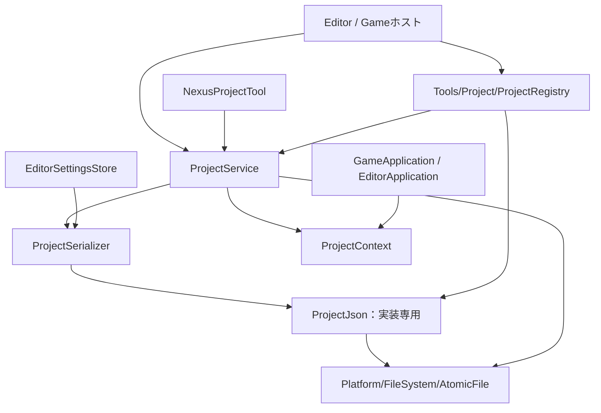

# Phase 2：Project System

EngineとGameの分離に続き、Projectを共有可能なデータとして扱う基盤を実装した。
対象はDescriptor、作成・読込、Root解決、最近使ったProject、既存ホストへの接続。
Launcher UI、テンプレート選択、Engine Registry / Version Resolver、移行・SDK発行・パッケージ化は後続Phaseの対象。

## 起動と作成

新規の`Build/NexusProjectTool.vcxproj`を個別ビルドする。
既存の`Build/NexusEngineModules.slnx`にもCLIターゲットを追加した。

```powershell
./Project/Tests/Invoke-GraphicsBuild.ps1 -Project Project/Build/NexusProjectTool.vcxproj
./Project/Tests/Invoke-GraphicsBuild.ps1 -Project Project/Build/SampleGameRuntime.vcxproj
./Project/Tests/Invoke-GraphicsBuild.ps1 -Project Project/Build/SampleGameEditor.vcxproj

./Generated/Modules/x64/Debug/NexusProjectTool/NexusProjectTool.exe create "C:/Games/My Game" "My Game"
./Generated/Modules/x64/Debug/NexusProjectTool/NexusProjectTool.exe inspect "C:/Games/My Game/My Game.nxproject"

./Generated/Modules/x64/Debug/SampleGameRuntime/SampleGameRuntime.exe `
  --project "C:/Games/My Game/My Game.nxproject" --engine ./Project --check-game

./Generated/Modules/x64/Debug/SampleGameEditor/SampleGameEditor.exe `
  --project "C:/Games/My Game/My Game.nxproject" --engine ./Project
```

作成先の親フォルダは先に用意する。保存先Rootは未作成であることが必要で、既存Rootは空でも上書きしない。
CLIの作成処理はAssets / Levels / Source / Config、Descriptor、`.gitignore`、Cameraだけの最小起動Levelを生成する。
Engineのソース、Shader、フォントをGameへコピーしない。
共有データの保存先が既定の成果物名と重なる場合、そのDirectoryを`.gitignore`の生成対象から外す。
Game C++ホストやビルド定義・テンプレートの生成はPhase 4で扱う。
既存のGameホストを使用する場合、そのホストへ静的リンクされている型とSystemが利用される。
Descriptorを渡すだけで任意のGame C++コードが動的ロードされるわけではない。

`--project <legacy-root>`の旧ディレクトリ起動も維持している。
ディレクトリ指定を新形式へ自動変換したり、複数Descriptorから暗黙に選択したりしない。
新形式は`.nxproject`ファイルを明示する。旧共有設定とDescriptorの同時マージも行わない。

## Descriptor

```json
{
  "schemaVersion": 1,
  "projectId": "12345678-1234-4234-8234-123456789abc",
  "name": "My Game",
  "projectVersion": "0.1.0",
  "engine": {
    "association": "development",
    "id": "nexus-development",
    "version": ""
  },
  "paths": {
    "assets": "Assets",
    "levels": "Levels",
    "source": "Source",
    "config": "Config"
  },
  "startupLevel": "Levels/Startup.level"
}
```

`projectId`は非nil・小文字のcanonical UUID。作成時に空ならPlatformのUUID発行処理で生成する。
移動・クローン時は同じIDを維持する。Gameの版とEngineの版は別の情報である。
Engineは絶対パスではなくassociation / id / versionで要求する。
Developmentの空versionは明示的な開発版追従で、変更の影響を受ける。
Developmentは版を記録してもSource自体を固定しない。安定性の固定はInstalledの不変build管理で実現する予定。
Installedでは空versionを拒否する。意味上の版比較や互換性推測はせず、指定されていれば文字列を完全一致で照合する。

`startupLevel`は今回追加した必須項目で、設定されたlevelsフォルダの内側を指す。
全共有パスはProject Root相対・UTF-8・`/`区切り。
フォルダ名はAssets / Levels / Source / Configに固定されず、Content / Worlds / Code / Settings等も使用できる。
Engineの既定Game名やSample Level名をDescriptorの代わりに使うことはない。

## 責務と依存関係



| ファイル / 型 | 責務 |
|---|---|
| Runtime/Project/ProjectDescriptor.h | シリアライズする共有メタデータだけを保持 |
| Runtime/Project/ProjectSerializer.* | JSONとschemaを検証し、Descriptorを原子的に保存 |
| Runtime/Project/ProjectContext.* | Descriptorの親をRootにして不変の絶対パスsnapshotを構築。Engine要求照合関数も提供 |
| Runtime/Project/ProjectService.* | 作成・読込・必要フォルダと起動ファイルの実在確認。LevelやGraphicsの形式は知らない |
| Runtime/Project/ProjectJson.* | JSONのサイズ・深さ・重複キー・文字列検証。外部APIにはJSON型を出さない |
| Platform/FileSystem/AtomicFile.* | UUID、原子的ファイル保存、Directory公開、更新ロック、Windowsのパス比較 |
| Tools/Project/ProjectRegistry.* | ユーザー固有の最近使ったProject。GameデータやEngine選択を変更しない |
| Tools/Project/ProjectTool.cpp | UIに依存しない作成・検査・登録・一覧・除外の操作入口 |
| Build/Nexus.EngineIdentity.props | ホストへ埋め込むEngine ID / version / associationのビルド情報 |

Runtime Project処理はNexusRuntime.libへ追加した。RegistryはEditorSupportとCLI側でコンパイルし、RuntimeからToolsへ依存させない。
Project処理にDevice / Descriptor / CommandList等のGraphics実装は持ち込んでいない。
Launcherは将来RegistryとProject処理を使う際、EditorSupport全体へ依存する必要はない。
必要なら既存ソースをProject専用libへ分けるが、今回はビルドグラフの全面再編を行わない。

## 方式の選定

JSONには固定版nlohmann/json 3.11.3を同梱し、公表されたヘッダのSHA-256と照合した。
ライセンス、公式URL、ハッシュは[同梱元情報](../ThirdParty/nlohmann/UPSTREAM.md)に記録した。
既存のLevel / Reflection / settingsは独自形式なので、そのParserをJSONとして流用していない。

| 比較した方式 | 判断 |
|---|---|
| 同梱する固定版JSONヘッダ | 採用。既存のThirdParty管理と一致し、ビルド時ネットワーク取得が不要 |
| 独自JSON Parser | Unicode、数値、エスケープの再実装・保守負担が増えるため不採用 |
| cgltf内部Parser流用 | Asset読込内部へ依存が生じ、Project形式の独立性が弱くなるため不採用 |
| WinRT JSON | Project形式処理へ追加のOS API依存を持ち込むため不採用 |

利点は実績あるJSON処理を使いつつ公開APIから隔離できること。
欠点は同梱ヘッダのサイズと、その更新・ライセンス確認が必要なこと。
未知schemaや未知項目は拒否するため、将来項目を追加するときは対応版・schemaの扱いを明示する必要がある。
未知のデータを読み捨てて再保存する挙動にはしない。

## 所有権と初期化順序

1. ホストがDescriptorを読み、ProjectContextを構築する。
2. ホストに埋め込まれたEngine識別情報と要求を照合する。
3. `shared_ptr<const ProjectContext>`をApplicationPathsへ渡す。
4. GameApplication / EditorApplicationが起動時のsnapshotを保持し、必要なパスだけを下層へ渡す。
5. 従来通りLevel / Asset / Rendererを準備し、Frameworkを起動する。

ContextはWorld、Registry、設定Service、Deviceを所有しない。
`GameApplication::Project()`と`EditorApplication::Project()`から参照でき、旧起動ではnullptrになる。
Game Systemが必要とする情報はGameLevelSetupのcapture等で明示的に渡せる。
Contextは実行中に暗黙更新しない。保存先の変更などはProjectを開き直したときに反映する。

作成Initializerへ渡すContextはstaging専用で、callbackの実行中だけ利用する。
参照やそのパスを外へ保持せず、作成成功後はCreateが返す最終RootのContextを使う。

## 作成と復旧

作成先と同じ親に一意の`.nexus-project-<uuid>`を新規作成し、必要フォルダと初期データを生成する。
InitializerはGame側・Tool側の信頼済みコードであり、ProjectServiceはLevel形式を知らない。
初期化後にDescriptorと起動ファイルを検証し、既存先を置き換えないDirectory renameで公開する。
途中で失敗・例外が発生した場合は自分で作成したstagingだけを回収する。
OSが回収を拒否した場合、同じ親にstagingが残り得る。既存ProjectやEngineを削除して復旧する処理はない。

DescriptorとRegistryは同じDirectoryの一時ファイルへ排他的に書き、flush後に置換する。
無効な保存値はI/O前に拒否する。既存ファイルを上書きしない保存モードも提供する。
Registryのread-modify-writeは正規化したパスに対応するWindows named mutexで直列化する（待機上限5秒）。
これは協調する書込処理間の排他であり、任意の外部Editorとの競合解決やファイルシステムのsandboxではない。

## Editor / Runtime接続

新形式ではname / assets / startupLevelをDescriptorから取得し、旧Project.settingsを併読・自動生成しない。
Editor.settingsはDescriptorのconfigパスを使い、個人設定は従来のLOCALAPPDATAへ保存する。
EditorからProject設定を明示保存する場合はDescriptorを再読込し、編集対象のname / assets / startupLevelだけを更新する。
再読込時点のEngine要求等は保持する。別Projectへの差替え、未知schema、未知項目はエラーにする。

Level一覧はAsset Rootと別のAssetCatalogを使用し、Descriptorで指定されたLevel Rootの`.level` / `.json`を列挙する。
Levelファイルの内容は従来の`NEXUS_LEVEL`形式。拡張子を理由にJSONへ変換しない。
Content BrowserはGameのAsset Rootを使い、Shader・フォント・辞書は引き続きEngine Rootを使う。
CWDは変更しない。Project Root外の参照、drive-relative、dot segment、Windows予約名・末尾dot/space、symlink逸脱を拒否する。

現在のEditor Playは同一プロセス。別プロセスRuntimeの起動・制御はまだ追加していない。
将来は同じDescriptorの絶対パスをプロセス引数で渡し、既存RuntimeProtocol / ViewportSessionへ接続する。

## 最近使ったProject

既定保存先は`LOCALAPPDATA/NexusEngine/Projects/RecentProjects.json`。
CLIやテストでは保存先を明示指定できる。LOCALAPPDATAが取得できなければ既定保存先のエラーとし、作業Directoryへ勝手に保存しない。

```powershell
./Generated/Modules/x64/Debug/NexusProjectTool/NexusProjectTool.exe register "C:/Games/My Game/My Game.nxproject" "C:/UserData/Recent.json"
./Generated/Modules/x64/Debug/NexusProjectTool/NexusProjectTool.exe list "C:/UserData/Recent.json"
./Generated/Modules/x64/Debug/NexusProjectTool/NexusProjectTool.exe remove "C:/Games/My Game/My Game.nxproject" "C:/UserData/Recent.json"
```

最大64件。絶対パス、Project ID、表示名、Engine要求、最終使用日時（UTC Unix秒）を保持する。
一覧取得時の状態はAvailable=0 / Missing=1 / Invalid=2。ファイルの実在性とProject IDを再検証する。
AvailableはEngineがインストール済みという意味ではない。Engine availabilityはPhase 6で別に判定する。
移動後の再登録では同じIDで欠損している古い記録だけを置換し、実在する別クローンは残す。
除外操作はRegistryの記録だけを消し、Project本体は削除しない。
破損Registryは空一覧へ読み替えず、登録・除外も失敗させて元データを保持する。
EditorホストはProjectのCPU側ロード成功後に登録する。Game単体起動や`--check-game`は個人Registryへ記録しない。
一覧の実在検証は同期処理なので、Launcher UIではworker / cacheへ委譲し、毎frame呼ばない。

## Engine照合の範囲

`Nexus.EngineIdentity.props`の既定値はdevelopment / nexus-development / 0.1.0-dev。
`NexusHostEngineAssociation` / `NexusHostEngineId` / `NexusHostEngineVersion`をビルド設定で上書きできる。
この情報をホストへ埋め込み、Project要求と照合する。
`--engine`はデータRootの指定であり、実行中のバイナリのEngine IDや版を変更しない。
別Engineを必要とするProjectを勝手に開かないための照合で、Engine RegistryやVersion Resolverの代替ではない。
インストール先の検索、別ホスト選択、SDK / Asset形式の互換性診断、Engineデータとバイナリのbuild ID整合確認は後続Phaseに残る。
DescriptorのEngine項目を自動更新する処理は実装していない。

## エラー処理と検証

JSONは1 MiB、深さ32、既知schemaに制限し、重複キー・不正UTF-8・不正値・未知項目を拒否する。
パース・検証・ファイル操作の失敗は既存Result / Errorで返す。CLIとホストの起動失敗は終了コード1。
ProjectService::Openは必要フォルダと起動ファイルの実在性を検証し、Levelの中身の検証は既存LevelSerializerへ委譲する。

再実行する検証入口：

- `Build/NexusProjectTests.vcxproj`：Descriptorのround-tripと拒否条件、原子的保存、作成rollback、Root移動、クローン相当のID保持、symlink、Engine不一致、Config、同時Registry更新、破損保護、Runtime接続。
- `Tests/ProjectSystemCli.Tests.ps1`：CLIからの作成・検査・登録・一覧・除外、両ホストのnxproject引数、Unicode / 空白 / 移動Root、Engine不一致時の非更新。
- `Tests/StartupIsolation.Tests.ps1`：旧ディレクトリ起動との互換性。
- `NexusEditorTests`：既存Editor・Play・保存・UIサービスの回帰。Phase 2専用出力先へ隔離する。

GPUの実操作、Release / Develop、Installed SDK、分離構成でのLive++は今回も未確認。
Solution全体のビルド、既存成果物のクリーンアップは行わない。

2026-10-31のDebug / x64検証結果：

| 検証 | 結果 |
|---|---|
| NexusProjectTool / NexusProjectTests / SampleGameRuntime / SampleGameEditorの個別ビルド | 成功 |
| Project System専用CPUテスト（作成・保存・移動・clone相当・symlink・Registry同時更新等） | 成功 |
| 既存Editorテストの隔離ビルド・実行 | 成功 |
| CLIで新規作成したnxprojectを両ホストのCPUモードで起動 | 成功 |
| 別CWD、日本語・空白・移動Root、版・association不一致時の拒否とDescriptor保持 | 成功 |
| 旧ディレクトリ起動の互換検証 | 成功 |
| MSBuild XML / ソース参照、git diff --check | 成功 |

既存のGenerated/Outputsにある互換exeは再ビルドせず、新しい分離ホストで共通main.cppを検証した。
検証データはGenerated/Phase2Validation以下に残しており、既存の制作データを変更していない。

## 変更ファイルと次の拡張

追加：Runtime/Project/*、Platform/FileSystem/AtomicFile.*、Tools/Project/*、ThirdParty/nlohmann/*、
Build/Nexus.EngineIdentity.props / NexusProjectTool.vcxproj / NexusProjectTests.vcxproj、ProjectSystemTests.cpp / ProjectSystemCli.Tests.ps1。

接続変更：ApplicationPaths.h、ProjectSettings.h、GameApplication.h、EditorApplication.*、EditorWorkspace.*、EditorSettings.*、main.cpp、
Runtime / EditorSupport / 互換exe / EditorTestsのvcxproj、Nexus.Common.props、NexusEngineModules.slnx、READMEと関連Docs。

Phase 3はこのService / Registryを使うLauncher UIとPlatform process起動。
Phase 4はデータ定義から列挙するテンプレート、Gameホスト・ソース・Level生成と検証。
Phase 6はEngine Registry / Resolver、厳密な互換性診断、明示操作によるMigrationと復旧。
Phase 7はSource Control Providerとチーム運用、Phase 8はRuntime / Shader / 必要Assetの収集へ拡張する。
