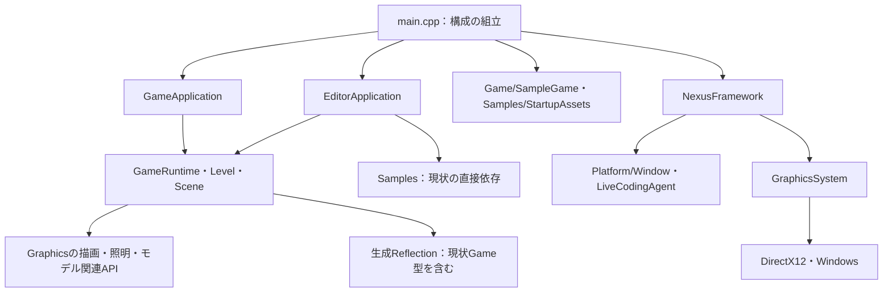

# Project System：現状調査とEngine / Game分離設計

本資料は実装前の調査記録。実装後の構成と制限は[Engine / Game分離](EngineGameSeparation.md)を参照する。

調査日：2026-10-31。対象は現在の作業ツリー。Phase 0の調査とPhase 1の詳細設計のみを扱う。
以下の「現状」はコードで確認した事実、「提案」は未実装の設計である。
今回、C++、ビルド設定、設定ファイル、生成コードは変更していない。ビルド・実行・生成器の実行も行っていない。

## 1. 調査範囲と前提

リポジトリ直下、全自作コードのファイル配置、Solution / Project / props、Tests / Benchmarks / Tools、
Resources / Shaders、ThirdPartyの配置、既存Docs、Git除外設定を調査した。
起動、依存境界、設定、型登録、Level永続化、Asset解決、Editor Play、IPCの関係は実装を読んで確認した。
外部ライブラリ全実装や全Shaderアルゴリズムの逐行レビュー、実際のリンク可否・描画動作の確認は対象外。
`Project/Agent/AGENT.md`の責務・所有権・日本語コメント規則を今後の実装にも適用する。

調査開始時点で次の既存変更があった。これらは利用者の変更として保持し、生成器による上書きもしない。

- `Project/Config/Editor.settings`
- `Project/Resources/Assets/Levels/DemoLevel.json`
- `Project/Runtime/Reflection/Generated/GeneratedReflection.cpp`
- `Project/Runtime/Reflection/Generated/GeneratedReflection.h`

## 2. Phase 0：現在の構造

```text
Project/
  NexusEngine.slnx / NexusEngine.vcxproj / main.cpp
  Foundation/  Error、Logging、Math、Reflection、IPC
  Core/Framework/  Window / Graphicsの起動とフレームループ
  Runtime/  Application、Level、Scene（独自ECS）、Reflection、Rendering
  Graphics/  Renderer、Model、Resource、Shader、各描画機能、Backend/DirectX12
  Platform/  Window、Development/LiveCodingAgent
  Editor/  Core、Services、Gui、ImGui、Runtime/ViewportSession
  Game/  SampleGame、MoveComponent
  Samples/  OpticalDemoScene、StartupAssets
  Config/  Project.settings、Editor.settings
  Resources/  Assets（Levels / Models / Fonts等）、Editor/Localization
  Shaders/ / ThirdParty/ / Tests/ / Benchmarks/ / Tools/ / Docs/
Generated/  Outputs、obj等の生成物
```

`Engine/`を新設して既存フォルダを移動する必要はない。Renderer / Resource / Assetは主に`Graphics/`に属する。
Sceneは`Runtime/Scene`、Levelは`Runtime/Level`にある。一般名に合わせた改名は行わない。

### 2.1 ビルド構成

| 項目 | 確認結果・根拠 |
|---|---|
| Solution | `Project/NexusEngine.slnx`。登録されたビルドProjectは`NexusEngine.vcxproj`のみ |
| 形式 | MSBuild / Visual C++。自作ターゲット用CMakeListsはなく、ThirdPartyのサンプルには存在 |
| メインターゲット | 全構成で`Application`。Engine / Editor / Gameの独立lib / DLLは未分離 |
| 構成 | Debug / Develop / Release、x64、v145、Windows SDK 10.0、C++23、`/utf-8`、警告をエラー扱い |
| CRT | メインはDebug / Developが`MultiThreadedDebug`、Releaseが`MultiThreaded`。Developは`_DEBUG`と`NEXUS_DEVELOP` |
| 出力 | `$(SolutionDir)..\Generated\Outputs\$(Configuration)`、中間は`Generated/obj/$(ProjectName)/$(Configuration)` |
| 起動成果物 | 通常はProject名による`NexusEngine.exe`。Editor / Gameは引数で分岐 |
| 外部依存 | imgui / ImGuizmoはソースを直接コンパイル、cgltfは同梱ヘッダ、Live++は任意SDKとlocal props |
| OS / GPU | d3d12 / dxgi / dxcompiler / windowscodecs / ole32をリンク。DXC / DXIL DLLをSDKからコピー |
| データ配置 | PostBuildでShaders / Resourcesを全コピー。別TargetでConfigをコピー。依存Asset収集ではない |
| テスト | ECS / Editor / GUI / Graphics / LiveCodingSmokeとECS Benchmarkは独立vcxproj。テストは必要な実装cppを直接列挙 |

Testsの多くはDebugのみ、GraphicsTestsには複数構成がある。CRT指定はテスト間で一様ではない。
今後libを共有する場合は明示的に揃える。既存テストを最初から一括で新lib参照に変更しない。
`SolutionDir`は外部Game Solutionからの参照時に意味が変わるため、そのままSDKの出力基準には使えない。
LivePP.props / Reflection.propsにはビルド時の副作用があり、今回MSBuild評価・ビルドは実行していない。

### 2.2 現在の依存関係



Foundationには`Result`（std::expected系）、Error、Logger、ReflectionValue / Archiveがある。
FoundationのDebugOutputLogSinkもWindows依存なので、Foundation全体を現状のままOS非依存とは呼べない。
RuntimeのLevelはGraphicsの照明設定、RenderingはRenderScene等を参照する。論理境界はあるが完全独立ライブラリではない。
Coreの公開FrameworkヘッダはProjectWindow / GraphicsSystemをincludeし、Win32型も公開している。
Phase 1の対象プラットフォームはWindows / DX12を維持し、全面的なPlatform抽象化は行わない。

重要な逆依存は次の通り。

1. `Runtime/Reflection/Generated/GeneratedReflection.h`が`Game/Components/MoveComponent.h`をincludeする。
2. `LevelSerializer.cpp`がローカルにComponentReflectionを構築し、`RegisterGeneratedComponents`を呼ぶ。
   現状の単一生成関数にはGameの登録も含まれ、Engineだけのリンク・型集合の分離を妨げる。
3. `EditorApplication.cpp`は`Samples/OpticalDemoScene.h`と`Samples/StartupAssets.h`を直接includeする。
   CreateSceneでサンプルAssetを無条件ロードし、材質名`Mirror Sphere` / `Glass Sphere`やDemoLevelベイクパスも扱う。
4. `main.cpp`がEditor / Game双方に`SetupSampleGame`を接続する。ここは構成ルートとして自然だが、汎用配布ホストには残せない。

### 2.3 RuntimeとEditorの再利用箇所

| 既存要素 | 現在の責務・再利用方針 |
|---|---|
| NexusFramework / FrameworkDesc | Window / Graphics所有、更新先・Renderer・描画拡張は非所有。フレームループを継続使用 |
| GameRuntime / GameLevelSetup | LevelとSystemの所有、Start / Stop / Pause / Update。Game側の構築関数を接続済み |
| GameApplication | Levelロード、CPU Asset準備、RenderScene抽出。Editor依存なし。単体起動で継続使用 |
| Scene / SystemScheduler | 独自ECS。Simulation後にTransform段階。SystemはLevelごとに所有 |
| EditorSession | LevelDocumentと再生用GameRuntimeを別所有。Playは編集Worldを複製し、Stopで再生Worldを破棄 |
| LevelDocument / EditorDocumentService | LevelのCreate / Open / Save / SaveAs、未保存確認。Project切替とは責務を分ける |
| EditorWorkspace | Panel / Command / Toolbar / 設定 / AssetCatalog等の組立。AddEditorExtensionも利用可能 |
| DetailsPanel / PropertyEditService | TypeRegistry経由で型・プロパティ編集。旧PropertiesはDetailsへ統合済み |
| AssetCatalog / ContentBrowserPanel | Asset Root内の一覧・検索・移動。weakly_canonical後の範囲確認あり |
| ModelAssetLibrary | Asset Root基準のモデル・Texture解決とCPU snapshot。`:startup`に互換用Loaderを接続可能 |
| ComponentReflection / ReflectedInspector | Game型の永続化、Details、自動登録、Reinstancingの基盤として再利用 |
| RenderSceneExtractor | RuntimeからRendererへ値snapshotを渡す境界。Project管理を追加しない |

GameRuntime::StartはSetup失敗・例外時に半構築Levelを公開せず、System初期化後にTransformを確定する。
追加の汎用GameManagerや新しい更新インターフェースは不要。終了はStopによるLevel / Scheduler / SystemのRAII解放が現行契約。
Game全体の開始終了サービスが必要になった時点でホスト所有のオブジェクトを追加し、架空のOnShutdown階層を先行導入しない。

Editor Playは現在同一プロセスである。`Foundation/IPC/RuntimeProtocol`にwire形式とIRuntimeConnection / IControlChannel、
`Graphics/Viewport`にFrame転送境界、`Editor/Runtime/ViewportSession`に接続仲介がある。
現行EditorはLocalPreviewを使用し、OSプロセス起動・実用の別プロセスRuntime制御が完成しているわけではない。
後続Phaseではこの境界を利用し、EditorSessionから別プロセスのLevel実体を直接参照しない。

### 2.4 Serialization / Reflectionの注意点

`Resources/Assets/Levels/*.json`はJSONではない。`LevelSerializer.cpp`の形式は`NEXUS_LEVEL 12`の独自テキストで、
バージョン1〜12を読み、現行形式で保存する。Component拡張値もReflectionTextArchiveの独自形式。
Config/*.settingsは行単位のキーと引用符付き値。cgltfのJSON処理はモデル読込内部用であり、汎用Project JSON基盤として扱わない。
今回調べた自作コードに再利用可能な汎用JSON Serializerは見つからなかった。
Phase 2ではJSONライブラリ導入か独立Parserの方式を別途選定する。Level形式をJSONへ変換する必要はない。

Generate-Reflection.ps1はFoundation / Runtime / Graphics / Editor / Samples / Gameを一括走査し、
Runtime/Reflection/Generatedへ固定出力する。Reflection.propsからビルド時に実行され、LiveCodingAgentも同じ生成器を起動する。
型IDの重複確認とmutexがあるが、Engine / Gameを別々に生成した場合の集合全体の重複確認は追加が必要。
GeneratedReflectionの分割は手編集ではなく生成器と呼出側を一緒に変更する。

### 2.5 パスと設定の実態

| 対象 | 現状 | 分離時に必要な変更 |
|---|---|---|
| --project | `main.cpp`はディレクトリとして解釈。`.nxproject`の読込ではない | Phase 1は既存root形式維持、Phase 2でdescriptor形式を明示的に追加 |
| Root探索 | CWDから上位探索、失敗時は実行ファイルから探索。Config / Resources/Assets / Shadersを要求 | 外部GameにEngine Shadersを要求しない。Engine RootとGame Rootを分離 |
| CWD | 起動時にcurrent_path(projectRoot)を実行 | 互換期間後は変更せず、境界で絶対パスへ解決 |
| 起動設定 | LoadProjectSettingsとEditorSettingsStoreがProject.settingsを別々に読む | 起動値はRuntime側Readerを共用し、Editor側は編集・個人設定に限定 |
| Model / Texture | ModelAssetLibraryがAsset Root内へ正規化・検証 | 絶対Asset Rootを渡し、永続参照はAsset Root相対のまま維持 |
| Level保存 | LevelDocumentは渡されたパスを保持する | Open / SaveAs境界で検証・絶対化。Project外参照の方針を明示 |
| Shader | GraphicsSystemDescの既定値が`Shaders` | Engine側shaderDirectoryを絶対パスで指定 |
| Editor起動 | CreateScene / CreateWorkspaceがcurrent_pathを利用 | Game Rootを引数で渡す |
| UI資源 | フォントはResources/Assets/Fonts固定、辞書はroot/Resources/Editor/Localization | Engine / Editor資源をGame資源から分け、Engine側Rootを注入 |
| 照明 | LevelのHDRパスは相対文字列、EnvironmentLightingはそのままLoadHdrImageへ渡す | Rendererへ渡すsnapshot側で解決し、保存値は相対のまま維持 |
| ベイク | EditorApplicationにGenerated/Lighting/DemoLevel.nxgi固定値 | Project生成物Root＋Level識別子へ置換 |
| 個人設定 | LOCALAPPDATA/NexusEngine/Editor/User.settings、recentLevelsも利用者共通 | Project設定と混同しない。将来Projectごとのレイアウト等をIDで区別 |
| Live++ | ビルド埋込NEXUS_PROJECT_DIRECTORYから生成器を起動 | Engine Toolの場所とGame Source / 生成先を分ける |

パス解決はRoot別の値構造体と小さな関数に限定し、サービスを抱えるProjectContextは作らない。
モデル参照は既にAsset相対だが、HDRは現在Project相対の例があるため、黙って全参照をAsset相対と解釈し直さない。
既存HDRはProject相対として解決する互換規則を残す。新形式の参照規則はPhase 2でschemaとともに定義する。
`..`、drive-relative、UNC、絶対パス、junction / symlinkでのRoot逸脱、存在しない保存先を扱う。
既存ファイルはcanonical相当、未生成ファイルは存在する親を解決してから要素単位でRoot内か判定する。
文字列のprefix比較だけで包含確認しない。CLIはwmain / filesystem::pathを維持し、保存文字列だけUTF-8で往復する。

## 3. 推奨方式と代替案

推奨はMSBuildを維持し、既存配置のままStatic Libraryとホストを分ける方式。
EngineはGameを知らず、Game側の構成ルートがEngine / Gameの型登録とSystem登録を組み立てる。
Game単体起動ではEditor / imguiのcppをリンク対象にしない。

| 方式 | 利点 | 課題・判断 |
|---|---|---|
| MSBuild ProjectReference＋共通props | 現在のVS / Live++ / テストに近く、開発Engineを直接参照できる | 出力先と生成物の分離が必要。Phase 1の推奨 |
| MSBuildによるInstalled SDK | 同じ公開ヘッダ / lib契約を使用し、Engine Sourceのコピー不要 | 構成・CRT・Toolset・API / Asset互換性とSDK収集が必要。後続Phaseで実装 |
| Git Submodule | Engine commitを固定可能 | Game cloneや更新が複雑、ビルド済みEngine配布の代替にならない。必要なチームのみ任意採用 |
| CMake package | 他環境へ展開しやすい | 現状CMake基盤がなくビルド移行が大きい。今回は導入しない |
| cpp共有itemsだけ | 初期分離が小さい | 各GameでEngine再コンパイル、SDK契約が曖昧。移行途中に限定 |
| Game DLL＋汎用Editor | Editorの再リンクなしでGameを選択できる | CRT / RTTI / STL / 関数寿命 / Reinstancing / ABIの設計が増える。Phase 1では導入しない |

**設計上の衝突：静的リンクされた汎用NexusEditor.exeは、後から追加された任意のGame C++型を認識できない。**
Phase 1ではGameごとにEditorホストもリンクする。後続Launcherは選択EngineでビルドされたProject Editorホストを起動する設計を基本とする。
図示された「必ず共通NexusEditor.exeから任意Gameを開く」を必須とする場合、Game DLLか別プロセス型メタデータ連携が必要になる。
この点は同等機能が静的リンクだけで成立すると扱わず、Phase 3 / 5実装前に起動契約として確定する。

## 4. Phase 1詳細設計（未実装）

### 4.1 ターゲットと責務

| 提案ターゲット | 入力と責務 | 依存 |
|---|---|---|
| NexusRuntime.lib | Foundation / Runtime / Core / Graphics / 必要なPlatform。Game / Samples / Editorを除外 | Windows / DX12、cgltf。imguiは含めない |
| NexusEditorSupport.lib | Editor実装とEditor用imgui / ImGuizmoの組立 | NexusRuntime |
| SampleGame.lib | 現在のGameとSample用startup Asset / demo生成のアダプタ | NexusRuntime公開API |
| SampleGame.exe | Game側main、共通起動解決、GameApplication / Renderer組立 | SampleGame、NexusRuntime |
| SampleGameEditor.exe | Game側Editor main、型登録・Sampleアダプタ接続 | SampleGame、NexusEditorSupport、NexusRuntime |
| 既存NexusEngine.exe | 移行期間の従来Editor / --game起動。既存名・引数を保持 | 上記libを用いる互換ホストへ最後に変更 |

これは論理的なライブラリ境界であり、一度に全ターゲットを追加しない。
最初はNexusRuntime内でFoundation / Graphicsをまとめ、さらに細かいlib分割は実際の循環依存やビルド時間を確認して判断する。
同じcppをホストとlib両方でコンパイルしない。SamplesのCPUアセット生成はSampleGame側に残す。
SDKに必要な`Graphics/Meshlet/MeshletConfig.h`は`Shaders/Mesh/MeshletConfig.h`を相対includeしているため、
公開ヘッダclosureとShader共有ヘッダも収集対象にする。単にRuntime配下だけをコピーしたSDKでは成立しない。

DevelopmentではGameのvcxprojがEngine側lib Projectを参照し、マシン固有NexusEngineRootは環境変数か未追跡local propsで与える。
外部SolutionのSolutionDirを使わず、EngineのMSBuildThisFileDirectoryを基準にEngine中間物を配置する。
Game成果物はGame RootのBuild / Intermediateへ置く。Engine / Game、構成、Platform、互換ビルドIDごとに分離する。
Installedでは同じGame側propsが公開ヘッダ・構成別lib・必要Tool / Runtimeデータを参照する。Engine ProjectReferenceは持たない。
Installed SDK自体の作成・Registry・Version ResolverはPhase 6以降であり、Phase 1完了条件に含めない。

### 4.2 型登録の分離

既存ComponentReflection / TypeRegistryを維持し、Gameが実装する次の登録関数を起動ホストから接続する。

- Engine生成：EngineのReflectionTraits、Engine Component登録、Engine Inspector登録。
- Game生成：GameのReflectionTraits、Game Component登録、Game Inspector登録。
- ホスト：Engine登録後にGame登録を実行。保存、読込、Play複製、Details、Reinstancingで同じ型集合を使う。

最小追加候補は`Runtime/Reflection/ReflectionRegistration.h`の登録callback値構造体。
ComponentReflectionとTypeRegistryへの登録関数だけを保持し、Project / UI / ファイルIOは保持しない。
Levelには構築時にこの値を渡す。LevelSerializerの内部生成registryへ適用し、LevelDocument / GameApplication / EditorSessionから伝播する。
既存の引数なし経路はEngine組み込み型だけを使う互換overloadとし、Game型を暗黙に検索しない。
Game型を読む前に登録が終わることが必要であり、ロード後に呼ぶGameLevelSetupだけでは代用できない。
Play時に新規作成するLevelにも同じ登録値を渡す。Game型の未知IDはエラーとして報告し、消して保存しない。

Generate-Reflection.ps1には入力Root、走査対象、出力Directory、登録関数prefixの指定を追加する。
EngineはGame / Samples / Editor固有型を含めず、Editor固有型が必要ならEditor集合を別生成する。
Game出力はGame側Intermediateへ置き、Engine生成物を書き換えない。名前衝突と安定型ID重複を結合集合でも検証する。
新callbackは常設global registryにせず、ホスト所有の登録方針を各利用先へ渡す。
Live++復元時は古いregistryを保持せず登録関数から再構築する既存方式を維持する。
Engine Tool位置とGame走査Rootを分け、LivePP.propsとLiveCodingAgentのpre-buildも同じ生成引数に揃える。
静的lib抽出漏れを防ぐため生成登録関数をホストから明示参照し、static初期化だけの自動登録には依存しない。

### 4.3 Sample依存と起動パス

EditorApplication::CreateSceneを汎用経路とSampleアダプタに分ける。
標準はLevel内で参照されたAsset / 組み込み形状を準備し、`:startup`がある場合のみ注入されたLoaderを使う。
GameApplicationの任意ReloadStartup方式を基礎にする。Mirror / Glassの材質名検索・診断・既定Demo設定はSample拡張へ移す。
一般Editorにサンプルファイル名を残してcallback化しただけの状態を完了とはしない。

追加候補は`Runtime/Application/ApplicationPaths.h`の不変パス値と解決関数。
Game Root / Asset Root / Config Root / Level起動パス / 生成物Rootと、Engine Shader / Editor資源Rootを区別する。
ProjectDescriptor、Engine Registry、最近のProject一覧はPhase 1では追加しない。
EditorApplication / EditorWorkspace / ImGuiRendererへ必要なRootだけを渡し、Graphicsには解決済みshaderDirectory / assetDirectoryのみを渡す。
フォントはUnicodeパスでも開けるようfilesystem経由で読込後にImGuiへメモリを渡す案を優先する。バッファ寿命と所有権を明示する。
CLIで相対Rootを受け取る瞬間だけ起動CWDで絶対化し、その後の資源参照はCWDを利用しない。
自動Root探索は既存互換ホストだけに残し、明示指定した無効Rootから別Projectへfallbackしない。

### 4.4 所有権・初期化・終了順序

1. ホストでログ、CLI、Rootと設定、型登録callback、Game側サービスを準備する。
2. GameApplicationまたはEditorApplicationを作成し、型登録とGameLevelSetupを接続する。
3. 編集Level / Runtime Levelをロードし、CPU Asset / pose / RenderSceneを構築する。
4. ホスト所有Rendererに非所有参照を設定し、NexusFramework::Runへ渡す。
5. FrameworkはWindow、Graphics、Renderer、任意Editor描画拡張を順に初期化して更新する。
6. 終了・失敗時は非同期Asset準備を停止・回収し、GPU利用完了を待って描画拡張・Renderer / Graphics / Windowを終了する。
7. ホストでApplicationのLevel / System / CPU Assetを破棄し、最後にGameサービスと登録callbackの所有元を解放する。

Frameworkが借りるRenderer / ApplicationはRunとShutdownが完了するまで生存させる。
Game側サービスをcaptureしたSetup関数と生成Systemはサービスより先に破棄する。
停止中にのみ登録を変更し、複数Projectの型集合を一つのglobalへ蓄積しない。DLL unload契約は今回は作らない。

### 4.5 公開APIの範囲

初期公開範囲はResult / Error、Math、ReflectionMarkers / Traits / 値codec、Scene / Entity / Components、
Level、ISceneSystem / SystemScheduler、GameRuntime / GameLevelSetup / GameApplicationと登録callbackに限定して文書化する。
ホスト構築向けにFrameworkDesc、Renderer境界、必要なAssetデータAPIも別途公開する。
Backend/DirectX12、Device / CommandList / Descriptor内部はGameロジックの公開契約にしない。
既存includeを全面変更せず、SDK側の公開ヘッダ一覧と推移includeを検査する。
現在の公開ヘッダがWin32 / Graphics詳細を含む箇所は残存制約として記録し、別の純粋Runtime APIが既にあるとは扱わない。

### 4.6 変更予定ファイル

以下は次回以降の予定で、今回は作成・変更していない。

| ファイル / 群 | 予定変更 |
|---|---|
| NexusEngine.slnx / NexusEngine.vcxproj / .filters | 新lib / ホスト追加後に既存cpp所属を移行。既存起動を最後まで維持 |
| Build/Nexus.Common.props、Nexus.Runtime.props、Nexus.Game.props（新規候補） | Root / Toolset / CRT / 構成 / 出力とリンク契約を共通化 |
| Build/NexusRuntime.vcxproj、NexusEditorSupport.vcxproj（新規候補） | RuntimeとEditorの明示ソース一覧。既存Project/配下のコードを参照 |
| GameのSampleGame.vcxproj / GameMain.cpp / EditorMain.cpp（新規候補） | Gameと起動ホストの構成ルート。後で外部Gameへコピーするのはこの骨格のみ |
| main.cpp | CLI互換を保ち、Game固有組立をSampleホストへ委譲 |
| Runtime/Application/ApplicationPaths.h/.cpp（新規候補）、ProjectSettings.h | Root別解決、設定読込の共用 |
| Runtime/Reflection/ReflectionRegistration.h（新規候補） | 非所有登録callbackの小さな値型 |
| Tools/Reflection/Generate-Reflection.ps1、Reflection.props、GeneratedReflection.* | 入力 / 出力 / 登録名を分離。生成器で再生成 |
| Runtime/Level/Level.h/.cpp、LevelSerializer.h/.cpp、LevelDocument.h/.cpp | 型登録方針を保存・読込・新Level生成まで伝播 |
| Runtime/Application/GameApplication.h/.cpp、必要ならGameRuntime.h/.cpp | ロード前登録の接続。既存更新ライフサイクルを保持 |
| Editor/Core/EditorSession.h/.cpp、EditorApplication.h/.cpp、EditorWorkspace.h/.cpp | Play複製の型集合、Root注入、Sample依存除去 |
| Editor/Core/EditorReinstancing.cpp、EditorWorkspaceReinstancing.cpp | Game登録を含めて毎回registryを再構築 |
| Editor/Core/EditorProjectPaths.h、Editor/Services/EditorSettings.h/.cpp | 互換Root探索の範囲と設定Reader重複を整理 |
| Editor/ImGui/ImGuiRenderer.h/.cpp | Engine側フォントRoot注入とUnicode読込 |
| Editor/Services/EditorDocumentService.*、EditorWorkspaceのLevel操作 | Open / SaveAs入口のパス解決・範囲確認 |
| Runtime/Rendering/RenderSceneExtractor.*またはホスト側snapshot変換 | HDR等の保存参照を変更せず、描画用絶対パスへ変換する境界を実装 |
| Samples/StartupAssets.*、OpticalDemoScene.*、Game/SampleGame.* | Demo構成・材質診断をSample側アダプタへ集約 |
| LivePP.props、Platform/Development/LiveCodingAgent.* | Engine ToolとGame生成先を分離。Runtime専用では無効化 |
| Tests/*.vcxproj、StartupPathTests.inl、GameRuntimeTests.cpp、ReflectedComponentTests.cpp、ReinstancingTests.cpp | 必要な登録接続と回帰検証。既存テストの一括再編はしない |
| README.md、Docs/GameRuntime.md、CustomComponents.md、LiveCoding.md | 公開契約と分離後の操作手順へ更新 |

Build/以下の名前は提案であり、実装時に既存ビルド補助との重複を再確認して確定する。
AssetCatalog / DetailsPanel / Level形式 / DX12実装自体は基本的に再利用し、必要なパス注入以外は変更しない。

### 4.7 移行順序と各段階の完了条件

| 順序 | 作業 | 単独で確認する条件 |
|---|---|---|
| 1A | Reflection登録の注入を既存単一exeに導入 | MoveComponentの保存 / 復元 / Details / Play / Reinstancingが同じ型集合で成立 |
| 1B | 生成器をEngine / Game別入力・別出力へ分割 | Engine生成物からGame includeが消え、二重生成・型ID重複を検出 |
| 1C | ApplicationPathsと設定共用、Sampleアダプタを導入 | CWDを変えず既存Level / Shader / フォント / HDR / ベイク先を解決 |
| 1D | NexusRuntime.libとEditorSupport.libを追加 | Engine単独でGameシンボルを要求しない。RuntimeホストにEditor / imguiが混入しない |
| 1E | SampleGame / SampleGameEditorホストを追加 | 同じGame登録でPlayと単体起動の更新結果が一致。従来exeも互換起動 |
| 1F | リポジトリ外の検証Gameを作成する手順を整備 | Engine Sourceをコピーせず参照。日本語・空白パス、Game移動後のRoot再設定で利用可能 |

各段階でコードレビュー後に必要な個別ターゲットのビルド検証へ進む。Solution全体のビルドや既存出力の削除は許可があるまで行わない。
今回の調査だけではどの段階も動作検証済みとは扱わない。実装時は利用者の並行変更を再確認して差分を限定する。

## 5. 検証計画とエラー処理

既存のStartupPathTests、GameRuntimeTests、ReflectedComponentTests、ReinstancingTestsを利用する。
今回テストは実行していない。Phase 1実装後の検証は次を予定する。

- Engineソースと生成物からGame / Samples / Editorへの禁止依存を静的確認し、リンク入力の所属重複も確認する。
- Rootと設定のCPU検証：任意CWD、明示無効Root、空白 / 日本語、絶対 / 相対、Root逸脱、移動・clone、欠損Shader / UI資源。
- 型登録のCPU検証：Game型round-trip、未知ID・重複ID、EngineのみのLevel、Play複製、Setup失敗rollback、Stop時のSystem破棄。
- 許可後の個別ビルド：既存ECS / Editorテスト、新Runtime / Sampleホスト。新規出力先を使い既存成果物を掃除しない。
- 実行許可と環境がある場合：従来Editor / --game / --check-game、SampleGameEditorのPlay / Stop、Game単体描画、Live++復元。

失敗はResult / Errorへ集約し、対象パス・処理段階を含めて起動ホストまたはEditor通知へ返す。
不正設定や未知型を既定値へ黙って置換して保存しない。ロード失敗時は既存編集Documentを保持する現在の置換方式を継承する。
Descriptor読書き、Project作成、Engine未インストール、Version Resolverの実検証はPhase 2以降で追加する。

## 6. 後続Phaseへの接続方針（設計上の予約のみ）

Phase 2は既存ProjectSettingsと役割を分けて`.nxproject`、Serializer、最小Context、登録一覧を追加する。
Rootはdescriptorの親から求め、Project内にマシン固有Engine絶対パスを保存しない。
Phase 3はLauncherをEditorSupport全体へリンクしない。軽量Win32＋Dear ImGui構成を第一候補とし、
既存GuiTheme / SearchBar / ProjectWindowの依存を確認して必要な部分だけ共有する。
Win32ネイティブUIは描画依存が小さいが既存テーマとの共用が減る。UI方式の確定・実装は今回行わない。
現在のProjectWindowにはDPI awareness / WM_DPICHANGED処理があり、再利用候補となる。

プロセス起動は後続のPlatform/Processに分離し、CreateProcessWの実行ファイルを明示する。
引数は構造化してWindows規則で引用し、空白・引用符・末尾backslash・Unicodeを検証する。
shell文字列連結やCWDの共有を前提にしない。EditorからGame Runtimeを起動する際も同じdescriptor絶対パスを渡す。
Phase 1ではOSプロセス起動クラスやIPC実装を先行追加しない。

Phase 4のテンプレートはデータ定義から列挙し、既存LevelSerializerで生成・検証する。
空Levelは現在GameApplicationがprimary cameraを要求する点と衝突するため、Blankの実行契約をテンプレート実装前に決める。
Editorで編集可能な完全空Levelと、単体起動可能な最小Camera付きLevelを同一と扱わない。

Phase 6はProjectのassociation / Engine ID / version要求をマシン側Registryへ照合する専用Resolverを置く。
Developmentは明示選択されたSource参照で変更が反映される。Installedは不変のbuild IDと構成別SDKを固定参照する。
Developmentを選んだGameにはEngine変更が影響し得るため、「Engine更新で既存Gameが変わらない」保証はInstalled固定で実現する。
同version文字列の別build混入も拒否できるよう、Toolset / CRT / Platform / APIとAsset / Level互換性を別情報として扱う。
未解決時は別versionへfallbackせずエラー。切替は明示操作とし、専用Migrationで事前診断・バックアップ・復元手順を用意する。
単にdescriptorのversionを書き換える更新処理は作らない。

Phase 7はEngine / Game別Git。GameにはSource / Assets / Levels / Config / descriptor / ビルド骨格を保存し、
Build / Intermediate / Cache / ローカルEngineパス / 個人設定を除外する。SDKは別配置でありEngine Sourceを複製しない。
Phase 8はGameホストから構成別exeを生成し、Runtime DLL（必要な場合）、DXC / DXIL、Shader、依存Asset、Configを収集するToolへ拡張する。
現在のResources全コピーを完成したパッケージ機能とは扱わず、Shader include closureとEngine内蔵データの収集も必要になる。

## 7. 今回の成果と残課題

Phase 0の構造・依存・再利用箇所・影響範囲を確認し、Phase 1の変更予定ファイル、ターゲット、所有権、移行順序を提示した。
今回の変更は本資料とREADMEの案内のみ。追加クラス・新ビルドターゲット・実行機能・依存関係の変更はない。
主な残課題は、提案した境界の実装、個別ビルド検証、公開ヘッダclosure、Live++での分割生成の確認、
将来の汎用Editorと静的Gameリンクの起動契約の確定である。Phase 1の実装は次回の作業対象となる。
